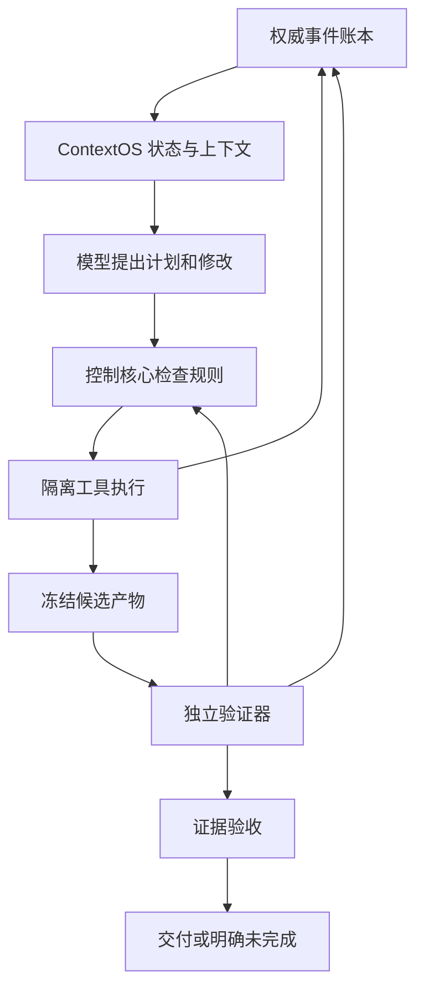

# Polaris：可靠工程执行系统升级方案

**我建议把 Polaris 下一阶段的目标定为：建立“由可核验证据驱动、受风险与预算约束的工程执行系统”。**

保留你现有的单一工程运行时、`module → cascade → bench`、四支柱、残差归因和终止机制；重点升级五个部分：

1. **用小规模、可验证的控制核心管理执行、冻结、验收和终止。**
2. **让验收结论绑定具体产物、契约、环境和验证器版本。**
3. **用可复现反例指导修复，提高每次尝试的信息量。**
4. **让 ContextOS 保存影响决策的事实，并显式管理证据失效。**
5. **用统计资格和成本收益比较控制模型路由、继续执行与停止。**

这套方向比原方案更可靠的原因，是它同时处理了三个不同问题：**系统是否遵守执行规则、交付物是否满足要求、改进机制是否确实有效。**三者需要不同的证据。

以下判断以你提供的盘点为基础。我没有审查 Polaris 源码，因此目录职责、已解决根因和当前性能均视为输入材料。下面会区分**论文结论、数学条件和针对 Polaris 的工程设计**，不会把论文中的实验收益直接算成 Polaris 的预期收益。

---

## 一、先修正原方案中几个会影响方向的判断

你的 P0、P1、P3 有明确价值，但 P2、P5、P6 的表述需要调整。

| 原建议 | 我的判断 | 更可靠的改法 |
|---|---|---|
| P0：工程模块纳入冻结治理 | 应当优先做，但新增模块名称不等于形成有效边界 | 按真实依赖、共享状态和变更影响建立门禁；级联顺序从依赖图产生 |
| P1：function、fidelity 全部机器可判 | 目标过强，容易制造虚假的确定性 | 分层判定器，加 `PASS / FAIL / UNKNOWN`；明确哪些条款需要裁决 |
| P2：强制思考态、自检 | 可以作为候选机制，不能成为正确性保证 | 改为简短、可证伪的决策记录，要求引用真实失败和验证结果 |
| P3：步骤单元、检查点回滚 | 应当保留，但文件快照覆盖不了全部副作用 | 增加效应范围、幂等键、提交条件和外部状态对账 |
| P4：经验库、模型升级 | 有价值，但容易受到错误经验和选择偏差影响 | 经验必须有适用条件和验证证据；路由先用可审计规则，再学习 |
| P5：近期收益为负即停止 | 可能误杀必要修复，也可能把失败交付包装成收敛 | 比较继续、诊断、升级、回滚和停止的预期最终价值 |
| P6：通过率作为唯一推进指标 | 不足以支撑可靠性结论 | 同时约束误放行率、覆盖率、成本、延迟和重复运行稳定性 |

这里有两个直接相关的研究结论。

第一，**自动执行测试和自动判断需求正确性，是两个不同问题**。Barr 等人的测试预言机综述指出，在完整规范缺失时，自动化判定需要依赖部分规范、契约、变形关系和人工领域判断。增加测试数量不会自动消除这个问题。[^oracle]

第二，Huang 等人在 ICLR 2024 的研究发现，所测试模型在缺少外部反馈时，内在自纠错可能无效甚至降低推理表现。但后续 ProCo 研究又发现，特定的关键条件验证方法可以改善部分任务。因此，科学上支持的结论是：**自检的价值取决于反馈、任务和方法，需要实验；不能把“多写思考”设成普遍可靠的默认机制。**[^huang][^proco]

---

## 二、先定义 Polaris 究竟要优化什么

### 2.1 把“系统放行”和“交付正确”分开

定义：

- $A=1$：Polaris 判定可以交付。
- $Y=1$：交付物经独立核验，满足冻结的验收契约。
- $C$：本次任务所有尝试的总成本。
- $T$：总耗时。
- $B,D$：成本预算和时间上限。

建议的核心目标是：

$$
\max_\pi
P_\pi(A=1,\;Y=1,\;C\le B,\;T\le D)
$$

同时约束：

$$
P_\pi(Y=0\mid A=1)\le \delta
$$

其中 $\pi$ 是运行策略，$\delta$ 是产品允许的误放行风险。

**这是一项工程目标定义，不是论文已经证明 Polaris 能满足的保证。**

它解决一个很实际的问题：如果直接优化 `accepted_rate`，系统可能通过降低验收标准来提高指标。将独立核验标签 $Y$ 与系统放行标签 $A$ 分离，才能发现这种退化。

还必须报告：

$$
\text{自动放行覆盖率}=P(A=1)
$$

否则，一个几乎拒绝所有任务的系统，也可能得到很好看的“放行后正确率”。

### 2.2 总体架构

建议在现有运行时内部建立下列关系，不增加第二个运行时 owner：



模型负责提出方案；控制核心负责检查动作是否允许；验证器负责产生观察结果；验收器负责根据契约和证据形成结论。

**这些职责可以在同一进程、同一代码库中实现。当前没有必要因为职责分离就拆成微服务。**

---

## 三、P0 应升级为“小控制核心的形式化约束”

现有冻结机制已经具备基础。进一步的收益来自：把关键规则写成可检查的状态约束，并验证异常事件顺序。

### 3.1 优先形式化这六类性质

| 性质 | 必须保证的行为 | 典型反例 |
|---|---|---|
| 执行权限 | 工具调用只能使用当前状态允许的能力和效应范围 | 验证阶段调用修改工具 |
| 版本一致性 | 验收证据对应最终交付的同一候选版本 | 用旧测试结果认证新代码 |
| 冻结一致性 | 验证中的候选不会被后台任务继续修改 | 浏览器探针期间构建进程覆写产物 |
| 终止单调性 | 同一 run 进入 terminal 后，不再发起新的任务动作 | 迟到的 QA 结果重新打开循环 |
| 提交一致性 | 提交时检查预期版本仍为当前版本 | 两个单元并发提交，覆盖对方修改 |
| 回放一致性 | 事件回放只重建状态，不重新执行工具 | 重启后重复产生外部副作用 |

可以用时序逻辑表达其中几项：

$$
\Box\bigl(\mathrm{Accepted}(r)\Rightarrow \mathrm{Verified}(r)\bigr)
$$

$$
\Box\bigl(\mathrm{Terminal}\Rightarrow \bigcirc\mathrm{Terminal}\bigr)
$$

$$
\Box\bigl(\mathrm{Commit}\Rightarrow
\mathrm{ExpectedRevision}=\mathrm{CurrentRevision}\bigr)
$$

这里：

- $\Box$：始终成立。
- $\bigcirc$：下一状态。
- $r$：被验证和交付的候选版本。

这些公式首先是**待实现、待验证的规格**。写进文档不代表已经证明。

### 3.2 形式化范围要小

我建议先用 TLA+ 或同类状态模型检查以下对象：

- run 生命周期；
- tool call 生命周期；
- freeze、verify、accept 的版本关系；
- budget reservation；
- cancel、timeout、late result 的事件交错。

不要一开始试图证明整个 Polaris 代码库。

AWS 的研究提供了适合这里的工程范式：对关键设计使用形式规格和模型检查；在 S3 的 ShardStore 实践中，再将正确性拆成不同性质，分别使用可执行参考模型、性质测试和模型检查。这个方法强调持续开发中的可用性，并不要求全系统完全形式化。[^aws-formal][^s3]

**Polaris 应当获得的是：有限控制协议的明确保证，加上实现层故障测试。不能由此宣称生成代码整体正确。**

### 3.3 专门处理 terminal 与迟到结果

这里有一个容易遗漏的细节：

**`terminal=true` 应禁止发起新动作，但应允许登记此前已经发出调用的迟到结果。**

否则会发生：

1. 工具已经修改了外部状态。
2. 运行时先因超时进入 terminal。
3. 工具返回结果被丢弃。
4. 账本和实际效果永久不一致。

正确行为是：记录结果、完成对账，但不恢复运行、不追加修复、不改变原终止决定。

---

## 四、验收升级：建立“条款—判定器—证据—产物”的完整关系

这是我认为整个方案中收益最高的一项。

### 4.1 验收要回答三个问题

每个条款都要分别检查：

1. **条款是否正确表达用户目标？**
2. **判定器能否识别这个条款被违反？**
3. **本次判定是否真的针对当前产物执行？**

原 P1 主要覆盖第三个问题的一部分。只增加 `call_id`，仍然解决不了前两个问题。

例如，“登录按钮存在”不能充分代表“用户能够登录”；“截图与参考图接近”不能充分代表“交互行为符合要求”。

### 4.2 用分层判定器覆盖不同要求

| 要求类型 | 推荐判定方式 | 需要保留的局限 |
|---|---|---|
| API、CLI 的明确输出 | 固定样例、错误码、状态变化、golden I/O | 样例不能覆盖所有输入 |
| 数据结构、算法性质 | 性质测试、边界输入、参考实现对照 | 性质本身可能过弱或写错 |
| 缺少精确答案的功能 | 变形关系，例如等价输入应满足某种输出关系 | 关系必须有正确的适用条件 |
| Web 用户流程 | DOM、键盘操作、网络结果、持久状态、端到端路径 | 只检查页面元素不足以证明业务完成 |
| 视觉 fidelity | 参考图、布局约束、文字内容、设计参数、容差 | 像素差异不能完整代表设计质量 |
| 主观或含糊要求 | 事先声明的评审规则与有权限的裁决 | 不能伪装成机器证明 |

QuickCheck 的基础思想是将规格表达为可执行性质，并使用输入生成器检验；变形测试则利用输入变化与输出变化之间的关系补充不完整的判定器。两者都能增强验证，但有限测试通过不等于普遍正确。[^quickcheck][^metamorphic]

### 4.3 必须支持 UNKNOWN

每个必要条款的结果应为：

$$
v_i\in\{\mathrm{PASS},\mathrm{FAIL},\mathrm{UNKNOWN}\}
$$

`UNKNOWN` 的原因可以是：

- 缺少证据；
- 证据属于旧版本；
- 环境不可用；
- 结果不稳定；
- 没有足够可靠的判定方法；
- 需要主观评审。

建议的接受条件为：

$$
\mathrm{Accept}(r,c)
\Rightarrow
\left(\bigwedge_{i\in\mathrm{Mandatory}(c)}v_i=\mathrm{PASS}\right)
\land \mathrm{EvidenceValid}(r,c)
\land \mathrm{ControlInvariants}(r)
$$

其中 $c$ 是冻结契约。

必要条款可以通过预先声明的人工裁决流程解决，但报告必须区分：

- 自动验收；
- 有人工裁决参与的验收；
- 尚未解决的条款。

**加权条款覆盖率可以表示进度，不能让多个次要通过项抵消一个关键失败。**

### 4.4 证据应由执行平台产生，QA 只能引用

建议至少记录：

```text
requirement_id
contract_digest
source_revision
deliverable_digest
environment_digest
verifier_digest
fixture_digest
tool_call_id
observation_digest
event_sequence
verdict
```

这里有几个必须明确的约束：

- 验证器和最终验收夹具不能由实现方随意修改。
- 观察记录不能由模型自行写成“测试成功”。
- 截图必须绑定实际服务实例和构建版本。
- 验证后产物发生变化，相关证据必须失效。
- 环境指纹要说明覆盖范围，不能假定一个 hash 包含了所有环境影响。
- 最终接受操作要检查候选版本，并原子地记录接受结果。

**哈希能证明身份一致和检测变化，不能证明需求解释正确，也不能证明验证器正确。**

### 4.5 验收器本身要接受“坏样本挑战”

至少加入以下必拒绝案例：

| 注入的错误 | 预期行为 |
|---|---|
| 用旧 revision 的成功证据认证新 revision | 拒绝 |
| 合同增加必要条款，但继续沿用旧结果 | 拒绝或标记未知 |
| 构建退出码为 0，但删除关键交互 | 功能断言失败 |
| 测试脚本被改成直接返回成功 | 验证器身份检查失败 |
| 截图来自旧进程或错误端口 | 证据绑定失败 |
| 必要检查没有执行，却有总成功标记 | 完整性检查失败 |
| QA 引用不存在或无关的调用 | 来源或覆盖范围检查失败 |
| 验证过程中候选被修改 | 本轮证据无效 |

Just 等人的研究发现，变异检出能力与真实缺陷检出能力存在统计关联，且不能仅由代码覆盖率解释。这支持用针对性的错误注入检验验收器，而不只是检查验收器自身的测试是否全绿。但变异分数仍只是代理指标。[^mutation]

### 4.6 “独立 QA”要落实到错误来源

设 $B$ 表示产物不合格，$J_1,J_2$ 表示两个评审都通过：

$$
P(B\cap J_1\cap J_2)
=
P(B)\,P(J_1\mid B)\,P(J_2\mid B,J_1)
$$

没有条件独立证据，就不能把最后一项替换成 $P(J_2\mid B)$。

因此，两个所谓“90% 准确的 QA”不能直接推出 99% 可靠性。换 prompt、换角色名，甚至换供应商，都不自动形成统计独立。

有关 LLM 评判者自偏好的研究也说明，同模型同时承担生成和评判时可能产生系统性偏差；该论文的实验不能直接给出 Polaris 编程 QA 的误判率，但足以支持对这种独立性假设保持审慎。[^self-preference]

工程上更有价值的组合是：**冻结规范、外部执行结果、状态约束、视觉参照和独立抽查。**

---

## 五、ContextOS：从“压缩历史”升级为“保持决策所需信息”

### 5.1 32k 是预算配置，不是正确性标准

按你的盘点，Director 已从旧基线约 100k 降至约 30k–32k。这个变化说明工作集得到了控制，但不能单独说明信息保留更好。

《Lost in the Middle》发现，在其多文档问答与键值检索任务中，相关信息的位置会显著影响模型表现。它支持“必须测量上下文使用效果”，并不能证明 32k 最优，也不能直接推断所有当前模型的工程任务表现。[^lost-middle]

### 5.2 真正相关的数学基础：近似信息态

令完整历史为 $H_t$，压缩状态为：

$$
z_t=\phi(H_t)
$$

理想情况下，$z_t$ 应保留两类信息：

- 评估当前动作价值所需的信息；
- 预测后续状态所需的信息。

Subramanian 等人在 JMLR 2022 提出的 **Approximate Information State，AIS** 给出了严格的近似条件。其定理 9 中，若奖励预测误差受 $\epsilon_t$ 控制、转移分布误差受 $\delta_t$ 控制，则：

$$
\alpha_{T+1}=0
$$

$$
\alpha_t
=
\epsilon_t
+
\rho_{\mathcal F}(\widehat V_{t+1})\delta_t
+
\alpha_{t+1}
$$

相应近似动态规划策略的价值损失满足：

$$
\left|V_t^\star(H_t)-V_t^{\widehat\pi}(H_t)\right|
\le 2\alpha_t
$$

$\rho_{\mathcal F}$ 描述价值函数相对于所选概率度量的敏感程度。[^ais]

对 Polaris 最有用的启示是：

**上下文压缩应尽量保留影响动作价值和后续判断的信息。压缩率、摘要流畅度和 token 数量都不能代替这项要求。**

同时必须明确：Polaris 目前没有证明上述误差界，普通历史平均误差也不能直接替代定理要求。因此，这里用理论指导设计与实验，不宣称已经获得性能保证。

### 5.3 接入时保留唯一权威事件源

建议继续让现有 `sessions.sqlite3` 中的运行事件作为权威来源：

- ContextOS 的 TruthLog 通过适配器读取这些事件。
- WorkingState 和 ProjectionEngine 是派生状态。
- pack assembly 使用相同的事件位置和版本标识。
- 投影可以重建，不能反向覆盖事实。
- 先影子运行，再切换工程 loop 的输入路径。

如果 ContextOS 暂时必须维护自己的存储，应将其明确标为**可丢弃、可重建的投影副本**，避免两套独立真相。

建议状态至少包含：

| 状态组 | 内容 |
|---|---|
| 身份与版本 | run、契约、候选版本、事件 offset、投影版本 |
| 已确认事实 | 事实、证据引用、有效范围 |
| 未解决要求 | 必要条款及当前缺口 |
| 当前失败 | 命令、退出码、错误位置、可复现输入 |
| 假设 | 待验证假设、已被否定假设及反证 |
| 执行状态 | 当前单元、待完成调用、未确定的外部效果 |
| 最佳候选 | 最近一个证据有效的候选 |
| 预算 | 生产预算、QA 预留、收尾预留 |

事实和假设必须分开。曾经通过的检查，还要有明确的失效条件。

### 5.4 pack assembly 应有不可静默丢弃的内容

以下信息优先级应高于普通历史对话：

1. 当前契约和关键约束。
2. 当前候选与证据版本。
3. 尚未解决的失败。
4. 已被证伪、不能无条件重复的路线。
5. 终止条件、剩余预算和待确定副作用。

完整日志和原始截图可以放在证据存储中，按需取局部内容。若这些必要信息仍超过预算，应显式触发 pack overflow，采取缩小任务单元或调整预算的策略。

不能把关键约束截断后继续表现为“状态完整”。

### 5.5 ContextOS 上线门槛

影子阶段至少比较：

- 关键约束是否保留；
- 证据引用是否存在、是否属于当前版本；
- 指定历史事实能否正确恢复；
- 失败定位是否改善；
- 最终成功率是否达到预先设定的非劣标准；
- token、延迟及重复查找已知信息的次数。

**“新旧上下文导致相同动作”只能作为辅助观察，因为旧动作本身可能错误。**

---

## 六、能力改进的重点：反例驱动修复与更好的工具接口

可靠性机制需要与实际解决问题的能力共同提升。

### 6.1 将修复循环改成“反例累积”

程序综合中的 CEGIS 思想是：

1. 生成候选程序。
2. 验证候选。
3. 找到反例。
4. 将反例加入约束。
5. 生成满足已有约束的新候选。

Solar-Lezama 等人的 SKETCH 研究在有限程序与形式规格条件下，用这种综合—验证循环搜索实现。论文中的正确性与终止性质依赖这些条件，不能直接移植到任意 LLM 工程任务。[^cegis]

对 Polaris，可以采用它的工程结构：

$$
\mathcal C_{t+1}=\mathcal C_t\cup\{c_t\}
$$

其中 $\mathcal C_t$ 是当前契约下已确认的反例集合。

随后要求新候选先通过已有反例，再进入更大范围验证。

具体落地：

- `_distill_verification_failure` 保存可运行的失败材料，而不只生成自然语言摘要。
- 每个确认的缺陷形成独立回归用例。
- 新修复先跑原反例和受影响检查。
- 反例只有在契约、环境或判定器发生相关变化时才重新审查。
- 不稳定失败先标记为不稳定，不能立即当作确定反例。
- 重复失败时比较假设和实际观察，避免只换文字继续相同补丁。

### 6.2 优先缩小失败，而不是增加解释长度

Delta Debugging 的核心是缩小仍能触发失败的输入，帮助隔离失败条件。它可以减少模型需要同时理解的无关信息。其结果通常依赖测试性质与缩减策略，不能一概称为全局最小反例。[^delta-debugging]

适合你的场景包括：

- 浏览器失败：缩短到必要的交互序列。
- C++ 失败：提取最小编译错误、相关类型和必要构建配置。
- 上下文失败：找出缺失的关键事实或错误失效的证据。
- 验收失败：明确是哪条要求、哪次观察、哪个版本不满足。

计划、修复、提交这三个决策点，只要求一份简短记录：

```text
当前失败及证据
待验证的根因假设
准备采取的动作
预计观察到什么
什么结果会否定该假设
完成条件
需要消耗的预算
```

这是一份可检查的工程决策记录。它不承担“证明模型思考正确”的作用。

### 6.3 工具接口可以降低弱模型的操作负担

SWE-agent 的研究专门考察了 agent 与计算机接口的设计，并在其软件工程任务上展示了接口设计对行为和结果的影响。它支持把工具接口当作需要实验的能力组件。[^swe-agent]

Polaris 已有丰富底座，可以优先补少量高价值操作：

| 操作 | 应提供的约束和反馈 |
|---|---|
| 检查符号或文件片段 | 返回结构化位置、版本及相关依赖 |
| 应用补丁 | 带 `expected_revision`，拒绝修改过时内容 |
| 运行验证配置 | 指向预定义检查配置，统一输出证据 |
| 读取失败证据 | 返回原始观察、最小反例和上下文 |
| 提交单元 | 同时检查完成条件、版本和效应范围 |

这些操作可以封装现有工具执行系统，保持现有权限边界。

### 6.4 不要为了复用而强行接入所有解析模块

`robust_parser` 是否接入，应取决于真实错误类型：

- 低风险格式问题，可以做明确、可记录的规范化。
- 涉及路径、删除对象、金额、权限和执行范围的参数，不能静默猜测。
- 规范化完成后，应对**最终参数**重新做 schema 与权限检查。
- 解析成功只代表格式可处理，不代表语义正确。
- reasoning 标签可以辅助协议解析，不能承担权限或防注入保证。

“未使用某模块”本身不能证明存在能力缺口。需要观察失败数据后判断。

---

## 七、执行单元要有事务边界，EROFS 要在验证环境内解决

### 7.1 单元定义借鉴前后条件

一个执行单元可以表达为：

$$
\{P\land I\}\;\mathrm{Unit}\;\{Q\land I\}
$$

其中：

- $P$：执行前置条件；
- $Q$：完成条件；
- $I$：执行前后都必须保持的不变量。

这是 Hoare 逻辑所代表的规格思想。但在 JSON 中写出这些字段，并不等于完成形式证明；部分正确性也不自动保证终止。[^hoare]

建议单元包含：

```text
base_revision
preconditions
allowed_effects
required_checks
done_condition
resource_limit
commit_condition
recovery_strategy
```

单元提交应满足：

- 相关检查通过；
- 基础版本仍匹配；
- 修改范围符合声明；
- 证据已持久记录；
- 不存在未处理的效应不确定性。

### 7.2 文件回滚与外部补偿分别处理

| 效应 | 恢复策略 |
|---|---|
| 工作区文件修改 | 隔离候选、快照恢复 |
| 构建缓存和临时文件 | 丢弃本轮输出或缓存分区 |
| 本地子进程 | 进程组终止、资源回收 |
| 可幂等外部操作 | 稳定幂等键、查询后重试 |
| 不可幂等外部操作 | 先确认实际效果，再决定补偿或阻塞 |

Sagas 的经典研究明确区分了子事务与补偿：补偿恢复的是业务语义，不一定让整个世界回到之前的字节状态。这个区别直接适用于 agent 的外部副作用。[^sagas]

工具调用还需要区分：

```text
planned / dispatched / observed / unknown
```

超时不意味着“没有执行”。SQLite 的事务也不能自动让数据库记录与外部工具执行形成通用 exactly-once。

### 7.3 EROFS 的建议方案

既然 overlay 已因 containment 被否，应沿着明确输入与输出边界处理：

- 冻结源代码作为验证输入。
- `build / out / cache / tmp` 使用本轮专属可写目录。
- 验证器及夹具独立保护。
- 构建和测试都运行在声明的隔离边界内。
- 产物与实际构建输入建立关联。
- 验证前后检查不应改变的输入。

Bazel 的官方文档说明了逐动作工作目录、声明输入和隔离输出对构建一致性的意义，也明确了不同 sandbox 实现的隔离能力存在差别。可以借鉴这些原则，无须因此迁移整个构建系统。[^bazel]

如果某个构建系统必须写入源树，可以在符合现有 containment 要求的前提下，使用**独立的可写输入副本**，并检查其改动。无法满足隔离要求时，应报告验证环境不支持，而不是扩大原工作区权限。

---

## 八、终止与模型升级：采用受约束的决策比较

### 8.1 最近几轮分数下降，不足以判断继续无价值

两个反例：

- 新增有效测试揭示隐藏缺陷，通过率下降，但系统对真实质量的了解提高了。
- 必要重构存在暂时不通过的中间状态，最终可以得到更可靠结果。

因此：

$$
\Delta\mathrm{verification\ score}<0
$$

不能直接推出：

$$
\text{继续执行的价值}<0
$$

### 8.2 数学上应比较最终价值

令：

- $s$：当前工程状态；
- $\boldsymbol b$：剩余资源预算；
- $d(a)$：动作消耗的资源；
- $c(a)$：动作成本对应的效用损失。

可以将决策写成：

$$
V(s,\boldsymbol b)=
\max\left\{
U_{\mathrm{stop}}(s),
\max_{\substack{a\in A_{\mathrm{allowed}}(s)\\d(a)\le\boldsymbol b}}
\left[
-c(a)+
\mathbb E V(s',\boldsymbol b-d(a))
\right]
\right\}
$$

停止可能意味着合格交付，也可能意味着明确报告阻塞或未完成。

Hay 等人的元推理研究提供了相关理论基础：计算与观察本身也需要根据它对最终决策的改善和成本来选择。该研究并不支持用近期分数斜率代替这种比较，也没有让工程系统删除硬预算。[^metareasoning]

实际部署前，Polaris 并不知道精确状态转移和效用。因此，**第一版应使用可解释规则，并记录数据；后续再校准收益估计。**

### 8.3 第一版控制规则

建议直接实现：

1. **QA 与收尾预算独立预留。**普通修复不能把全部资源耗尽。
2. **持续保留最佳已验证候选。**探索新候选不能覆盖它。
3. **必要条款全部满足后进入冻结。**额外修改需要对应尚未满足的目标。
4. **失败先分类。**缺信息走诊断；环境失败走环境处理；重复被证伪路线要换方案；能力不足再升级。
5. **未知不能自动转为通过。**预算耗尽可以触发停止，不改变正确性标签。
6. **升级在 terminal 前决定。**terminal 后保持既有停止规则。
7. **收益估计不确定时，允许有限诊断。**不得无限等待“再想一次”。

预算单位也要修正：至少分别记录 token、费用、墙钟时间、工具时间和预留额度。写文件次数可以描述行为，不能代替预算或进展。

### 8.4 路由先按任务类别资格，再学习细粒度策略

可以先使用：

$$
\min_m \widehat{\mathbb E}[C\mid m,g]
$$

满足：

$$
\operatorname{LCB}(p_{\mathrm{success},m,g})\ge\tau_g
$$

其中 $g$ 是任务类别，LCB 是成功率下置信界。

它表示：在已有证据显示能够满足该类任务标准的模型中，选择成本更合适的模型。

RouteLLM 在其公开基准中验证了学习路由改善成本与质量权衡的可能性，但这些结果不能直接证明长链工程 agent 的交付可靠性。Polaris 需要自己的数据。[^routellm]

需要特别避免两个问题：

- 把模型自报信心当作成功概率。
- 弱模型已经耗尽修复预算后，才尝试升级。

跨运行经验库也应纳入这套资格管理：保存适用环境、失败签名、修复方法、验证办法、支持证据和反例。先做结构化与关键词检索，是否增加向量检索由迁移成功率决定。

---

## 九、“模型天花板”应收紧为有适用范围的资格结论

你提供的两类现象应分开诊断。

### 9.1 “passed 后预算耗尽”至少有两种解释

| 实际情况 | 优先处理方向 |
|---|---|
| 最终产物已满足完整契约，但继续修改、验证或收尾耗尽预算 | 停止控制、预算预留、交付协议 |
| 只是部分检查 passed，必要条款仍未满足 | 能力、上下文、工具、修复策略或预算配置 |

仅凭 `passed` 字样无法确定属于哪一种。

建议增加以下观测：

- 首次完整满足契约的时间；
- 此后新增修改次数与成本；
- 已满足条款是否被后续修改破坏；
- 最终停止原因；
- 交付状态与验收状态是否一致。

### 9.2 三次失败也不能证明能力为零

即使是三次独立、同条件的真正失败，在简单二项模型下，成功概率的一侧 95% 上界仍为：

$$
p_U=1-0.05^{1/3}\approx63.16\%
$$

这不是说模型实际成功率很高，而是说明**三个样本不足以把其成功概率压到很低**。

上述计算来自二项分布精确区间的反演；独立性、固定总体和抽样方式都影响解释。[^nist]

建议保留 `ModelCeilingTerminalResultV1` 的调度效力，同时让结论明确绑定：

```text
模型版本
任务类别
运行时版本
上下文策略
工具 schema
预算
环境
证据样本
统计区间
重新资格评估的触发条件
```

结论应表达为：

> 在这一配置、任务类别和预算范围内，目前没有达到资格要求，停止同条件重复尝试。

这不需要削弱现有 terminal。条件发生实质变化时，按照现有 owner 复验流程建立新的资格评估。

---

## 十、实验体系：同时验证收益和风险

### 10.1 保留 L1–L12，但增加不能被“刷绿”的指标

| 指标 | 定义或目的 |
|---|---|
| 独立核验成功率 | 成功标签不能直接使用被评估验收器的自报 |
| 放行后错误风险 | $P(Y=0\mid A=1)$ |
| 自动放行覆盖率 | 防止通过拒绝大部分任务获得漂亮风险指标 |
| 单位成功交付成本 | 所有尝试成本 ÷ 独立核验成功数 |
| P95 延迟 | 观察尾部耗时 |
| 重复运行稳定性 | 区分偶尔成功与稳定成功 |
| 已验证成果被后续破坏的比例 | 量化过度工作 |
| 控制规则违反情况 | 单独记录，不能被平均通过率抵消 |

成功交付数为零时，单位成功成本不能写成零。

《AI Agents That Matter》明确讨论了只看准确率、忽视成本、缺少合适留出集以及评估不可复现的问题。你原来的 P6 应吸收这些约束。[^agents-matter]

τ-bench 还区分了：

- `pass@k`：多次尝试中至少成功一次；
- `pass^k`：多次尝试全部成功。

Polaris 可以同时报告首次成功、重试后的成功以及重复运行一致性，避免将额外预算带来的成功误判成架构可靠性的提升。[^tau-bench]

### 10.2 A/B 必须以独立任务和项目为基础

建议：

- 从同一个初始项目快照启动基线与候选方案。
- 固定模型版本、权限、验收标准和预算。
- 随机化执行顺序，减小环境变化影响。
- 同一项目的多次随机运行按项目聚类分析。
- 每次先改变一个重要机制，再评估组合效果。
- 开发集、阈值校准集和隐藏评估集分离。
- 隐藏评估期间冻结跨运行 lessons 更新。
- 如果要声称能够泛化到新仓库，必须实际留出新仓库。

同一个项目跑几十次，可以帮助估计这个项目上的稳定性，但不能充当几十个独立项目的泛化证据。

### 10.3 给可靠性主张明确的样本要求

在固定策略、固定总体、独立同分布、预先固定样本量，且观察到 $n$ 次全部成功的条件下，一侧 $1-\alpha$ 精确下界为：

$$
p_L=\alpha^{1/n}
$$

若希望 $p_L\ge p_0$，则：

$$
n\ge
\left\lceil\frac{\ln\alpha}{\ln p_0}\right\rceil
$$

由此计算：

| 想支持的主张 | 条件下的最低全成功样本数 |
|---|---:|
| 成功率至少 95%，一侧置信度 95% | 59 |
| 成功率至少 99%，一侧置信度 95% | 299 |
| L1–L12 每类都至少 95%，总体同时置信度至少 95%，采用 Bonferroni | 每类 107 |

这些是**零失败情况下的统计示例**，不是统一的项目样本量建议。出现失败、存在相关性或策略变化时，不能继续套用这些数值。[^nist]

若评估的是放行后错误风险，分母必须是经过独立核验的已放行交付物。故意制造的坏样本用于测验收器的拒绝能力，不能直接替代这个分母。

另外，零错误数据直接做普通 bootstrap，可能得到虚假的零宽区间；不能只写“使用 bootstrap”就认为统计问题已经解决。

### 10.4 N-batch 不能反复看普通显著性，见绿就停

第一阶段最简单可靠的做法是：

**预先固定样本量、主要指标和通过标准，完成后统一判断。**

如果确实需要持续监测，应采用适合可选停止的方法，例如 confidence sequence：

$$
P\left(\forall n,\theta\in[L_n,U_n]\right)\ge1-\alpha
$$

Howard 等人的研究提供了这类时间一致的区间方法。但它仍然不能自动修复项目相关性、标签错误、数据泄漏和分布变化。[^confidence-sequences]

---

## 十一、如何接入现有冻结、级联、四支柱体系

### 11.1 先确认边界，再分配模块编号

我支持将工程运行时纳入 `PLATFORM_MODULES`，但不建议直接规定：

```text
M11 → M12 → M13 → M09
```

从职责上看，context 会影响 loop，acceptance 又消费 verification 和产物证据；这不天然对应这条单向链。

应先建立真实依赖图，包含：

- 代码调用；
- 事件 schema；
- 数据库结构；
- 上下文投影；
- 工具 schema；
- 验收夹具；
- 配置和提示协议；
- 共享可变状态。

级联测试根据这些关系选择。编号以当前 registry 为准。

Parnas 的模块化研究强调，模块边界应围绕需要隐藏的设计决定组织。按流程步骤或文件数量切分，未必能控制变更传播。[^parnas]

### 11.2 模块门禁通过，不代表所有受影响集成都通过

对于变更 $\Delta$，可以定义：

$$
\mathrm{Affected}(\Delta)
=
\mathrm{ReverseReachable}(\mathrm{Owners}(\Delta))
$$

据此选择受影响的 cascade。

但前提是依赖图足够完整。存在动态依赖、共享配置或无法归属的变化时，应扩大回归范围。

所以，“17 分钟降到单模块”只能作为待测目标。不能在依赖选择能力尚未验证时承诺这个收益。

`owner_paths` 也不应让多个模块重复覆盖同一个宽泛的 `internal/*`。共享协议可以有唯一 owner，再显式登记消费者。

### 11.3 保留你已有的治理规则

建议继续保持：

- M09 四支柱的原定义；
- N-batch 的资格要求；
- `terminal=true` 的停止效力；
- 残差漂移后的预防规则；
- cascade 红时禁止推进；
- L1–L12 未完成资格时保持 OPEN；
- delivery 状态类原有的 measure-only 语义。

新证据记录应通过明确的 acceptance 接口参与判断。不要让新增的模型评分偷偷改变原状态类的含义。

残差仍可以指定唯一整改 owner，同时增加原因证据、共同影响因素和未证实假设。**唯一整改责任和唯一物理原因是不同概念。**

---

## 十二、实施顺序：用六个可验收里程碑推进

| 阶段 | 建议落点 | 主要交付 | 退出条件 |
|---|---|---|---|
| 0：建立基线 | module registry、bench | 精确 owner、依赖图、冻结任务集、统一指标 | 已有结果可复现，指标分母明确 |
| 1：控制与证据 | loop、verification、acceptance | 冻结候选、证据绑定、三值判定、terminal 协议 | 陈旧证据、迟到结果、并发提交等故障测试通过 |
| 2：验证与恢复 | sandbox、tool execution、workspace revision | 隔离构建、单元提交、快照、外部效果状态 | EROFS 场景有明确支持路径，恢复不重复副作用 |
| 3：ContextOS 接入 | state projection、pack assembly | 单事实源适配、影子 pack、事实失效规则 | 信息保留达标，任务结果非劣，成本可接受 |
| 4：修复与路由 | failure distillation、loop、llm config | 反例回归、改进工具接口、预算预留、规则路由 | 消融实验显示真实收益，误放行风险不恶化 |
| 5：数据驱动优化 | lessons、bench、routing policy | 经验证经验、收益校准、可选学习路由 | 隐藏评估通过，再设为默认 |

每个阶段都沿用：

**模块门禁 → 受影响级联 → 原四支柱 → N-batch 资格。**

新机制先记录或影子运行，再有限启用；只有证据支持时才成为默认。这样能避免一次性同时改变上下文、推理协议、验收和路由，最后无法解释收益来自哪里。

---

## 十三、最值得优先读的论文与工程决策

下面这些是对本方案最直接有用的原始来源。年份新旧不代表对 Polaris 的价值大小。

| 论文 | 对应决策 |
|---|---|
| Hoare，1969，[An Axiomatic Basis for Computer Programming](https://www.cs.cmu.edu/~crary/819-f09/Hoare69.pdf) | 用前置条件、后置条件和不变量定义执行单元 |
| Parnas，1972，[On the Criteria To Be Used in Decomposing Systems into Modules](https://www.cs.lafayette.edu/~gexia/cs301/resources/parnas.html) | 按变更边界组织模块 |
| Garcia-Molina、Salem，1987，[Sagas](https://www.cs.cornell.edu/andru/cs711/2002fa/reading/sagas.pdf) | 区分文件回滚和外部业务补偿 |
| Claessen、Hughes，2000，[QuickCheck](https://research.chalmers.se/en/publication/237427) | 将关键性质变为可执行测试 |
| Zeller、Hildebrandt，2002，[Simplifying and Isolating Failure-Inducing Input](https://www.st.cs.uni-saarland.de/publications/details/zeller-tse-2002/) | 缩小失败输入，提高诊断质量 |
| Solar-Lezama 等，2006，[Combinatorial Sketching for Finite Programs](https://people.csail.mit.edu/asolar/papers/Solar-LezamaTBSS06.pdf) | 采用反例累积的修复结构 |
| Hay 等，2012，[Selecting Computations: Theory and Applications](https://proceedings.mlr.press/r10/hay12a.html) | 根据最终决策价值选择计算和观察 |
| Barr 等，2015，[The Oracle Problem in Software Testing: A Survey](https://discovery.ucl.ac.uk/id/eprint/1471263/) | 承认验收预言机边界，保留未知状态 |
| Bornholt 等，2021，[Using Lightweight Formal Methods to Validate a Key-Value Storage Node in Amazon S3](https://www.amazon.science/publications/using-lightweight-formal-methods-to-validate-a-key-value-storage-node-in-amazon-s3) | 用适当工具验证不同关键性质 |
| Howard 等，2021，[Time-uniform, nonparametric, nonasymptotic confidence sequences](https://arxiv.org/abs/1810.08240) | 规范 N-batch 持续监测与停止 |
| Subramanian 等，2022，[Approximate Information State…](https://www.jmlr.org/papers/v23/20-1165.html) | 以决策信息保持为 ContextOS 目标 |
| Huang 等，ICLR 2024，[Large Language Models Cannot Self-Correct Reasoning Yet](https://arxiv.org/abs/2310.01798) | 不把无外部反馈的自检当可靠性门 |
| Liu 等，TACL 2024，[Lost in the Middle](https://aclanthology.org/2024.tacl-1.9/) | 检验上下文信息位置与保留效果 |
| Yang 等，NeurIPS 2024，[SWE-agent](https://proceedings.nips.cc/paper_files/paper/2024/hash/5a7c947568c1b1328ccc5230172e1e7c-Abstract-Conference.html) | 将工具接口作为能力改进对象 |
| Ong 等，ICLR 2025，[RouteLLM: Learning to Route LLMs from Preference Data](https://proceedings.iclr.cc/paper_files/paper/2025/hash/5503a7c69d48a2f86fc00b3dc09de686-Abstract-Conference.html) | 用数据研究模型成本与质量权衡 |

**如果现在开始实施，我会优先验收三个结果：任何交付结论都能追到当前产物的真实证据；任何终止或恢复都不会意外重启任务或重复副作用；任何新机制的收益都能在独立评估中与基线区分。**

在这个基础上，反例驱动修复、ContextOS 和模型路由才有稳定的观察与评价条件，也更容易确定哪些投入确实提高了 Polaris 的工程能力。

---

## 附录：正文引用来源

[^oracle]: Earl T. Barr, Mark Harman, Phil McMinn, Muzammil Shahbaz, Shin Yoo. **The Oracle Problem in Software Testing: A Survey**. IEEE Transactions on Software Engineering, 41(5), 507–525, 2015. [论文及摘要](https://discovery.ucl.ac.uk/id/eprint/1471263/).

[^huang]: Jie Huang et al. **Large Language Models Cannot Self-Correct Reasoning Yet**. ICLR 2024. [原论文](https://arxiv.org/abs/2310.01798).

[^proco]: Zhenyu Wu, Qingkai Zeng, Zhihan Zhang, Zhaoxuan Tan, Chao Shen, Meng Jiang. **Large Language Models Can Self-Correct with Key Condition Verification**. EMNLP 2024. [原论文](https://aclanthology.org/2024.emnlp-main.714/).

[^aws-formal]: Chris Newcombe, Tim Rath, Fan Zhang, Bogdan Munteanu, Marc Brooker, Michael Deardeuff. **How Amazon Web Services uses formal methods**. Communications of the ACM, 2015. [作者机构论文页面](https://www.amazon.science/publications/how-amazon-web-services-uses-formal-methods).

[^s3]: James Bornholt et al. **Using Lightweight Formal Methods to Validate a Key-Value Storage Node in Amazon S3**. SOSP 2021. [作者机构论文页面](https://www.amazon.science/publications/using-lightweight-formal-methods-to-validate-a-key-value-storage-node-in-amazon-s3).

[^quickcheck]: Koen Claessen, John Hughes. **QuickCheck: A Lightweight Tool for Random Testing of Haskell Programs**. ICFP 2000. [作者机构论文记录](https://research.chalmers.se/en/publication/237427).

[^metamorphic]: T. Y. Chen, S. C. Cheung, S. M. Yiu. **Metamorphic Testing: A New Approach for Generating Next Test Cases**. Technical Report HKUST-CS98-01, 1998. [原始技术报告](https://www.cse.ust.hk/faculty/scc/publ/CS98-01-metamorphictesting.pdf).

[^mutation]: René Just, Darioush Jalali, Laura Inozemtseva, Michael D. Ernst, Reid Holmes, Gordon Fraser. **Are Mutants a Valid Substitute for Real Faults in Software Testing?** FSE 2014. [作者论文页面](https://homes.cs.washington.edu/~mernst/pubs/mutation-effectiveness-fse2014-abstract.html).

[^self-preference]: Arjun Panickssery, Samuel R. Bowman, Shi Feng. **LLM Evaluators Recognize and Favor Their Own Generations**. 2024. [原论文](https://arxiv.org/abs/2404.13076).

[^lost-middle]: Nelson F. Liu et al. **Lost in the Middle: How Language Models Use Long Contexts**. Transactions of the Association for Computational Linguistics, 12, 157–173, 2024. [原论文](https://aclanthology.org/2024.tacl-1.9/).

[^ais]: Jayakumar Subramanian, Amit Sinha, Raihan Seraj, Aditya Mahajan. **Approximate Information State for Approximate Planning and Reinforcement Learning in Partially Observed Systems**. JMLR 23(12), 1–83, 2022. [论文页面](https://www.jmlr.org/papers/v23/20-1165.html)；[全文](https://www.jmlr.org/papers/volume23/20-1165/20-1165.pdf)。正文所引为定理 9，论文页码 16。

[^cegis]: Armando Solar-Lezama, Liviu Tancau, Rastislav Bodik, Vijay Saraswat, Sanjit Seshia. **Combinatorial Sketching for Finite Programs**. ASPLOS 2006. [原论文](https://people.csail.mit.edu/asolar/papers/Solar-LezamaTBSS06.pdf).

[^delta-debugging]: Andreas Zeller, Ralf Hildebrandt. **Simplifying and Isolating Failure-Inducing Input**. IEEE Transactions on Software Engineering, 28(2), 183–200, 2002. [作者机构论文页面](https://www.st.cs.uni-saarland.de/publications/details/zeller-tse-2002/).

[^swe-agent]: John Yang, Carlos E. Jimenez, Alexander Wettig, Kilian Lieret, Shunyu Yao, Karthik Narasimhan, Ofir Press. **SWE-agent: Agent-Computer Interfaces Enable Automated Software Engineering**. NeurIPS 2024. [正式会议论文页面](https://proceedings.nips.cc/paper_files/paper/2024/hash/5a7c947568c1b1328ccc5230172e1e7c-Abstract-Conference.html).

[^hoare]: C. A. R. Hoare. **An Axiomatic Basis for Computer Programming**. Communications of the ACM, 12(10), 576–580, 583, 1969. [原论文](https://www.cs.cmu.edu/~crary/819-f09/Hoare69.pdf).

[^sagas]: Hector Garcia-Molina, Kenneth Salem. **Sagas**. SIGMOD 1987. [原论文](https://www.cs.cornell.edu/andru/cs711/2002fa/reading/sagas.pdf).

[^bazel]: Bazel Documentation. **Sandboxing**. [官方文档](https://bazel.build/docs/sandboxing).

[^metareasoning]: Nicholas Hay, Stuart Russell, David Tolpin, Solomon Eyal Shimony. **Selecting Computations: Theory and Applications**. UAI 2012, 344–353. [正式论文页面](https://proceedings.mlr.press/r10/hay12a.html).

[^routellm]: Isaac Ong, Amjad Almahairi, Vincent Wu, Wei-Lin Chiang, Tianhao Wu, Joseph E. Gonzalez, M. Kadous, Ion Stoica. **RouteLLM: Learning to Route LLMs from Preference Data**. ICLR 2025. [正式会议论文页面](https://proceedings.iclr.cc/paper_files/paper/2025/hash/5503a7c69d48a2f86fc00b3dc09de686-Abstract-Conference.html).

[^nist]: NIST/SEMATECH e-Handbook of Statistical Methods. **7.2.4.1. Confidence intervals**. [官方统计方法说明](https://itl.nist.gov/div898/handbook/prc/section2/prc241.htm)。正文中的零失败样本量与三次失败上界由二项分布精确区间反演计算。

[^agents-matter]: Sayash Kapoor, Benedikt Stroebl, Zachary S. Siegel, Nitya Nadgir, Arvind Narayanan. **AI Agents That Matter**. 2024 预印本. [原论文](https://arxiv.org/abs/2407.01502).

[^tau-bench]: Shunyu Yao, Noah Shinn, Pedram Razavi, Karthik Narasimhan. **τ-bench: A Benchmark for Tool-Agent-User Interaction in Real-World Domains**. 2024. [原论文全文](https://arxiv.org/html/2406.12045v1).

[^confidence-sequences]: Steven R. Howard, Aaditya Ramdas, Jon McAuliffe, Jasjeet Sekhon. **Time-uniform, nonparametric, nonasymptotic confidence sequences**. The Annals of Statistics, 49(2), 1055–1080, 2021. [原论文](https://arxiv.org/abs/1810.08240).

[^parnas]: David L. Parnas. **On the Criteria To Be Used in Decomposing Systems into Modules**. Communications of the ACM, 15(12), 1053–1058, 1972. [论文全文](https://www.cs.lafayette.edu/~gexia/cs301/resources/parnas.html).


