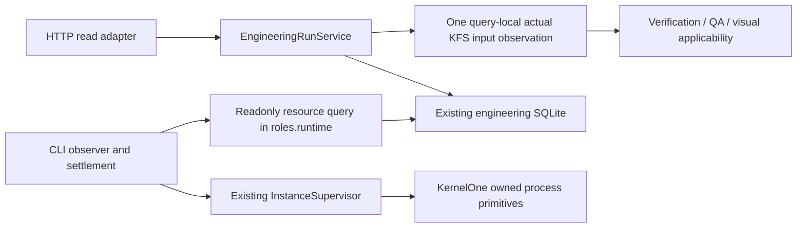

# Engineering observation and resource settlement

Status: qualified and validated in the fresh frozen v20 L2-13 run at `52f09d48e60f016ebdd3bf16314e899628d178a0`: current candidate61 accepted, automatic resource closure, and ROOT's12 finite business groups passed with nonblocking UX findings. This is bounded module/project evidence, not platform-wide stability or causal performance proof. Baseline main: `fbc96f8e106522c6e685f66264b920c3dd292e16`. See [the native and personal quality report](../history/POLARIS_ORIGINAL120_V20_L213_20261024.md).

## Problem and first deviation

L2-13 completed/passed and QA approved at revision141, event2322, with release_allowed=true and no active/pending tools. Its current-snapshot HTTP requests took208–413seconds; even health requests timed out. The outer driver expired at6000seconds. Existing InstanceSupervisor required ROOT assistance to close resources; the first frontend confirmation exception left the backend alive until an explicitly reconciled second stop. Business artifacts passed ROOT's12 finite public HTTP/UI/SVG scenarios, but this is not unattended delivery success.

The input binding had17487files/822979841bytes, including model-provisioned SDK/cache and416.74MB of external readonly dependencies. ROOT had selected base Web rather than the existing qualified Go profile; that configuration omission is confirmed and must not be blamed on model permission bypass. It is not the sole proven latency cause.

First code deviation: `roles.runtime.EngineeringRunService._fresh_verification` separately captures complete current inputs for verification, QA and required visual evidence. The async HTTP adapter calls the synchronous reader. `delivery.cli.engineering_acceptance.stop` additionally requires the same heavy HTTP snapshot before its independent canonical activity check. Instance stop attempts frontend before backend and an exception skips later cleanup.

## Existing owners and dataflow

EngineeringRunService and its SQLite remain the sole execution/state owners. The resource query is a narrow readonly facet of the same owner. Current-source acceptance remains separate from terminal/quiescence facts. No new Cell, task table, ledger, controller, model contract or business-specific verifier is introduced.

## Facts, hypotheses and unknowns

- Fact: the approved+required-visual source path captures3complete manifests per snapshot. SDK/cache reads were observed directly through file descriptors and IO counters while backend CPU was saturated.
- Fact: the reviewed32-file module experiment used real K1 execution, SQLite and KFS. One rejected-QA snapshot captured2manifests,64reads/524288bytes for262144bytes of inputs; no model/browser/HTTP or target code was run. The rejected QA journal entry was an explicit synthetic fixture. Its0.275s toy duration is not a large-project timing claim.
- Fact: canonical query and existing process guards already exist. A private exited-unreaped-child protocol demonstrated PID presence after exit; it did not invoke the product helper and does not prove the original frontend was a zombie.
- Hypothesis: eliminating repeated captures plus moving complete observation/encoding off ASGI removes the observed transport starvation. Exact live Python stack and exclusive NATS cause remain UNKNOWN.
- Falsifier: if one-capture, worker-isolated observation still blocks health/publication or changes stale-evidence behavior, the proposed explanation/fix is insufficient. Do not compensate by increasing global timeouts or retries.

## A. Current observation boundary

Own files: engineering_verification.py, public/engineering_service.py and delivery/http/routers/engineering_runs.py; associated new tests.

Within one public observation, capture actual KFS inputs once and share that host-owned observation across current verification, QA and visual checks. It must not survive into another request. Preserve current scope/policy/output-root checks and every byte/metadata/visual binding comparison. Unreadable, changed or missing evidence stays UNKNOWN. Model/API payload cannot supply an authoritative observation.

Reuse existing selected-event query filters instead of decoding unrelated full history. Keep the public snapshot200-event window and role hydration semantics. Execute the complete synchronous read plus JSON encoding through an existing bounded worker facility so ASGI/NATS stays responsive; do not add product polling. Initial/current/request-lookup readers must use the same behavior. Cross-request source changes, external dependency changes and cold reads still invalidate old evidence.

## B. Resource settlement boundary

Own files: existing engineering_session.py; new thin public `engineering_resource_state.py`; CLI engineering_acceptance.py; existing instances service and focused tests. Bucket A does not edit engineering_session.py.

Expose `query_engineering_resource_state(workspace, session_id=None, request_key=None)` through roles.runtime public. Use the existing store's readonly URI/consistent transaction and canonical storage resolution, without initializing a recovery-writing service. Return exact identity/version, terminal event/drain/release evidence, current active/pending and reconciled-UNKNOWN facts. It cannot return fresh accepted. Missing/legacy/unreadable/busy/ambiguous evidence remains UNKNOWN; no new POST or effect replay.

CLI observe may stop waiting on an unavailable freshness API after it independently confirms exact committed terminal/quiescence facts. That result is UNKNOWN acceptance, never accepted from SQL passed. CLI stop uses this resource facet before expensive HTTP; actual effects remain in InstanceSupervisor. Require exact instance/workspace/launch binding, current-controller/main/foreign protections and positive drain/quiescence immediately before automatic effects. Keep active/pending/unknown effects fenced. Preserve original timeout/cancel/UNKNOWN history and all original5400/6000budgets.

The Supervisor consumes only a platform-level `engineering.resource_settlement.v1` envelope: expected registered instance plus exact run/request and resource namespace identity. Internal acceptance/Bench plan, mode, nonce and kind restrictions remain in the CLI consumer, which converts its binding before the public call. The production owner must not require `internal_test_only`, `bench_project`, `acceptance_owner` or an internal acceptance-binding schema. A normal project with the same positive owner proofs must work; a raw internal harness binding must not become its production contract.

In Supervisor, preserve frontend error and independently attempt a still-authorized backend after revalidation. Do not clear unknown PIDs or mark stopped without actual closure. Do not add a global Z=closed shortcut: leader exit is not process-tree or owned-port release. Reuse K1 technical primitives; add one only for an evidenced public capability gap. Generic administrative stop and automatic terminal settlement retain distinct authorization semantics.

## Experiment, integration and stop criteria

1. RED original read-capture amplification and ASGI responsiveness with owner-level fixtures; GREEN one capture/query while the same stale/denied/changed-input counterexamples remain UNKNOWN. Include real KFS/Store/cold-service tests, and an explicitly labelled controlled slow observer for scheduling only.
2. RED heavy/unavailable HTTP blocks terminal settlement; GREEN exact released/idle owner can close through existing Supervisor while acceptance stays UNKNOWN. Pair with active, missing release, unknown effects, wrong workspace/ID/nonce, current controller, main/foreign process and cold legacy negatives.
3. RED frontend termination exception prevents backend progress; GREEN partial errors are preserved and only the still-owned residual backend is attempted. Protect identity reuse and foreign listeners. Synthetic zombie evidence alone is not permission to weaken the helper.
4. Root runs targeted Ruff/format/mypy/tests, adjacent CLI/consumer/recovery/visual tests, architecture/KernelOne ALL/catalog and independent review. Inspect actual diff/owner boundaries. No synthetic fixture proves native delivery.
5. Freeze a new source/config candidate, explicitly select the existing Go-capable host profile, then use a fresh isolated original contract run. Require real product quality and automatic resource closure. Old L213 remains assisted/timeout; the120-case scope and pelican animation goal stay unchanged.

Research stops when the minimum counterexamples fail old/pass new and adjacent safety/cold/current-input paths hold. Unrelated improvements go into the later queue. QA coverage-hint four-slot experiment did not demonstrate final quality benefit and does not change production prompts.

## Component evidence and limits

ROOT independently repeated the actual32-file K1/Store/KFS fixture: two captures/64reads/524288bytes became one capture/32reads/262144bytes, with verification, synthetic rejected QA and outcome unchanged. Counts establish this mechanism only; tiny-fixture elapsed time does not establish native latency benefit. Task A's original20-file regression passed385tests after narrowly correcting scripted-provider exhaustion and a test producer's leaked process environment; one intermediate cold-child exit remains unexplained and preserved. Task B's generic-envelope and partial-stop counterexamples have separate RED/GREEN and independent review records. These component results must be read together with the later qualification and frozen v20 native evidence linked above; they did not by themselves establish unattended delivery.

Initial synchronous observations inside create/admission, wait and cancel/resume orchestration remain outside this candidate's read-adapter scheduling guarantee. No blanket all-workload responsiveness, superior QA quality, lower cost or full-platform completion is asserted.

Whole-change review reproduced a missing-PID counterexample with real SQLite and an occupied loopback listener: automatic settlement incorrectly persisted stopped. The scoped correction confirms configured backend and enabled frontend ports even when the original PID is absent, preserves disabled-frontend and generic administrative behavior, and creates no invented PID provenance. Its real-listener RED/GREEN evidence is separate from the still-required fresh project run.

The first combined regression retained615passes and one failed crash-injection case. A controlled provider delay reproduces an earlier request timeout that prevents the child reaching its expected crash hook; the original failure's cause remains UNKNOWN because its temporary database was already removed. The test now reports the actual wait result and selected durable event/context references if the hook is not reached, without changing timeouts, exit assertions or production recovery. Final qualification runs the regression separately from heavy gates to avoid measurement contention; a pass cannot retroactively explain or erase that original failure. One entirely synthetic instance-start test also isolates its fake port probe from host port availability; physical closure remains covered by the real-listener tests.
