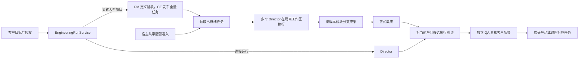

# Polaris 工程求解平台的底座完善与重构方案

2026-11-28 · 架构讨论稿。适用范围包括正向开发、逆向研究、长期多实验室协作和最终产品交付。

Polaris 要兑现两项可分别检验的承诺。给定客户目标、约束和授权，平台能自主产出一个可运行、可独立验收、可由第三方复核的产品。在有独立工作可做时，增加适合的算力能够缩短**合格交付**的时间。第一项决定正确性，第二项决定扩展价值。应先复用已有的单运行执行与验证机制，优先打通项目级计划、跨实例领取和最终集成，再用实测决定后续重构范围。

## 一、从客户承诺推导底座

把三种依据写在不同位置。**客观约束**包括信息不完备、资源有限、外部动作可能部分成功、观察可能延迟、一个局部结论有适用范围。**产品决定**包括 PM 整理文档、CE 负责分解、大型项目先发布覆盖全项目的工作包和任务、多个 Director 领取、所有必要分支通过后正式集成并独立验收。**当前工程选择**包括 EngineeringRunService、KernelOne、SQLite、JetStream 和两个层级的工作台。前两类给出要证明的性质，第三类接受实验检验。

每个拟议改造先回答五个问题。

1. **客户失去什么？** 写出移去该能力后，哪一条可观察的客户行为或交付承诺无法成立。以“编辑后同一只生物能试演、保存并重新打开”为例，可以据此导出候选身份、可复现输入和正常产品入口三个要求。
2. **什么事实必须成立？** 给出作用域、稳定身份、版本、负责人和状态转换。例如“一个共享池最后一个名额，在同一时刻最多属于一份有效租约”。
3. **谁有权产生这个事实？** 顺着正常入口走一遍请求、负责模块、实际效果、验证、裁决、结算。再走重复请求、取消、崩溃与恢复四条路径。记录谁能写，谁只能读取或投影。
4. **怎样用最小反例推翻它？** 让两个独立实例同时争抢最后一个名额，再提供两个合格名额作为对照。前次最多一个成功，后次两项独立任务应能同时推进。
5. **哪种改动已经足够？** 已有能力通过反例就复用。能力齐备但主线尚未消费时接通入口，缺少明确语义时补契约。出现重复写入者、无法隔离或现有边界不能守住约束，才重构该边界。没有反例和收益基线的优化先留作假设。

为系统地列全工作，按 **事实对象 × 生命周期 × 故障条件** 建检查矩阵。对象从目标、计划、任务、尝试、权限、租约、工具效果，一直列到研究结论、候选、裁决和项目交付。对每个对象检查创建、推进、取消、恢复、结算与归档。对会改变状态的交点，再加入重复请求、并发竞争、中断、版本变化和作用域切换。选择有实际意义的交点，写清其余项的适用边界。

以候选审核期间的版本变化为例。QA 开始审 r1 后，Director 产生 r2。预期是 r1 的裁决仍可复查、r2 保持待审。若已有实现能证明这点，就保留它。缺独立证据则先补实验。若两个模块分别有权把同一 r2 标为通过，登记为所有权重构。这样能把一个抽象的“验收体系要加强”变成可完成的工程工作包。

每个研发工作包都填写**客户义务、必须成立的条件、现有负责人及入口、观察到的缺口、最小改动、能推翻它的实验、验收证据、撤回办法**。一次迁移只改变一项关键条件，使结果可解释。排序时，可能越权、重复产生外部效果或错误验收的问题优先。基线守住这些条件后，先补阻止项目交付的接口，再比较效率优化。

## 二、当前起点

| 已核对的事实 | 对方案的影响 |
|---|---|
| HTTP 和 CLI 有通向现有工程服务的入口。工作区内的工程 SQLite 保存运行、事件、工具观察和验证。默认 direct 与显式 collaborative 已有不同语义。 | 在同一工程负责人内扩展大型项目。简单任务继续由 Director 直接执行，大型项目的全量计划准入只在显式选择时启用。[系统地图](../agent-guides/system-map.md) · [工程入口](../../src/backend/polaris/bootstrap/engineering_runtime.py) · [工程运行服务](../../src/backend/polaris/cells/roles/runtime/public/engineering_service.py) |
| 已有实验室计划绑定、依赖版本复核、已验证成果发布和消费端导入。当前研究入口由宿主提供计划并选中实验室。 | 复用版本交换，另行检验 PM/CE 能否从原始目标发布全量可领取任务。科学结论的适用域、工件字节完整性与整体验收分别记录。[长期研究与交换](LONG_HORIZON_RESEARCH_EVIDENCE_20261126.md) · [研究计划绑定](../../src/backend/polaris/cells/roles/runtime/internal/engineering_research_labs.py) |
| KernelOne 能按角色并发数、提供商绑定和配置上限计算 worker 槽位。通用并发管理器另有本进程的 I/O、CPU、HTTP 等执行池。 | 两种已有能力分别复用。共享订阅的实时剩余和跨实例互斥领取，还需用同一配额池上的实际竞争证明。[角色并发配置](../../src/backend/polaris/kernelone/llm/runtime_config.py) · [本地并发执行池](../../src/backend/polaris/kernelone/concurrency/manager.py) |
| 当前候选复核、独立 QA、按宿主配置保留并导出已验证文件均有实现。经验证文件快照有明确的授权与覆盖范围。 | 复用单次候选的验证和裁决。整合后的源码、外部环境和正常产品入口各自取得证据。[候选验证](../../src/backend/polaris/cells/roles/runtime/internal/engineering_verification.py) · [已验证候选的保留与恢复](../../src/backend/docs/ENGINEERING_VERIFIED_CHECKPOINTS.md) |
| 工程循环已按配置装配 MCP 工具子集。11 月 27 日蓝图中的“支持为 0”描述立项时点。 | 开放能力的下一项核查应放在最终工具集、宿主授权、效果归属及失败恢复。工作清单按当前可达代码更新。[早期 MCP 蓝图](MCP_INTEGRATION_20261127.md) · [当前工程循环](../../src/backend/polaris/cells/roles/runtime/internal/engineering_loop.py) · [当前 MCP 适配器](../../src/backend/polaris/infrastructure/mcp/engineering_bridge.py) |
| 已有独立 Three.js 上层总控样例，浏览器证据对应历史任务定义及模拟执行和配额。 | 保留交互设计。主线接入需由真实任务记录、共享池观测和 Agent 运行绑定供数，单 Agent 的工程工作台继续作为下钻终点。[本机样例及验证范围](/home/dains/.polaris/research-vision-at3w3hij/console/browser-check.json) |

本次审计基于本地 main 的 `c5812c990b79` 工作树。后端 9 个测试文件共 **98 项通过**，覆盖存储、权限路径、候选与 QA、研究计划及交换、提供商池和 MCP 选择。前端 2 个测试文件共 **36 项通过**，覆盖工程运行投影与 WebSocket 管理器。两组测试前后 HEAD 与已跟踪源码差异摘要相同。工作树包含既有的 `_timeout_config.py` 修改，具体身份与命令见记录。这一轮取得的是定向组件证据。完整 KernelOne 发布门禁、新鲜原生交付、共享池实跑与规模收益仍待检验。[本机基线](/home/dains/.polaris/audits/foundation-first-principles-20261128-hpfld0rt/baseline.json)

## 三、全平台的十项底座责任

表中每一行是一项可独立检验的责任，允许由同一个现有模块承担多行。跨 Cell 沿公开契约调用，通用能力先查现有 Cell 和 KernelOne，高风险副作用经既有端口与适配器执行。[后端架构规范](../../src/backend/docs/AGENT_ARCHITECTURE_STANDARD.md)

| 底座责任 | 完善或重构的决定 | 最先应通过的反例 |
|---|---|---|
| 1. 客户目标与验收范围 | PM 维护客户动作、输入、输出、约束及未决问题。保留最初目标与所有已声明检查。正向项目固定预期行为。逆向项目另固定只读参照、适用输入域、比较方法、容差和反例。 | 展示页可打开，但编辑、保存、重开后丢失状态，产品保持待验收。某假设被证伪可以结束研究任务，相关产品义务继续开放。 |
| 2. 项目身份、存储与生命周期 | 复用实例绑定、单工作区后端、单一运行根和工程 SQLite。项目主工作区保存计划、分配归属和集成裁决。子工作区保存本次实际执行证据，项目按版本引用。旧记录按引擎版本读取。 | 在两个工作区创建同名任务。一次取消、恢复、打开页面或读取快照只能命中原工作区及原运行。 |
| 3. 权限、工具和物理效果 | 复用宿主 PermissionScope、ToolSpecRegistry、KFS 与进程沙箱。归一化工具名和参数后再校验授权、真实路径、预算和隔离能力。分别记录派发、实际观察与未知效果。 | 显式空权限、授权根外路径或不可隔离的命令均被拒绝。写入可能已落盘但回执丢失时，恢复先核对效果。 |
| 4. 模型、上下文与知识 | 以最终 provider request 核对真实角色、工具、工具参数、token 和当前任务证据。同运行绑定工作集、失败样本和可取回的版本引用。制图、蒸馏、检索的价值由错误决策、重复读取和合格交付衡量。 | 提示要求某工具而最终请求缺它，或摘要沿用旧候选结论，应能从物理请求与来源定位。上下文更短但验收率下降时，不推广该策略。 |
| 5. 规划、拆解与就绪条件 | 在现有工程服务内增加项目级计划发布。CE 定义工作包、任务、已知依赖、资源、交付物及检查。计划可先写清未知问题及其判定方法。宿主校验版本、重复身份、循环、悬空依赖和集成任务。 | 计划未发布时没有可领工作。发布后独立支线可领，集成仍等前置。依赖换版时只将受影响的消费者标为待复核。 |
| 6. 算力、预算与公平分配 | 区分提供商账户上限、宿主分配上限、预留、占用、当前可派、外部使用未知。别名按实际共享配额池合计。按能力、预算、独占设备、关键路径和就绪条件匹配任务。 | 同一订阅两个别名、两个实例争最后一个名额，最多成功一份。限流后其他独立池仍可工作，未知余量保留未知或明确的本地上界。 |
| 7. 并行执行、恢复与隔离 | 同一任务只有一个有效持有尝试。不同 Director 通过隔离工作区并发写入，每个工作区维持单一源码写入者。恢复重验原授权、身份、截止时间和当前宿主策略。 | 两个 Director 抢同一任务，最多一个被授权执行。旧尝试迟到提交只写历史观察。失联且效果未知的尝试无法抢占新候选或自动重放。 |
| 8. 工件、科学证据与正式集成 | 明确区分研究报告、可复验数据、可消费工件、产品候选、版本检查与独立裁决。成果按明确版本交接。必要研发成果全数接受后才开放正式集成。QA 在同一集成版本走客户路径。 | 所有单项检查通过，组合后输出错误，项目继续开放。QA 的旧版本通过或一份哈希匹配的历史报告，均无法关闭当前候选。 |
| 9. 实时观察与产品分层 | 工程记录和资源准入分别产生事实。初始快照加 runtime.v2 WebSocket 更新视图，按来源和序号处理重复、断线与缺口。上层总控显示项目和算力，点 Agent 进入原工程工作台。Launcher 管实例运维。 | 断线后保持带时点的旧观测，可派数变未知。重连不重复扣额，切项目不串状态。点历史 Agent 时命中指定运行或明确显示缺少绑定。 |
| 10. 开放扩展、演进与运维 | 第三方模型、工具、领域数据和验证器通过可版本化的公开适配器加入，声明能力、读写效果、预算和可取证结果。评估、Bench 和外部审计保留内部边界。旧写路径按实际可达性逐步退役。 | 接入第二类项目时，只增加项目材料、授权的适配器或检查。普通工程入口与错误恢复仍走同一 owner。冻结历史可读，当前运行身份和外部副作用均可对账。 |

核查上述责任时可直接从通用工具注册、文件效果、最终请求与实例规范定位现有代码和边界。[工具规格注册](../../src/backend/polaris/kernelone/tool_execution/tool_spec_registry.py) · [KFS 效果边界](../../src/backend/docs/KFS_NAMESPACE_EFFECTS.md) · [最终 provider 请求](../../src/backend/polaris/kernelone/llm/engine/provider_native_request.py) · [ContextOS 决策上下文](CONTEXTOS_DECISION_CONTEXT_20261125.md) · [多实例规范](../../src/backend/docs/MULTI_INSTANCE_LAUNCHER.md)

一处具体的重构候选是外部工具装配。当前工程循环直接导入基础设施层的 MCP 适配器。先在同一宿主配置下检验工具选择、授权拒绝、外部失联和观测落盘能否独立复现。若具体装配妨碍隔离和证据归属，再将装配移到现有 bootstrap 边界，让工程循环消费已有的工具描述和调用接口。用同一输入比较迁移前后的最终请求、实际效果和失败记录。单凭文件长度不足以决定拆分服务。[工程循环装配位置](../../src/backend/polaris/cells/roles/runtime/internal/engineering_loop.py#L935) · [工程启动装配](../../src/backend/polaris/bootstrap/engineering_runtime.py)

## 四、知识、任务、名额和交付分别结算

这条建议路径展示需要独立验收的产品交付。项目总控和单 Agent 工程工作台都从负责模块读取事实。

**知识增长。** 从未知问题走到已知结论，需要提出能被反例推翻的假设，在固定输入和比较条件下复现，记录适用域，然后由下游用自己的输入复核。失败样本可以排除一个假设，也可能暴露新的前提。父版本、证据、消费方及未解问题随成果一起传递。这样研究时间会累积成下一位 Director 能用的知识。预算或截止时间耗尽时，保留已知、未解和可续接条件。

**任务归属。** PM 与 CE 提供可读的文档和任务语义，工程宿主在项目工作区的现有运行记录上发布版本。稳定任务编号关联多个历史尝试，每份有效尝试绑定执行者和隔离工作区。检查计划后发现新问题时，CE 发布修订版，说明受影响的任务和输入。现有 direct 入口按原规则执行。跨实例调度的项目操作也由现有工程服务承接。

任务列表由工程记录投影。工程状态的写入继续归 EngineeringRunService，配额机制只对名额负责。旧 Factory、TaskMarket 和 Run Ledger 相关的历史及在途工作按原引擎身份处理。退役前分别核对历史读取和当前写入口的可达性。

**共享名额。** 工程记录回答“谁领了哪项任务”，配额池回答“哪一份资源仍被谁持有”。本机多实例先验证一个共享资源准入边界，每个池都有稳定身份，所有参与实例经它预留和释放。这个边界只管理名额。首版可用同一尝试编号关联“领取意图、幂等预留、确认归属”。两边都确认后才派发工具。中途故障从两边对账，旧持有者被新尝试隔离，未决效果保留。SQLite 的写事务串行约束作用于其数据库，跨工作区的资源承诺仍需要共同的准入和确认。[SQLite 事务说明](https://www.sqlite.org/lang_transaction.html)

例如一个订阅允许 8 个并发 Agent，宿主分给 Polaris 6 个。已有 2 个占用和 1 个预留，本地还能派至多 3 个。只有取得足够新鲜、相同单位的账户余量，且核对未计入的本地承诺后，才能报出已确认的可派数。若供应商只报告请求数或 token 额度，Agent 上限标为未披露。最终能发起多少工作，还取决于可领取任务和模型、设备、预算之间实际能配成多少对。

**候选与交付。** Director 提交 r1 后，任务进入待审核。执行结束已被确认时释放相应名额，r1 的裁决仍待产生。若 QA 使用模型，另计自己的占用。若 QA 退回，保留 r1、局部检查和退回原因，新尝试交 r2。即使 CE 漏拆了“保存后重开”，最终 QA 仍对照原始客户义务检验集成候选。工程宿主把适用版本、检查和裁决共同写入结算。消息通知携带事实引用。JetStream 在未收到确认时可以重投，读侧必须使同一事件重复到达仍得到同一结果。[工程证据绑定](../../src/backend/docs/governance/decisions/adr-20261120-engineering-evidence-binding.md) · [NATS 确认与重投](https://docs.nats.io/learn/jetstream/acknowledgment)

## 五、按依赖实施，每一批都能单独否决

| 顺序 | 最小可交付变化和责任方 | 放行证据 | 失败时怎样撤回 |
|---|---|---|---|
| 0 · 固定现状 | 主开发方列出 HTTP、CLI、UI、取消、恢复及错误路径的实际写入者。冻结源码、配置、权限及样本，保留当前通过与首个失败。 | 用真实 direct 任务取得正常产品入口和当前候选的验证，并记录一次中断后的效果核对。本轮定向测试作为组件起点。 | 按原始身份和记录分析失败，在负责模块修复并复测同一反例。 |
| 1 · 全项目计划 | PM 形成带验收场景的目标文档，CE 从文档给出全量任务。工程服务显式发布、保存和查询。 | 从自然语言目标启动。发布前零项可领，发布后两条独立支线可领，一项集成仍受阻。重启后读到同一版，重复提交只发布一次，同一请求键换内容会报冲突。 | 关闭新项目计划准入，已发布版本继续可查，已有 direct 运行按原约定处理。 |
| 2 · 领取与资源 | 工程服务接任务尝试，宿主接共享名额，Launcher 提供隔离实例。落实前述幂等与对账。 | 分别通过“抢同任务”“抢同名额”“两个合格名额允许两个真实尝试”“预留后崩溃、旧提交迟到”四组试验。 | 停止发新尝试，核对在途运行及名额，仅释放可证实已结束的占用。 |
| 3 · 成果合并 | 两个工作区发布可验证成果，集成 Director 显式采用版本，独立 QA 验收集成候选。 | 一项局部通过和一次故意不兼容的组合都保留。组合失败能定位责任任务。修订后从客户正常入口实际走通。 | 保留原工件、失败候选与裁决。选择上一已知版本创建新的集成尝试，再检验当前输入。 |
| 4 · 接上总控 | 在已能产生事实的项目与配额池上接入快照与推送。Three.js 上层总控消费投影，宿主按 Agent、实例、工作区和运行绑定进入原工程工作台。 | 真实浏览器能从一次领取跟到释放与 QA。另验重复、断线、重连及越权项目不可见。 | 关闭新投影入口，工程运行和事实写入仍由原 owner 继续。 |
| 5 · 验证收益并演进 | 对同一计划测单 Director 与多 Director，再换正向、逆向及内部留出项目。按结果改粒度、路由或上下文。 | 两侧均有独立接受的产品。延迟、费用、失败与适用范围可由第三方复核。迁移旧路径前完成正常、错误、恢复入口和历史读取的兼容检验。 | 撤回新调度或选模策略对新运行的默认启用。保留在途版本、历史解码及所有失败证据。 |

KernelOne 发生实质修改时按工程规范跑相应发布门禁。从仓库根目录可执行 `rtk proxy python src/backend/docs/governance/ci/scripts/run_kernelone_release_gate.py --mode all`。该门禁、真实工程验收、内部 L1–L12 的平台资格检验各自出具结果。[发布门禁入口](../../src/backend/docs/governance/ci/scripts/run_kernelone_release_gate.py) · [可靠工程实施与验收](RELIABLE_ENGINEERING_EXECUTION_20261120.md)

## 六、怎样证明额外算力真有价值

先固定输入、计划、候选验收方法、权限、工作区起点和预算口径。比较单 Director 与多 Director 独立交付的产品。记录从目标提出到产品被接受的墙钟时间，并分别记录规划、等依赖、等名额、有效执行、返工、等待审核和最终集成。若两次执行共用已经发布的计划，共用的规划时间单列，相加所得端到端时间标为推算。

同时记录合格产品数、人工介入次数、所有物理调用和实际费用、资源的占用与预留、未决结果。费用缺少物理证据时写 UNKNOWN。只有两个配置都交付了合格产品，才给出时间比。失败、中断、未运行各计其数。若声称两份模型算力并行，须有可比时钟上的物理调用区间重叠。模型、供应商和并发度同时改变时，报告这组配置的整体效果。

**正向试点**可用一个具有导入、校验、导出和重开路径的小产品。独立输入既含正确数据也含错误数据，最终要求在同一候选上走通。**逆向试点**沿用 Spore 829 号设计。动作混合与 Snazzy 涂装各有历史对照，最终需在同一只生物上涂装、试演、保存、重开和重播。原研究目录的 13 个工作包、77 项任务、144 条依赖可用于检验历史计划读取和调度假设。其等时长模拟与历史对照均不提供真实提速或当前产品验收结论。本次只读核查到该工作区的 4 次 Polaris 协作运行中 1 次失败、3 次中断，验证状态均为 UNKNOWN。[试点输入基线](/home/dains/.polaris/research-vision-at3w3hij/pilot-829/reference-baseline.json) · [历史图与模拟假设](/home/dains/.polaris/research-vision-at3w3hij/task-graph.json)

**第一项新增能力只验一个结果。** 用户输入目标，PM 与 CE 形成并发布一份覆盖该目标的可执行计划。任何获准查看该项目的人重新打开工作台，都能复核哪些任务此刻可领、哪一项在等谁、最终由谁验收，以及这些判断出自哪一版计划。随后才有依据把新增算力投到正确的工作上。
