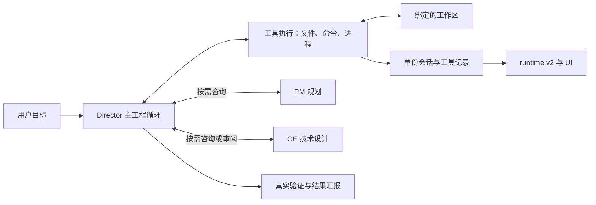

# Polaris 完整重构方案：保留角色分工，回到工程工具循环

状态：设计已采用，实施中；第 1–6 批组件已验证，后续批次未完成，尚无新引擎真实 Bench 交付。日期：2026-10-20。

本方案采用本轮用户明确的新方向：保留 PM、CE、Director 的专业能力，删除模型维护候选合同、hash、OBL 覆盖图和语义修复补丁的工作。它取代此前“继续收紧旧合同”的重构方向；不把旧流程搬进后台后称为简化。

## 1. 要交付的改变

用户给出工程目标后，模型能开始读代码、编辑、准备环境和运行测试。需要规划、设计或审阅时调用对应角色，结果直接帮助下一步工程工作。任务不再先通过一套完整项目合同的生成、编译和修补流程。

完成重构的标准有三项：

1. 没有候选合同、覆盖图和 hash 回填，仍能从自然语言完成真实工程任务。
2. 权限、隔离、取消恢复和验证结果仍可靠；模型没有因简化获得额外机器权限。
3. 旧前置协议确实退出生产调用、恢复路径和默认 UI，不留下永久双轨或自动回退。

## 2. 为什么需要这次重构

历史上的问题包括字段传播漂移、相同工具的多套定义、投影替代事实、测试没有经过真实接口，以及局部通过被扩大为整体成功。R13 又说明：模型尚未写代码，就可能在 recipe、覆盖范围和修复授权之间耗尽调用。

已核实的 R13 细节：三份已保存 semantic patch 中，round2/4 真正改变了覆盖集合；round3 保留覆盖却在环境准备要求上失败；后续请求又没有相应的新诊断授权。单独收紧 `covers_obligation_ids` schema 不能消除整条流程的复杂性。

本次不否定规划、架构审查、实际测试或必要权限。重构对象是将这些职责耦合到重型模型协议的运行方式。

## 3. 目标架构

这是职责图，不新增七个服务。核心执行、会话和角色协作放在已有 `roles.runtime` Cell；底层文件、模型与进程能力复用 KernelOne。

### 3.1 角色如何工作

| 角色 | 输入 | 输出 | 什么时候调用 |
| --- | --- | --- | --- |
| PM | 原用户目标、当前进展与约束 | 清楚的目标、少量任务、优先级与完成条件 | 用户请求规划，或任务确需分解/澄清 |
| CE | 相关代码、目标、具体技术问题 | 必要设计、接口建议、风险或审阅意见 | 跨模块设计、技术不确定性、重要改动审阅 |
| Director | 用户目标、相关设计与工具结果 | 代码、实际命令结果、修复与工作总结 | 工程执行的默认入口 |
| QA | 原需求、成品、已执行检查与必要独立工具 | 明确的通过、失败、未验证事项 | 用户/任务要求独立 QA，或明确选择独立验收 |

模型的规划与协作使用普通可读文本；工具继续使用正常工具参数。平台不要求角色输出业务合同 JSON、计算 hash、维护每文件归属图或生成 semantic patch。

### 3.2 两种用法，共用一个运行循环

- 直接执行：默认 Director；需要帮助时咨询 PM/CE。没有调用的角色显示“未调用”。
- 完整协作：用户选择规划/设计，或确有复杂需求时，真实执行 PM、CE、Director 协作；规划与设计只需足够指导当前工作，不提前穷举所有文件与验证关系。

首版不做新的复杂度分类器、任务市场或路由 Cell。入口提供上述两种用法，运行中可增加一次实际咨询。咨询使用只读能力，首版一层返回，不递归拉起另一套总控。

### 3.3 默认执行循环

1. 平台固定工作区、模型绑定、工具权限、预算与运行身份。
2. 模型读取用户目标、相关上下文，选择下一项工具或给出回复。
3. 平台逐个处理真实 native tool call：归一化、授权、执行、返回原结果。
4. 模型根据代码和命令结果继续修改；普通编译/测试错误不重启规划合同。
5. 模型认为实现结束后，停止写入，执行实际验证并汇报结果；仍有失败就回到工程循环。

一次角色回复结束只表示该次角色工作结束，不自动等于项目验收通过。

## 4. 明确删除、保留和改造什么

| 当前机制 | 决定 | 重构后的做法 |
| --- | --- | --- |
| 固定完整 PM→CE→Director 合同准入 | 删除强制前置 | 保留角色能力，按实际任务调用 |
| CE portfolio/candidate/diagnosis/semantic patch 循环 | 从新运行删除 | CE 给设计或意见，Director 用工具解决问题 |
| 模型回显 candidate/diagnosis/contract/blueprint hash | 删除 | 运行身份由服务器管理，不要求模型填写 |
| OBL/covers/shared_behavior 关系图 | 从新运行删除 | 原始用户要求与简短完成条件直接参与工作和验收 |
| JobToken/DEO/RunLedger 旧合同链的动作准入 | 从新运行删除 | 用户/管理员配置的工具与工作区权限直接作用于工具边界 |
| 自动 deterministic repair 调度与语言规则前置 | 从默认工程循环删除 | 错误直接返回 Director；独立实用工具可按需保留 |
| 文件、模型、工具参数归一化、进程管理 | 拆分复用 | 复用无业务合同依赖的技术能力 |
| ContextOS | 改造 | 帮模型选有用信息，帮人读真实请求，不负责业务合同准入 |
| Run Ledger/TaskBoard/旧合同视图 | 历史只读，停止新运行写入 | 新运行由单份会话记录提供活动/结果投影 |
| 实际构建、测试、CLI/Web/API 验证 | 保留 | 成品产生后真实执行；失败原样反馈 |
| Instance Registry/Launcher/runtime.v2 | 保留 | 管实例、范围和实时传输，不裁决工程完成 |

底层哈希可继续用于 Git、缓存或快照实现，但不能被重新包装成模型必须填对、任务才能推进的协议。保留普通程序接口不等于保留模型业务合同。

## 5. 代码布局与复用边界

### 5.1 新主实现放在现有 roles.runtime

拟新增一个类型文件和六个实现文件，名称为本方案决策，不是声称仓库已经存在：

| 文件 | 唯一职责 |
| --- | --- |
| `roles/runtime/public/contracts/engineering_run.py` | 五个普通程序类型，定义见实施计划 |
| `roles/runtime/public/engineering_service.py` | 启动、观察、取消和恢复的唯一公开服务 |
| `roles/runtime/internal/engineering_loop.py` | 模型与 native 工具结果的正常多轮循环 |
| `roles/runtime/internal/engineering_tools.py` | 少量文件/搜索/编辑/命令工具的安全组合 |
| `roles/runtime/internal/engineering_session.py` | 单份运行/会话持久化及工作区执行锁 |
| `roles/runtime/internal/engineering_roles.py` | PM/CE/Director/QA 提示、只读咨询与结果回送 |
| `roles/runtime/internal/engineering_verification.py` | 执行实际检查，汇总当前结果，不生成覆盖图 |

不新增 Cell、全局 RuntimeContext、通用规则引擎或第二张任务事实表。

### 5.2 可以拆分复用的现有底座

- `kernelone/llm/engine/client.py`：`ResilientLLMClient.invoke/invoke_stream`。
- `kernelone/llm/engine/provider_native_request.py`：native 消息编解码。
- `kernelone/llm/toolkit/parsers/native_function.py`：native 参数解析；须补齐明确拒绝，不能静默丢调用。
- `kernelone/tool_execution/tool_spec_registry.py`：统一工具定义与单次调用 alias/参数归一化。
- `kernelone/fs/runtime.py`、`kernelone/storage/layout.py`：UTF-8 I/O 与现有工作区 runtime 根。
- `kernelone/process/command_executor.py`：只复用命令准备/检查；其直接 `subprocess.run` 路径不作为新取消执行器。
- `kernelone/process/process_tree.py`：复用进程取消/回收原语；进程组不是完整 OS 隔离。

不能整体复用当前 `RoleExecutionKernel`、`KernelToolExecutor` 或旧 `execute_role_session`：它们会把 JobToken、PM target_files、execution_envelope 和旧合同门禁重新带回来。新入口的 import graph 必须证明这些依赖已断开。

## 6. 模型应看到什么

保留原用户目标、当前角色说明、必要设计、相关代码、近期工具结果及未解决问题。大输出以引用和按需读取处理；不逐轮回灌全部失败历史。

平台在适配 provider 后自动保存真实最终请求及调用身份，继续支持同 workspace 的 ContextOS 读取和 token 观测。模型无需填写快照 ref、覆盖 flags 或审计 hash。

新的请求不要求输出业务 `response_format`。PM/CE/QA 默认可读文本；实际工具仍有清楚、少量、正常的参数 schema。不同 provider 的工具调用转换在技术适配层解决。

## 7. 权限、记录与恢复的最小实现

### 7.1 操作权限

权限只来自用户/管理员配置的会话范围；角色文本不能扩大。首版同一工作区只有一个源码写入者，PM/CE/QA 默认只读；多个 Director 并行必须使用独立工作区，先不新增分布式写入协调。

文件工具检查真实路径、symlink 与允许根；命令通过现有或抽出的通用 OS 沙箱执行。仅检查 cwd/命令白名单不能限制脚本写到工作区外。首轮实测环境为当前 WSL2/Linux；若某平台无法实现要求的 containment，应明确报告不支持，不静默裸跑。

### 7.2 单份持久化

选择 `roles.runtime` 为新运行与会话记录的唯一写 owner，在 `<workspace>/.polaris/runtime/engineering/sessions.sqlite3` 使用标准 SQLite 保存运行、消息与真实工具观察。它取代新运行对旧 task/ledger/session 多份写入的依赖，不作为又一份镜像。

运行创建、工具 dispatch 记录、工具终态各自使用普通数据库事务。模型无需维护数据库字段。runtime.v2 是从记录派生的通知与 UI 投影，不能反向授予执行权限。

`engineering/` 中的数据库、执行锁及平台快照属于宿主控制域，不进入模型可写根；文件工具与命令沙箱都必须拒绝直接或经 symlink 改写、删除和替换这些记录。命令输出、构建缓存和临时文件使用另行挂载的可写目录，不能借此写回控制记录。

工作区锁放在相同 runtime 根；采用可随进程退出释放的本机 OS 文件锁，WSL/Linux 用 `flock`。Windows 原生锁与进程 containment 在扩大支持前单独验证。会话和日志均按 UTF-8 保存内容。

### 7.3 取消与未知效果

停止先禁止新派发，再取消 provider/进程并等待实际收尾；确认前不假称释放或回滚。角色循环只保留 completed/failed/cancelled/interrupted，验证结果单列 passed/failed/not_run/unknown。

恢复先读实际文件、进程和最后工具结果。已派发但缺终态的动作标 interrupted/unknown：读操作可重新读取，写入、安装、网络和外部命令不能盲重放。无法确定且不可安全重复时，明确说明阻塞，保留现状。

## 8. 验证与完成判定

验收依据是原始用户要求和真实成品。用户或测试环境已声明的必需命令必须保留；不存在的新 script 不会因一段 recipe JSON 而被当成已运行。

- Director 可在实现中自行运行测试并修复。
- 最终验证时关闭 Director 写入，持有工作区锁，通过同一命令底座实际执行检查；验收源代码只读，构建/缓存/临时输出使用明确可写目录。
- 平台用单调 `workspace_revision` 记录受管写入。检查关联实际 revision；再次修改代码即使旧检查失效。遇到外部改动或不能确定的结果，不复用旧绿灯。
- QA/CE 审阅使用原需求、当前 diff 与实际命令输出；不能把 Director 自述当验收事实。
- 没有运行的检查显示未运行，失败显示失败；实现回复结束可以汇报工作结果，但不能因此显示“验收通过”。

已有完整 Bench 原合同、预算和判定不因本重构降低。Bench 仍是内部量具；相同任务对比不能人工改目标、补依赖、替换验收命令或回填账本。

## 9. HTTP、CLI 与界面

新 HTTP 使用 `/v2/engineering/runs`，创建只需目标与工作区；可选 role、协作用法、用户检查与已配置权限 profile。运行身份和 `engine_version=engineering_v2` 由服务器生成并固定，模型不能选择或更改。

CLI、聊天中的“执行”动作和工程工作台都进入同一公开服务；纯讨论仍是讨论。UI 不再显示“缺少候选合同/CE覆盖关系”阻塞卡。

保留 PM、CE、Director、QA、ContextOS 与 Launcher 的可用界面：展示目标、实际活动角色、工具、代码改动、命令结果和验证。没有调用的角色明确写未调用；不补造蓝图或把跳过涂绿。

实时继续 Nats-JetStream 与 `/v2/ws/runtime`，不增加 SSE、HTTP polling 或断线轮询兜底。实例、workspace 和快照读取仍严格绑定；主实例沿用当前配置，项目实例由 Supervisor 分配端口。

## 10. 切换与旧代码退出

新运行固定新引擎；已有运行不热升级。开发期在独立实例验证新循环，不触碰 R13/R14 等在途冻结源码、配置或目标项目。

切换默认入口后停止旧引擎新建。旧运行由其原版本完成，或作为明确的历史只读记录；必须继续恢复的旧任务放入固定旧版独立实例。一个 run 不得新旧双执行、双写完成状态，失败也不自动回退旧引擎。

新 API 不伪造旧 Factory 合同/receipt 字段。旧查询保持历史语义；旧写请求在切换后明确拒绝并指出新入口。代码回滚不等于重放工具；存在未知效果时先对账。

迁移最后一批必须删除旧生产入口、默认 imports、prompt/schema、恢复与自动 repair 兜底。旧数据 reader 可以保留；若仍有旧合同作为新 run 的隐蔽前置，重构尚未完成。

## 11. 同步修改现有规范

本轮用户的新目标要求更新根/后端规范、镜像与相关测试：固定三角色机器交接、模型合同覆盖 flags、JobToken/DEO 合同准入、一 turn 最多一 batch、先 repair coverage/catalog 才可普通修复等旧强制项，不再约束新引擎。

仍保留 UTF-8、Cell public 边界、真实工具授权、单工作区实例、runtime 单根、实时单轨、平台/目标隔离、失败与未知保真，以及真实入口验收。平台开发需要设计与测试，不等于产品每次调用都要先完成设计审批。

## 12. 分批交付与验收

| 批次 | 可运行结果 | 结束条件 |
| --- | --- | --- |
| 1 底座验证 | native round trip、文件隔离、真实进程取消、普通日志持久化 | 技术端口可用；不能通过时先补既有底座，不带回业务合同 |
| 2 Director 主循环 | 自然语言下读写代码、运行失败命令、继续修复 | 零合同字段也能真正执行；全部 native 调用有真实观察 |
| 3 角色协作 | PM/CE 咨询和完整协作，未调用状态诚实 | 普通错误不重启规划；角色文本不能扩权 |
| 4 验证与恢复 | 实际检查、取消、重启、未知效果处理 | 旧绿灯不复用；未知写不重放；进程真实收尾 |
| 5 统一入口 | HTTP/CLI/聊天执行共用新服务 | 新旧身份分清，无伪兼容字段 |
| 6 UI 与 ContextOS | 真实工具反馈与请求可读，角色页可用 | WebSocket 无刷新更新；无全局串 workspace |
| 7 正式比较与切换 | 新建、已有项目修复、复杂协作及完整原任务验收 | 保留原判定；核真实效果、质量、时间与成本后切默认 |
| 8 删除旧主线 | 旧合同/patch/强制 repair 与兼容创建退役 | 新生产 import/调用路径不再进入旧机制 |

逐批文件、接口、测试和命令见[实施计划](../superpowers/plans/2026-10-20-polaris-role-agent-refactor.md)。各批验证是实施任务的检查，不会变成 LLM 的新业务审批表。

## 13. 如何判断确实更好

用固定模型、相同用户任务与预算对比：首个有效代码产出时间、完成率、测试与行为质量、真实模型调用、总时间、人工干预、观测开销及已知总成本。没有成本记录写 UNKNOWN；没有成功样本时成功交付单位成本未定义。

最关键的退化检查：没有 candidate hash、covers 或 semantic patch 仍能写代码；测试失败回工程循环；没有调用的角色不冒充完成；旧合同缺失不会成为错误；越权操作仍拒绝；取消/崩溃不会盲重放。

本方案不承诺新架构已经优于旧版。它给出可实现的替代结构和原任务对比方法；正式结果只由实际执行证明。

## 14. 依据与当前限制

- [历史经验报告全文](../history/历史经验报告.md)。
- 已完成 R13 原候选/三份保存提案/schema/composer 核对；不是五份已保存 patch，也不是全部因 covers 失败。
- 本轮代码发现确认：底层技术能力可拆用，旧角色内核会恢复被拒绝的合同依赖；provider 协议、OS containment 与新组合尚需第 1 批实际验证。
- 工具反馈循环、按需协作与从简单结构开始，是已有 Agent 架构模式；具体取舍是本方案结合 Polaris 失败史的设计。[原始工程说明](https://www.anthropic.com/engineering/building-effective-agents)
- 方案编写时的交付是报告与方案文档；当时未修改运行代码、运行产品验收或重启服务。后续实施事实见下方检查点。

2026-10-20 实施补充：第 1 批首次完整底座检查暴露 4 个旧流适配器兼容失败，已保留失败证据。R3 修复迭代结束与真实协议终态的适用边界后，冻结提交 `84474677f` 在独立 checkout 完整检查通过（368 passed、1 skipped）；没有修改旧测试的验收断言。第 2 批工程循环、单份 SQLite 与公开服务处于独立审查和修复中；尚无真实模型、产品运行或 Bench 交付结论。证据：`.superpowers/sdd/2026-10-20-polaris-role-agent-refactor/task1-release-all-r3/`。

第 2 批组件现已完成并通过独立审查：零旧合同输入的 Director 真实工具修复循环、单份 SQLite 会话、OS 写锁和六项工具已落地。主 Agent 最终 98 项通过；独立审查最终 29 项通过、16 条源码 hash 一致、未关闭发现 0。工具效果未知与进程清理未知分别如实保留，不盲重放或提前释放写锁。当前仍未完成后续角色协作、正式验证恢复、产品入口、UI、真实模型与 Bench 验收。

第 3 批组件完成：普通文本的 PM／CE／Director 协作与按需只读咨询已实际经过 loopback HTTP、角色模型路由及工具效果验证。主 Agent 最终 135 项通过，独立审查 44 项和专用 HTTP 5 项通过，六文件 SHA 一致、未关闭发现 0。冷接续旧权限的首失败已修复复验并保留。正式验证恢复、产品界面及真实模型／Bench 仍待完成。

2026-10-21 第 4 批组件已在 `main` 完成有界验收：真实只读检查、失败返回同一 Director、当前输入绑定、有限新进程恢复与原生工具历史均已验证。主 Agent 最终 244 项通过；独立审查两项 P1 关闭，修后 6 项复核通过。未完成后续统一产品入口、ContextOS／UI 与真实模型、Bench 交付。所有后续研发直接在主仓 `main`，不再创建开发分支或开发 worktree。

2026-10-21 第 5 批统一入口完成：正式新 HTTP、三角色 CLI 与聊天执行复用同一公开服务、固定 workspace 与同份 SQLite。选定 host profile 持久化；当前撤权、显式空权限、时间推进后的幂等及宿主关闭实际命令清理均已验证。普通讨论不创建工程 run。主 Agent 最终 243 项相邻测试、20 文件 Ruff／format／mypy 通过；独立完整应用、冷进程及 CLI 原候选 40 项检查与最终窄修 4 项复验通过。诊断 trace 混入 CLI stdout 的首失败已修复并保留。ContextOS／实时界面、默认切换及真实模型／Bench 验收仍待完成。

2026-10-21 第 6 批组件完成：同一 SQLite 提交后发布 `event.engineering`，原子快照与 SQL 水位用于恢复；最终原生请求快照可通过同 workspace 的 ContextOS 读取，普通聊天保留真实审计 metadata。UI 新模式明确选择，复用既有 WebSocket；未调用角色不补造完成，检查结果与执行结束分开，缺快照或重同步失败如实显示不可用。大日志保留检查身份与数量，超限时读取同库完整快照；重同步到达旧 GET 之后仍保证后续读取。主线程后端 379 项、前端 240 项相邻测试、后端 21 文件质量检查及 KernelOne ALL 通过。独立审查保留原两个 P1 的首失败，最终后端未关闭项 0、前端 10 项窄复验通过且未关闭项 0。此为组件与界面读模型验证，不是实际浏览器、远端模型或 Bench 交付。下一批仍需真实项目的当前候选独立 QA／反馈、正式入口及完整资源验收；原 L1-01 为 v2 catalog 的 TypeScript 发光昆虫花园模拟器。
