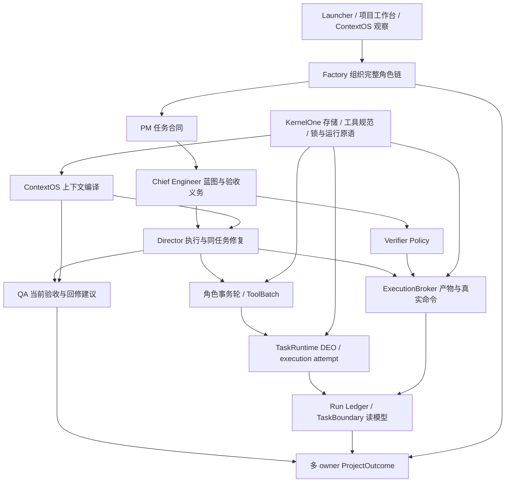
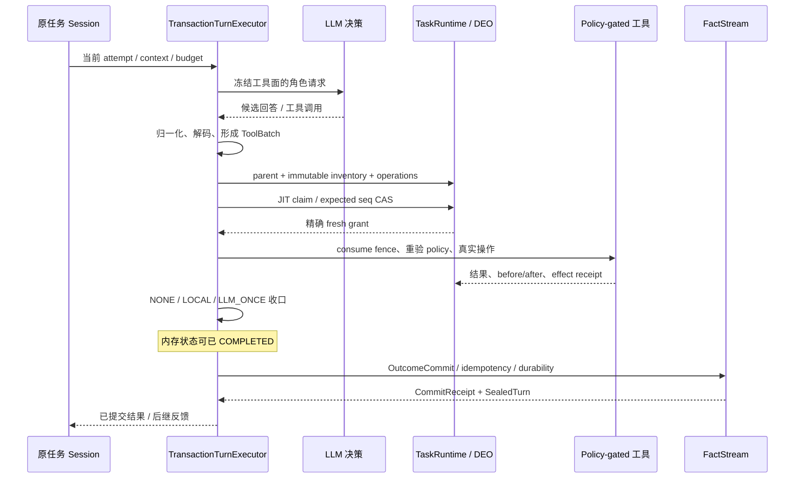
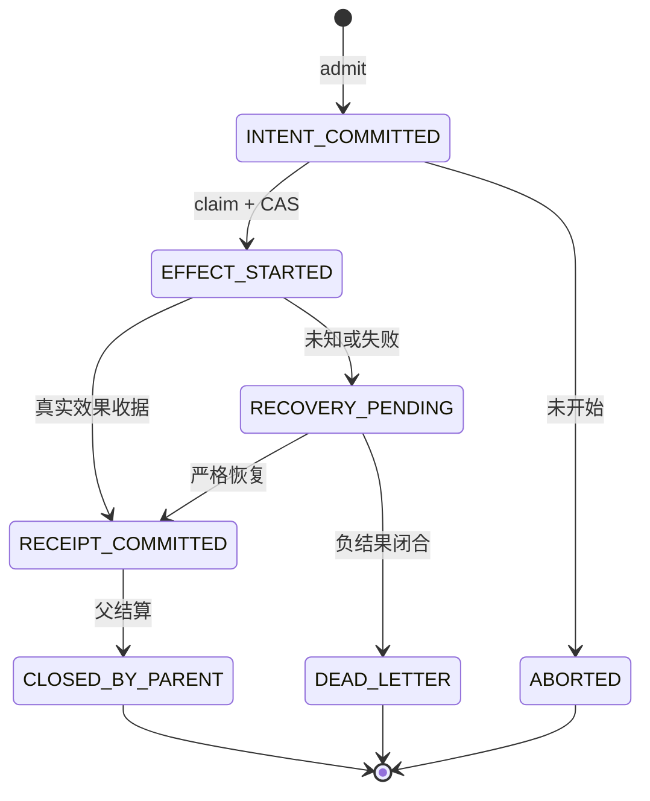
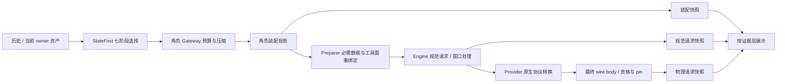
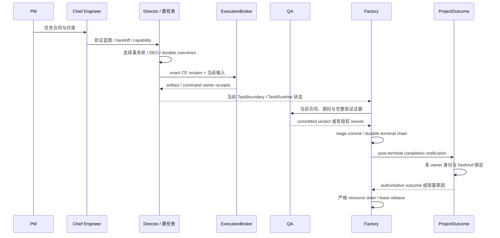
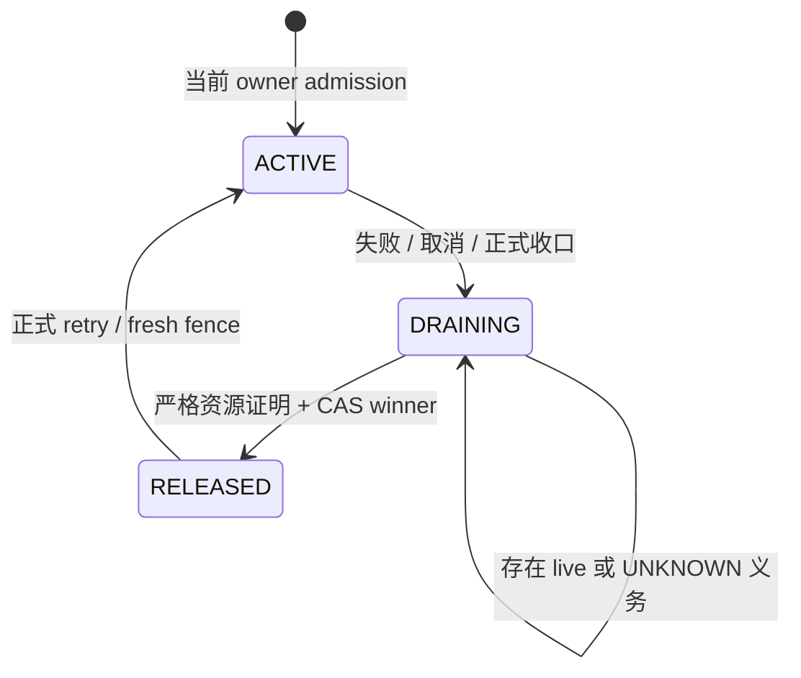

# Polaris：生成式决策与可审计工程执行之间的系统协议

> **2026-10-22 当前证据边界**：下文保留 10 月 14 日旧引擎分析。当前新工程仍由 EngineeringRunService 与 workspace 单份 engineering SQLite 管理，复用 Cell／KernelOne；不恢复旧合同或 TransactionTurn 准入。r05 达原期限后 failed，未正式验证、未调用 QA，资源已关闭。本次仅完成四处按需读取迁移，532 项相关回归和 K1 ALL 通过；局部提速不等于项目交付或平台优越性。当前证据见仓库 docs/blueprints/POLARIS_ENGINEERING_EVENT_SELECTION_20261022.md。

> 工程系统分析论文 · 中文版 · 2026-10-14 观察基线
>
> 本文分析已有实现及已封存失败，未宣称经过同行评审、提出经证明的新算法、获得比较实验优势，或完成全部项目交付。基线为工作区 HEAD `cc0cb98315ff2903783feb33e2739d43ee1c4f9d` 与 148 文件源码集合，集合 manifest 为 `4a0357bed646c94aeb15fb41021e147b0d475e3a71951ab6531623d438d42df7`。这个工作区包含已核实的增量实现，不能将该组合写成一个完全已提交、可直接 checkout 的发布 tag。

## 摘要

大型语言模型可以提出方案、编辑代码和解释失败，但自然语言中的成功声明并不说明操作已经获得权限、确实发生、结果已经提交，或当前产物通过独立验收。Polaris 将这些判断分配给具有单一状态拥有者的组件，并通过身份、合同、能力范围、当前输入、工具效果及收据连接生成式决策与确定性执行。角色链采用 PM→Chief Engineer→Director，并由 QA 与多 owner ProjectOutcome 汇总交付；单轮执行采用 TransactionTurnExecutor、工具批次、Directed Effect Operation（DEO）与独立 OutcomeCommit；ContextOS 则负责把历史和当前事实编译成受预算约束、可追踪的角色输入。

本文依据当前源码、公开契约和封存观测，说明这些层如何协同，以及为什么“有文件”“工具成功”“轮状态完成”“任务完成”“Factory 结束”“资源可释放”均不足以单独证明交付。分析发现，现有机制的主要难点位于组合边界：上下文装配与最终 wire 并非同一对象；效果收据与轮结果存在独立失败窗口；当前验收与全历史资源闭合需要不同投影；严格存储的工作预算可能变成长期会话的增长上限。原项目第 12 个执行 epoch 仍因 exact ENTRY 失败及后继轮提交受阻而失败，独立语义 QA 未完成。这些反例支撑对协议边界的分析，不构成端到端可靠性认证。

**关键词：** 多角色工程系统；TransactionTurn；ContextOS；DEO；事件溯源；能力授权；执行收据；ProjectOutcome；失败恢复。

## 1. 问题、范围与证据等级

一个模型回答“修好了”，至少涉及四个不同命题：它提出了可用方案；平台允许方案中的操作；操作产生了预期副作用；当前项目满足合同及独立验收。它们的证明来源不同。提示词约束模型行为，却不能替代运行时路径门禁；工具返回值描述一次调用，却不能替代编译、测试与语义 QA；状态投影便于观察，却不能因为字段名为 completed 就获得上游事实的写权限。

本文把 Polaris 视为工程执行与治理系统，而不是新的通用操作系统或语言模型内核。研究对象包括 KernelOne 底座、Cell/public 契约、角色事务轮、上下文编译、任务执行、物理进程、控制面与交付汇总。内部 Bench 只作为故障生产者和观察手段，不承担生产项目状态的所有权。Launcher 中的原理图和论文是静态解释视图，不能产生运行事件或成为成功证据。

证据分为三层。第一层是当前源码行为，例如状态转换、参数校验、append 与实际构造点。第二层是封存的生产路径观测，例如真实命令退出码和提交错误。第三层是由源码推导的风险，例如某个汇总字段可能混合历史与当前窗口。第三层不能直接提升为实际故障，更不能把已发现根因提升为已修复。组件测试和独立源码评审提供局部反证，但不能证明所有任务、模型、语言与崩溃时序均可收敛。

## 2. 与已有方法的关联

ReAct 研究模型推理与动作交替；SWE-agent 强调为软件工程代理设计适合其使用的计算机接口；Reflexion 利用语言反馈和情节记忆影响后继尝试，而非更新模型权重。它们为决策、交互和反馈提供相关视角。本文关注的额外工程问题是：动作由谁授权、如何绑定当前事实、执行到哪一步、失败后还有哪些义务，以及谁有权给出交付结论。本文没有复现这些论文的实验，也不据此比较 Polaris 的性能或能力。[ReAct](https://arxiv.org/abs/2210.03629)、[SWE-agent](https://arxiv.org/abs/2405.15793)、[Reflexion](https://arxiv.org/abs/2303.11366)。

事件溯源有助于分离已发生事件与派生状态，保留历史并重建不同视图；外部系统重放还必须避免再次产生副作用。Polaris 的 FactStream、幂等键、执行收据和恢复协议可以在这一视角下理解，但系统也保留 mutable session、工作区文件与进程内状态，不能将全部系统称为纯事件溯源数据库。[Focusing on Events](https://martinfowler.com/eaaDev/EventNarrative.html)。

NATS JetStream 提供持久消息与基于确认的消费及重放。持久消息传输不能自动授予工具写权限，也不能将消费者重投递变成业务副作用恰好一次。Polaris 的实时观察使用 JetStream 与 runtime WebSocket；合同、效果和验收的事实仍由各 owner 提供。消息通道是运输与观察机制，不是万能事实裁决器。[JetStream 官方文档](https://docs.nats.io/concepts/jetstream)。

## 3. 分层架构与单一状态拥有者

Graph First 表示先从组件图确定合法依赖，再进入目录实现。Cell 是最小自治边界，跨 Cell 通过 public command/query/event/result/error 协作。Single State Owner 要求同一权威状态只有一个拥有者；读模型、缓存和 UI 可以复制必要信息，但不能自行修改原 owner 的事实。Bootstrap 负责组装 public ports，避免汇总组件通过 import 私有实现取得隐含权限。



| 层与 owner | 保存或决定什么 | 本层不能单独证明什么 |
| --- | --- | --- |
| PM、Chief Engineer | 任务意图、蓝图、接口、产物与 exact command 义务、handoff | 当前实现正确、命令已运行 |
| roles.kernel | 一轮决策、解码、工具批次与轮结果提交 | 整个项目已完成 |
| ContextOS | 历史、结构状态、活动视图、内容引用和请求审计 | 操作获得权限、引用内容已被模型阅读 |
| runtime.task_runtime | task/session/attempt、DEO intent/claim/receipt、任务执行事实 | QA 通过、全项目义务满足 |
| runtime.execution_broker | 真实进程、当前产物与 verifier owner 收据 | 任意 exit 0 都可作为合同证明 |
| control_plane.run_ledger | capability、effects、gates、TaskBoundary 与 evidence 的聚合读模型 | 上游收据可以由 summary 或缓存补造 |
| factory.pipeline | run/stage/checkpoint、工作区 claim、控制及终态清理 | operational completed 等于 verified delivery |
| runtime.projection | 只读 owner observation、纯 reducer 与 authority binding | 自填全绿字段即可获得 authoritative outcome |

KernelOne 为这些组件提供通用运行原语，角色协议仍归 roles.kernel，DEO 持久状态归 TaskRuntime，修复 catalog 与 scheduler 归 director.runtime。已有 ProjectOutcome 是多 owner 汇总器；因此不能把当前缺口描述成“平台没有统一状态机”，更不能另造第二套任务、授权或完成事实源。[S01]、[S17]、[S23]、[S24]

## 4. 形式对象：身份、授权、输入、效果与结果

为解释现有 DTO，本节使用分析记号，不引入新的产品 schema。一次执行的身份记为：

```text
A = (workspace, project, factory_run, child_run,
     role, task, external_task, session, attempt, worker)
C = (PM contract, CE blueprint, completion contract, handoff)
P = (capability scope, gate policy, policy revision)
I = (authored inputs, dependency identity, executable identity, input hashes)
E = (operation/member identity, normalized arguments, before/after state, receipt)
O = (TurnOutcome, commit receipt, task verdict, QA verdict, ProjectOutcome)
```

workspace 同时是存储和权限边界，一个后端进程绑定一个 workspace。多项目通过多个独立实例观察，不把 active workspace 拼成临时多租户事实层。task 是业务义务的身份，session 承载同一任务连续轮，attempt 区分一次 claim 与执行资格。新 session 可以替换当前 row，但不能抹掉旧 attempt 的效果。role 决定上下文身份与能力策略，不能仅靠一个 prompt 标签重建授权。

contract 描述义务，policy 描述允许的执行，input hash 描述本次实际验证的字节。effect receipt 证明副作用及结果绑定；outcome 汇总一轮或任务的结果。普通 SHA 只能校验绑定与一致性，不能独立证明来源可信，更不是针对任意恶意改写者的数字签名。授权还需可信 owner、当前 attempt、能力范围与精确状态检查。[S02]、[S05]、[S06]

CE 的 JobToken 从已验证项目合同派生 target/write/read paths、required artifacts、command authority hashes 与合同/蓝图身份。它不是另一个合同事实源。一个自然命令通过通用 capability 判断，仍不能直接计入验收：正式 verifier 必须绑定 exact argv/cwd、obligation、当前 input closure 与可信可执行文件。[S16]、[S18]、[S19]

应保持几个不同 token 的语义：LLM token 是窗口和输出容量；JobToken 是派生 capability；claim/fence 是精确执行许可；content ref 是文本取回索引；context_snapshot_ref 是真实落盘请求快照键。它们有时都包含 hash，却不能互相替代。字段含义应由契约决定，而不是从字符串长度猜测。

## 5. TransactionTurn 与 DEO 的实际协议

正式入口是 TransactionTurnExecutor 与 TransactionKernel，后者委托 TurnTransactionController。一次轮调用先验证 attempt 与装配，构建上下文和工具面，请求模型并解码，再按工具效果分组。模型提出候选调用；工具分类、授权和执行顺序由确定性代码决定。工具表、别名与参数先经 ToolSpecRegistry 归一化，再进入 scope、path、command 与 policy guard。自然参数兼容不是权限扩张。[S01]、[S02]、[S03]、[S38]



这里的 Plan 是工具批次执行计划，不意味着每轮还有独立规划模型。Speculate 也不是必经状态。流式 shadow 可以提前执行便宜只读调用，之后 ADOPT、JOIN 或 REPLAY；写工具的 shadow 只做只读 Prepare 探测，不能提前写入。推测能力默认启用，领养重算审计默认关闭，且是否实际触发受调用路径控制。“默认开关启用”不能证明每轮已推测、更不能证明推测写入。[S07]

正式 DEO Prepare 则是不同协议：先校验原 attempt，登记 parent，封存完整有序 inventory，绑定成员参数、scope 与 policy，再确认 readiness。JIT claim 在严格当前 stream head 上以 CAS 将 INTENT_COMMITTED 转为 EFFECT_STARTED，成功才获得可执行 grant。重复 claim 可以观察已发生状态，但 idempotent 命中不能被当成新的派发许可。[S04]、[S05]

fence 绑定精确 parent/member、normalized arguments、policy、当前状态、PID 和对象身份；在进程内注册并单次消费后，私有执行器才实施效果。物理操作已发生而效果收据提交失败，需要 recovery，而不是报成功或假设没有效果。尚未 claim 的操作可以 ABORTED；已开始操作不能通过 abort 撤销现实。rollback contingency 是另一个预授权补偿副作用，只有观察证明补偿成功才可宣称 restored。[S06]、[S08]



整轮完成与整轮提交是两条边界。controller 先执行 `_execute_turn()`，再调用 canonical outcome commit。因此内存 TurnState.COMPLETED 可以早于持久化。effect receipt、TurnOutcome、CommitReceipt 和 SealedTurn 也不是同一个对象；一个轮提交失败不说明此前所有工具都没发生。sessionful outcome 选择 fsync，sessionless 路径可能采用 buffered durability，不能概括为所有写入都立即 fsync。[S09]、[S10]

| 数据库术语类比 | 当前可确认机制 | 必须保留的限制 |
| --- | --- | --- |
| 原子性 | 单流锁下的 append/seq/idempotency；单操作 claim/receipt | 多文件、进程、网络没有共同原子 rollback |
| 一致性 | DTO、合同、hash、scope 与合法转换检查 | 合同一致不等于业务行为正确 |
| 隔离性 | stream 锁、CAS、owner lease、写前状态重验 | 未证明整个 workspace 可串行化 |
| 持久性 | durable events、按路径选择 flush/fsync、commit receipt | buffered 和物理效果之间仍有失败窗口 |
| 两阶段提交 | 先登记 inventory 后领取许可再执行 | 不是全部参与者 vote prepared 后的数据库 2PC |
| exactly once | 稳定 intent、幂等/CAS、一次 fence、恢复避免盲重 | 不保证任意外部副作用全球恰好一次 |

此外，`TaskBoard.transaction()` 的当前实现只持有进程内 RLock 并 yield；接口名称不能证明任意文件或外部操作可共同回滚。[S42]

这些限制不否定协议价值。其价值是缩小权限与重复派发窗口，并在无法确定现实结果时保留 UNKNOWN 和恢复义务，而不是把“不知道”强制转换成成功或未发生。

## 6. ContextOS：上下文编译与三个请求层

ContextOS 把 transcript、结构状态、项目资产、当前目标和工具结果编译为角色输入。默认 StateFirstContextOS 构造普通七阶段 PipelineRunner，并组合 TruthLogService、WorkingStateManager、ReceiptStore 和 ProjectionEngine。它不拥有任务执行、DEO 或交付状态，结构状态里一句 completed 不能替上游事实。[S11]、[S12]

七阶段依次是 TranscriptMerger、Canonicalizer、StatePatcher、BudgetPlanner、WindowCollector、EpisodeSealer、ArtifactSelector。它们合并事件、提取领域 hints、选择活动根与近邻、分配预算、封存退出窗口的片段，并形成 artifact stubs、anchors 与 Run Card。错误可能返回带 fallback 标记的投影；“返回了 messages”不等于每个阶段成功。

TruthLogService 保留进程内 journal 与可替换的活动视图；另一个 TurnTruthLogRecorder 才写磁盘观察日志，且记录是 best-effort。WorkingState 管理目标、计划、阻塞与来源 confidence，是结构化理解，不是 execution state machine。ReceiptStore 将大文本内容引用化，其 receipt 是内容取回索引，不能与 DEO effect receipt 混同。ProjectionEngine 排序、删选与压缩输出模型可读视图，不改变原事实。[S13]、[S14]



第一层角色装配快照证明准备了哪些 messages、来源与工具候选；第二层 Engine 快照证明 post-compression 规范请求；第三层 wire 快照才绑定 provider-native endpoint/body、transport、wire hash 和执行资格。Engine 和 provider 在装配后仍可改变内容，所以前两层不能替第三层。Anthropic 的 system 是顶层字段，Responses 使用 input，不能只审统一 messages[0]。[S15]、[S20]、[S21]

`/v2/context/{hash}/final-request` 兼容返回规范投影；没有真实物理 schema 时 final body 可以为空。HTTP200 或接口名称带 final 不足以证明物理请求已资格化。role_session final gate 能力存在，但需要显式 snapshot、生命周期和 drain 协调器；默认角色入口是否实际构造与传播必须沿调用链证明，不能把未接入说成能力不存在。[S22]

预算也有多层。StateFirst 选择预算保留输出、工具与安全余量；角色 Gateway 使用角色策略和模型窗口的较小上界，并优先保留当前指令；Preparer 将源码与验证数据放入独立数据消息并核对来源；Engine 再计工具 schema、消息包装与输出余量。角色指令预算 8k 和模型窗口 1M 可以同时成立，因为它们限制的对象不同。[S12]、[S15]

因此，无损保存、当前可见和预算内可发送必须分别判断。引用存在不意味着模型取回原文；缓存可被驱逐；freshness 标记未变不意味着旧内容经历后继裁剪后仍在窗口里。当前 token audit 是估算，不能代替 provider 实计 usage；窗口利用率也不能代替 required refs、角色身份和工具覆盖度。

RoleSignalPlane 是网关 supplement 装配点：按角色、flags、priority 与 freshness 读取已有 owner 资产并分配预算，不是常驻独立模型。EnhancedPipelineRunner、Akashic 四层 MemoryManager 和 IntelligentCompressor 有实现，但默认 StateFirst 使用普通 runner；默认角色主链的实际构造点未得到同等证明。ProjectionEngine 的自适应排序是进程内启发式权重反馈，不能写成在线模型训练或已认证的强化学习系统。[S14]、[S26]、[S27]

## 7. PM→CE→Director→QA 与多 owner 交付

完整链路通过合同传递责任，而不是把 PM 的文本直接交给 Director。PM 提供任务意图；CE 将其变成覆盖任务、接口与验收命令的蓝图，生成可消费的 handoff 与能力约束；Director 执行并产生真实效果；QA 对当前实现和验证证据给出独立判断。一次 stage 可以复用已验证范围并不调用模型，但明确要求语义 QA 时，physical verifier 模式和自测结果不能作为该语义判断的替代品。

修复并不总要重启 PM/CE。普通编译、测试或入口错误，应在原任务、原合同和已授权范围内产生 typed feedback，再由 Director 修复。若需要改变合同义务或跨 owner 扩大范围，则需要正式 rework authority，不能从错误信息临时推测新权限。`director.runtime` 拥有 repair catalog、coverage、planner、composer、scheduler 与 revalidation；adapter bridge 只绑定已声明 step，Factory 不另写语言规则或调度事实源。[S28]、[S29]

候选接受与 owner 完成也要分开。一个补丁修好 TEST，却暴露 ENTRY 缺失，可以在其它已通过 gates 保持、scope/command/authority 不漂移时保存增量，再继续同任务。候选有净进展并不意味着 task 应终态成功。反之，一律在所有验证尚未完成时 rollback，会丢失可验证进展。当前实现已有相关 convergence 机制；如何在每个调用路径正确消费其 typed verdict，仍是组合审计问题。

ExecutionBroker 在正式 verifier spawn 前重新解析 exact CE authority，再冻结声明输入、绑定 executable identity、input hash 和 proof profile。Verifier Policy 只判断 proposal 是否属于启用、可信的证明方式，不单独 mint 执行资格。一个脚本被允许执行、一个进程成功启动、一个命令 exit 0、一个 owner receipt 被 seal，是不同证据等级。[S18]、[S19]

干净 VerificationGroup 从 authored inputs 和当前依赖建立候选，先 build 再 type/test/entry，后续命令消费同一组派生输出。它避免宿主旧 dist 偷渡进新候选。即使前几个命令为 0，整组仍可能因为最后入口失败而未 seal；这些前置成功应保留为真实进展，却不能被称为全组权威通过。

项目最终接受已经由 ProjectOutcome 实现。纯 reducer 对调用者提供的六轴只计算 completion_candidate，保持 authority_bound=false 和 completed_verified=false。Bootstrap-bound adapters 通过各 public owner port 观察事实，校验 exact workspace/project/run/contract 身份、projection hashes 与 evidence refs，然后 authority binder 才能授予 completed_verified。[S23]、[S24]

| ProjectOutcome 轴 | 实际问题 | 需要的 owner 证据 |
| --- | --- | --- |
| delivery | 当前产物与物理义务满足了吗 | 当前合同、输入、全部适用 obligation、Broker/verification owner proof |
| chain | Factory 全链是否正式完成 | 配置 stages、成功 stage 与 durable completion event |
| QA | 当前独立审查通过了吗 | 当前 scope 下的 committed QA verdict 与约束 |
| TaskBoundary | 每个任务局部边界完整了吗 | 产物、依赖、missing/failed evidence 与 verifier 列表 |
| TaskRuntime | owner 任务是否收敛 | 原 task 身份、当前执行事实或严格全义务 physical proof |
| RunLedger | 证据与完整性是否闭合 | exact scope、capability、integrity/outcome、有效 missing/failed 集合 |

当前非 Factory owner adapter 不只检查绿色枚举，还要求每个 axis 的 owner hash 绑定在 evidence refs 中，并核对 CE covered tasks、当前 Director child runs 与全部适用义务。因此现有机制不是“模型自评后完成”，也不是“把任意六个 true 拼成接受”。同时，六轴汇总仍依赖 producer 正确产出当前事实；纯 reducer 的确定性无法弥补上游遗漏。[S24]、[S30]

## 8. 正常交付时序及其证明链



图示的是已有接口的主要依赖，不是把所有 I/O 放入一个大原子事务。某一步的异常可能晚于更低层效果发生；因此后继恢复必须先确认事实，而非从上层失败字符串推断“没有写过”。同样，QA 接受不能消除另一个尚未终止的请求，lease release 也不能把 QA 失败改成成功。

Factory 的 `complete_run(success)` 明确只闭合 orchestration lifecycle，保存 verified=false，且不能把已经 FAILED 的 run 升成成功。项目 completion notification 要等 Factory terminal event 已持久化再触发；否则汇总器读到未完成 chain，会把一个准备完成的候选正确判为 incomplete。通知失败应保留为控制面阻塞，不回滚已真实完成的低层效果。[S31]、[S32]

一个可追责链条可写为：最终请求 → 响应/工具生命周期 → 受权 effect receipt → 当前 verifier proof → TaskBoundary/TaskRuntime → RunLedger/QA → owner-bound ProjectOutcome → protected resource release。每个箭头都需要具体身份与引用。源码 whitelist、日志 preview、prepared QA prompt、成功状态摘要只属于辅助说明，不能跳过中间证明。

## 9. 失败恢复、安全性与活性

资源生命周期和业务验收不是同一条状态轴。工作区 lease 防止多个 Factory owner 同时修改同一 workspace，fencing_token 区分权限 epoch；stage claim 绑定一次阶段执行；lifecycle claim 则绑定 cancel、settle、recover、retry 等控制操作的 nonce、sequence 和 run。过期表示旧资格失效，不表示它启动的 provider、进程或效果已经停止。



当前 settlement barrier 中 release_allowed=closed。closed 要求观察到该 Factory、open lifecycle 为零，以及 missing evidence 时严格的 terminal failure dispatch closure。passed 另要求 run projection 正常、failed count 为零、required evidence 无 missing/failed。因此 closed=true、release_allowed=true、passed=false 可以是完全正确的失败清理结果。[S33]

资源安全需要检查全部 stable execution identities：新 attempt 覆盖当前 task row，并不删除旧 attempt 的 effects。验收当前版本则需要当前 CE contract、input 与 authority revision 的证明。旧失败要保留为历史，却不能仅因保留就假定它代表当前候选。当前 barrier 的 failed_count 混合最新任务状态与历史 tool failed_count，是需要明确消费语义的静态风险；最终 ProjectOutcome adapter并不直接读取该 barrier.passed，所以“历史失败 16 次”不足以证明最终接受必被毒化。[S30]、[S33]、[S34]

原终态清理先确认 physical requests、child sessions 与 effect 义务，再对齐 stage claim 和 ledger barrier；保存 frozen terminal TaskRuntime authority 后，才执行正式 reset(keep_plan=True) 和 lease CAS release。恢复需要从 immutable facts 与 frozen projection 找回原 task、session、CE tuple，不能因为 live row 已删除就新建另一任务掩盖问题。[S35]、[S36]

restart 后进程内 coordinator 不再存在，必须 replay immutable start/terminal，并在持有相应 lease authority 的情况下重读稳定 views/fence。一个空的新进程不能证明旧请求已结束。两种恢复 route 若互相拒绝对方的 expired claim，会造成 orphan deadlock；通用解法是精确 resume 原 terminal nonce，并保持 child quiescence、strict closure 与单次 CAS winner，不能手工清锁或改 TTL。[S35]

安全性要求宁可阻塞也不重复派发未知效果；活性要求可证明的终态与同 owner 后继修复能继续。两者并不天然等价：UNKNOWN 正确阻塞，是安全机制的表现；若已有严格负结果却永久不能释放，则是恢复组合缺口。有限模型预算、单轮 ceiling、deadline、资源 lease 和存储限额也分别限制推进。本文没有证明这些约束下所有任务必能最终成功。

## 10. 观察方法与真实失败案例

本次分析先从 Graph、public contracts 与 CodeGraph call-path 定位，再用专家核实的源码索引解释实际执行体；只对已封存的 first-failure 和 closure 观测作因果整理。研究没有重新启动原实例、请求 provider、执行目标命令或进行新的冷历史扫描。历史 read-only query 的耗时仅描述那次观察，不是可泛化性能实验。

| 案例 | 已观察边界 | 机制解释 | 当前能声称的范围 |
| --- | --- | --- | --- |
| F30：QA 指令预算 | 原第 10 epoch 将完整源码证据拼入 current instruction，QA 在 provider 前失败 | 角色指令预算与模型窗口不同；数据 dossier 应作为来源受控的独立 data slot | 当前源码已经有对应数据 slot 与覆盖校验；prepared 成功不等于语义 QA 通过 |
| F32：失败 run 的清理入口 | Factory 已失败、Task1 却 completed，缺 QA 等证据时旧 failure-only 谓词不能进入严格负结果闭合 | 任务局部终态与项目失败可以同时成立，closure 应按 exact canonical failure/dispatch proof 判定 | 局部修复与原严格只读 closure 已有证据；passed=false及历史失败保留，不冒称交付 |
| F34：completed owner 恢复 | 正式 reset 记录 prevcompleted，后继恢复仍要求 owner failed，原 Task1 在 admission 前失败 | reset、failed/completed 与恢复 checkpoint 需要同一 canonical identity 规则 | 当前148源码已支持对应同任务、同 CE 恢复，原第12 epoch确已进入后续质量路径；项目仍失败 |
| F35：轮结果 append | 原第12 epoch 质量修复出现 strict event stream append byte limit 错误 | 严格读页预算与 append 整个流的 lifetime cap 不同 | 已定位，当前未实施修复，不能写成已闭环 |

F35 的 `roles.kernel.turn_outcomes` 已落流为 8,354,716 bytes、47 帧；默认严格 append cap 为 8,388,608 bytes，仅剩 33,892 bytes。已落最后帧为 552,213 bytes。**最后帧大小不是本次未提交 encoded 帧大小；本文没有后者的独立字节证据，不作等同推断。** 当前源码仍在 append 时以“既有整流字节＋新编码帧”检查上限，合法长期历史会接近这一有限容量。[S10]、[S37]

原第12 epoch 的 clean authored-input Group 实际观察到 ENV、BUILD、TYPECHECK、TEST 退出为 0，exact ENTRY 为 1，编译产物路径不能满足已声明 CLI 入口。后续 Director 有七组新语义 start/end callback及只读结果，但新快照缺 final physical body/wire hash；真实物理请求数未知，不能报 0，也不能把七份快照当作七份合格 wire 证明。独立语义 QA 尚未执行，原项目仍 FAILED，整组未 seal。

该案例不是对模型能力的直接否定。入口配置是普通目标缺陷，本应由授权 Director 修复；轮结果提交失败和最终请求证据缺口属于平台组合边界。将二者都写为“模型没按格式输出”会阻止正确归因。同样，局部组件测试通过并不消除原项目尚未完成的 ENTRY、QA 与交付义务。

## 11. 架构成本与收敛原则

### 2026-10-18 补充：权限投影的局部反例

以上历史观察基线保留。本次在 HEAD `b205b677c9987e8a6ef1884f57a661dc3a75e853` 及继承的 M10 工作区增量上，核实 envelope 消费者把显式空写权限回退为目标文件，同时发现递归解析畸形写范围会提取其中的读路径。首次偏差属于 `roles.kernel` 的 capability 投影；尚未证明这些反例曾造成真实目标越权写入。

修正复用原有 token 选择、路径归一化和工具权限层：按字段是否存在处理旧 envelope 兼容，选中写范围只接受平坦字符串集合，显式请求约束只能收窄。实际公开生产者输出经过序列化后送入消费者，避免测试保留的顶层空约束掩盖错误。因果 RED 为 13 项失败、25 项通过；最小修改后，相关 scope 与 envelope 生产者回归 48 项通过。这些是 Python 3.12.3 下的模块证据；当前版本的集成、真实 L1-01、独立 QA 和资源释放仍需各自证据，不据此更新交付成功率。记录见 `~/.polaris/audit_archives/autonomous-delivery-20261018/`。

后续正式空项目入口检查发现，质量消费者只读取外部预写的 catalog 时，会遗漏正式请求已经携带的量化验收合同。M11 将消费者接到现有持久请求及恢复后的 context：当前合同优先，显式无效输入失败，旧文件不能改写当前阈值。私有 HTTP、Store、恢复与静态质量检查实验通过；调度与 readiness 使用明确的无外部 I/O 替身，因而不能证明远端角色、独立 QA 或交付。原 L1-01 的九项 minimums 与 required evidence 保持不变，后续真实运行必须另起冻结候选。

### 2026-10-18 首次冻结候选的真实失败

在上述模块回归与集成门禁后，冻结源码及模型配置，以全新隔离 workspace 从正式 Factory API 启动 L1-01。运行 `factory_5072f0a3c239` 自然终止为 FAILED：PM、CE 完成，Director 执行，QA 尚未进入。15 次真实物理模型请求均终态（PM 3、CE 3、Director 9）；9 次平台合法写入与当前文件 hash 对应。平台自身的依赖准备、build、类型检查通过；测试配方在执行前被准入拒绝，后续入口验证未执行。外部工程 Agent 未预写项目、代修、安装依赖或代跑验收。因此该候选实际交付为 0/1；这不是整个平台成功率估计，成本与人工分钟未取得完整证据，保留 UNKNOWN。

首失败封存后核实了三个相邻接口问题：正式 project ID 被展示名称覆盖；Ledger 将内部数字 task ID 与持久化的外部 task ID 当作不同任务；验证准入反馈在原 owner 修复入口前被归为阻塞。身份接口分项修正和模块验收不能改写本次失败。Supervisor 已停止该隔离实例的进程与端口，Factory 资源结算仍未证实；历史 owner 终态与只读批次证明存在独立缺口，不能以进程退出冒充全部释放。原始请求、效果、版本及失败封存位于同目录的 `native-20261018-r01/`。下一次产品验收必须另起冻结候选与空 workspace。

### 2026-10-18 相邻接口的有界修正

后续修正分别在现有 owner 边界完成：正式 project ID 消费持久请求；内部行号与外部 task ID 只通过同 workspace/run/session 的不可变事实关联；已真正结算的 suspended 旧 attempt 可以证明效果关闭，但任务仍可恢复，活跃 successor 仍阻止整体释放。原验证失败不会因身份关联或效果关闭而变为通过。

资源观察器进一步复用现有生命周期投影生产者，核对原始收据、派生字段与完整事件清单。证明去重依据验证后的 scope 与有序 batch/hash 引用，不能因无权限含义的附加字段或新旧格式别名重复消费。当前同十一文件回归 257 项通过，独立复验 62 项通过；早期失败和两条真实私有 owner 反例保留。这只关闭相应模块问题，尚未证明新候选交付或旧 R01 全部资源释放。

前端全局 Bench 观察要求内部模式和显式 `globalObserver=1`（或对应环境开关），DEV 或功能可用性本身不能授权；workspace/instance 绑定拒绝全局模式。Director 视图核对角色与分配标记，畸形身份不会转成有效 Director。真实浏览器已核对默认与 scoped 页面请求/ACK 不订阅全局 Bench，但只有初始帧；新任务经 NATS 推送并正确投影仍留给下一次冻结运行验收。只读批次与共享工具分类的底层接口仍在验证，不能将这些局部结果外推为首条 L1-01 已完成。

协议可靠性来自更多检查，也承担更多成本。一次 outcome commit 需要整理执行证据、序列化 payload、查幂等历史并 append；DEO claim 需要当前 head、成员身份与 policy 重验；strict closure 还要观察全部历史 attempts。源码中的 Factory barrier 查询说明，每个独立 attempt 的 owner-history 校验可累积为 O(A*T) 工作。分页限制内存页大小，不自动消除多次历史遍历。[S34]、[S37]

第一项成本是事实重复。task execution event 可能携带完整 row snapshot，角色 history、上下文、工具结果和 summary又包含相似内容。持久化每一步的全量视图便于恢复，却会扩大 I/O、序列化和扫描；一个 8MiB lifetime cap 与长期同任务运行可能因此发生冲突。后续优化应从 producer 的记录粒度、稳定 immutable prefix、per-frame/work budget 与完整验证边界出发，而不是关 strict 或无限放大上限。

第二项成本是身份传播。workspace、合同、task、session、attempt、authority、input hash 必须跨主执行、质量修复、QA rework、role session 和 restart replay保持一致。少传一个字段可能使正确效果被拒，多信一个缓存字段又可能绕过当前 owner。这里更需要 producer→consumer 的明确契约与真实组合反例，而不是继续加入路径专用 flag。

第三项成本是观察误差。内存 COMPLETED、best-effort truthlog、语义 snapshot、未 seal 的验证组都能提供进展，却缺少另一层完成证明。UI 应展示当前证据等级、缺失和失败，不应只选择最显眼的绿色字段。角色上下文也要保留当前失败与已通过 frontier，减少过期错误反复回灌。[S09]、[S15]、[S33]

可收敛的原则是：复用已有 Cell public 能力；使各执行路径使用同类 authority 与最终请求屏障；将资源 closure 与当前 acceptance 明确分开；保留失败历史与真实 UNKNOWN；为有进展候选提供 typed continuation；对压缩、引用与可选模块声明实际接入状态。最终仍要用一条当前合同下的真实项目链验证效果，而非将解释文档、局部测试或原理图当作运行成功。

## 12. 局限与结论边界

本文没有完成模型、语言或项目全集的比较实验，没有提供吞吐、延迟或成功率指标，也没有形式化证明全 workspace isolation、任意远程副作用 exactly once 或恢复必然终止。观察包含多个源码波次；已修的局部生产者、当前源码能力与旧失败记录分别标注，不能把旧记录当成新修复后的真实端到端成功。

ContextOS 的某些更强主张尚无依据。StateFirst snapshot→compute→commit 的注释提到 CAS，但当前验证并未完成强源版本比较；这是静态风险，本文未新增并发反例。缓存 eviction、best-effort 原文镜像与模块级进程内权重，也限制重启与多 workspace 情况下的保持性。Enhanced/Akashic 的组件实现、默认主调用接入和本次实际执行，是三个不同问题。[S11]、[S26]、[S27]

形式对象和状态图是现有协议的解释抽象，不是新的执行实现。DEO 动态加载 `.source` 文件是实际生产执行体；论文引用它表示可追到执行实现，不能反向把所有带 source/log/receipt 字样的对象当权威。源码行号可能随后续修订变化，应同时核对文件内容与工作区基线。[S08]

Polaris 已有将生成式 proposal 与副作用授权分离、保存效果及轮结果、按当前输入验证、通过多 owner 汇总交付的工程机制。尚未闭合的重点是这些机制在长期执行、不同调用路径及恢复时序中的一致组合。本论文记录这种已有能力及真实缺口，不宣称原项目已交付，也不以研究出版、页面上线或源码评审代替真实验收。

## 13. 源码复核路径

下列定位来自当前源码或专题专家核实索引；它们是可复核实现入口，不是接口永久稳定性承诺。复核顺序为角色调用→工具批次→DEO→OutcomeCommit→ContextOS请求层→verifier→Task/Factory→ProjectOutcome。只读查看源码与已落证据不需要运行原项目；若要执行新的复现，必须另行取得对应工程范围、实例绑定与控制授权。


- **[S01] TransactionTurnExecutor.execute_turn**：`src/backend/polaris/cells/roles/kernel/internal/kernel/transaction_turn_executor.py:62`。
- **[S02] kernel 装配与 attempt 冻结**：`src/backend/polaris/cells/roles/kernel/internal/kernel/transaction_factory.py:220`；`src/backend/polaris/cells/roles/kernel/internal/kernel/transaction_turn_id.py:182`。
- **[S03] ToolSpecRegistry 规范与别名快照**：`src/backend/polaris/kernelone/tool_execution/tool_spec_registry.py:446`。
- **[S04] DEO parent / inventory admission**：`src/backend/polaris/cells/roles/kernel/internal/directed_effect_lifecycle.py:420`。
- **[S05] JIT claim 与当前 stream head**：`src/backend/polaris/cells/roles/kernel/internal/directed_effect_lifecycle.py:886`。
- **[S06] PID / object-bound fence**：`src/backend/polaris/cells/roles/kernel/internal/directed_effect_dispatch.py:77`；`src/backend/polaris/cells/roles/adapters/internal/director/directed_effect_mutation_port.py:608`。
- **[S07] 推测与 adoption audit 默认**：`src/backend/polaris/cells/roles/kernel/internal/speculative_flags.py:14`；`src/backend/polaris/cells/roles/kernel/internal/stream_shadow_engine.py:148`；`src/backend/polaris/cells/roles/kernel/internal/speculation/write_phases.py:23`。
- **[S08] DEO 合法状态、实际 loader 与补偿**：`src/backend/polaris/cells/runtime/task_runtime/internal/directed_effect_operation/_repository_class.source:6707`；`src/backend/polaris/cells/runtime/task_runtime/internal/directed_effect_operation/_repository.py:51`；`src/backend/polaris/cells/roles/kernel/internal/tool_batch_runtime.py:755`。
- **[S09] 轮状态执行后 canonical outcome commit**：`src/backend/polaris/cells/roles/kernel/internal/turn_transaction_controller.py:729`。
- **[S10] TurnOutcome 提交与收据**：`src/backend/polaris/cells/roles/kernel/internal/transaction/outcome_commit.py:55`。
- **[S11] 默认 StateFirst 与 projection 验证**：`src/backend/polaris/kernelone/context/context_os/runtime/engine.py:491`；`src/backend/polaris/kernelone/context/context_os/runtime/engine.py:694`。
- **[S12] 普通七阶段 runner 与角色预算**：`src/backend/polaris/kernelone/context/context_os/pipeline/runner.py:97`；`src/backend/polaris/cells/roles/kernel/internal/context_gateway/gateway.py:281`。
- **[S13] TruthLog journal 与内容 ReceiptStore**：`src/backend/polaris/kernelone/context/truth_log_service.py:360`；`src/backend/polaris/kernelone/context/receipt_store.py:16`。
- **[S14] ProjectionEngine 与只读 RoleSignalPlane**：`src/backend/polaris/kernelone/context/projection_engine.py:375`；`src/backend/polaris/kernelone/context/projection_engine.py:551`；`src/backend/polaris/cells/roles/kernel/internal/context_gateway/role_signals.py:563`。
- **[S15] Preparer 必需数据、工具与 Factory candidate**：`src/backend/polaris/cells/roles/kernel/internal/llm_caller/request_preparer.py:1007`；`src/backend/polaris/cells/roles/kernel/internal/llm_caller/request_preparer.py:1453`。
- **[S16] CE JobToken 派生与 scope 约束**：`src/backend/polaris/cells/chief_engineer/blueprint/internal/ce_consumer.py:200`。
- **[S17] Cell 权属与 public 契约目录**：`src/backend/docs/graph/catalog/cells.yaml:106`。
- **[S18] Broker exact authority / spawn 再验证**：`src/backend/polaris/cells/runtime/execution_broker/internal/project_verification_authority.py:1310`。
- **[S19] Verifier policy proposal 与 proof profile**：`src/backend/polaris/cells/control_plane/verifier_policy/public/service.py:856`。
- **[S20] Engine post-compression 规范请求**：`src/backend/polaris/kernelone/llm/engine/executor.py:630`；`src/backend/polaris/kernelone/llm/engine/executor.py:1045`。
- **[S21] Anthropic 原生 system/messages 转换**：`src/backend/polaris/infrastructure/llm/providers/anthropic_provider.py:543`。
- **[S22] Role-session gate 与 final-request API**：`src/backend/polaris/cells/roles/kernel/internal/llm_caller/final_provider_attempt_gate.py:285`；`src/backend/polaris/cells/roles/kernel/internal/llm_caller/final_provider_attempt_gate.py:946`；`src/backend/polaris/cells/context/engine/public/service.py:188`。
- **[S23] 无 authority 的 ProjectOutcome 纯 reducer**：`src/backend/polaris/cells/runtime/projection/internal/project_outcome.py:15`。
- **[S24] 多 owner ProjectOutcome authority binder**：`src/backend/polaris/cells/runtime/projection/internal/project_outcome_authority.py:69`。
- **[S25] TaskRuntime canonical child settlement**：`src/backend/polaris/cells/runtime/task_runtime/internal/service/_mixin_recovery_reexec.py:620`。
- **[S26] EnhancedPipelineRunner 可选实现**：`src/backend/polaris/kernelone/context/context_os/pipeline/enhanced_runner.py:62`。
- **[S27] Akashic 显式 integration 与 memory manager**：`src/backend/polaris/kernelone/akashic/integration.py:48`；`src/backend/polaris/kernelone/akashic/memory_manager.py:138`。
- **[S28] director.runtime 的 repair schedule 与 coverage**：`src/backend/polaris/cells/director/runtime/public/service/_execution.py:825`。
- **[S29] 有 durable owner action 的 router rework**：`src/backend/polaris/delivery/http/routers/_factory_handlers/mapping.py:129`；`src/backend/polaris/cells/factory/pipeline/internal/factory_run_service/_service_core.py:886`。
- **[S30] 当前 ProjectOutcome 多 owner 汇总**：`src/backend/polaris/bootstrap/runtime_projection_project_outcome_owner.py:431`。
- **[S31] Factory complete_run 的 operational 定义**：`src/backend/polaris/cells/factory/pipeline/internal/factory_run_service/_service_lifecycle.py:1212`。
- **[S32] Factory terminal 后 completion notify**：`src/backend/polaris/cells/factory/pipeline/internal/factory_run_service/_service_physical.py:382`。
- **[S33] 资源 barrier 的 counts / closed / passed**：`src/backend/polaris/cells/control_plane/run_ledger/public/settlement_barrier.py:217`；`src/backend/polaris/cells/control_plane/run_ledger/public/settlement_barrier.py:726`。
- **[S34] 全部历史 attempt 的只读 closure**：`src/backend/polaris/cells/control_plane/run_ledger/public/service.py:1429`。
- **[S35] strict orphan resume 与 freeze/reset/release**：`src/backend/polaris/cells/factory/pipeline/internal/factory_run_service/_service_lifecycle.py:1409`；`src/backend/polaris/cells/factory/pipeline/internal/factory_run_service/_service_lifecycle.py:66`。
- **[S36] 最新 task facts 与当前 head 的 projection**：`src/backend/polaris/cells/runtime/task_runtime/internal/service/_mixin_task_rows.py:1510`。
- **[S37] 严格 read 与整流 append 字节上限**：`src/backend/polaris/kernelone/events/sourcing/file_store.py:613`；`src/backend/polaris/kernelone/events/sourcing/file_store.py:399`。
- **[S38] 捕获快照后的参数归一化**：`src/backend/polaris/kernelone/llm/toolkit/tool_normalization/__init__.py:410`。
- **[S42] TaskBoard.transaction 的进程内锁范围**：`src/backend/polaris/cells/runtime/task_runtime/internal/task_board.py:514`。

## 14. 参考文献

以下均为原始论文、作者原文或官方文档；它们支持相关方法与术语的讨论，不是 Polaris 的实验结果来源。

1. Yao, S. 等. **ReAct: Synergizing Reasoning and Acting in Language Models**. arXiv:2210.03629，2022，v3 2023。[原始论文](https://arxiv.org/abs/2210.03629)。
2. Yang, J. 等. **SWE-agent: Agent-Computer Interfaces Enable Automated Software Engineering**. arXiv:2405.15793，2024。[原始论文](https://arxiv.org/abs/2405.15793)。
3. Shinn, N. 等. **Reflexion: Language Agents with Verbal Reinforcement Learning**. arXiv:2303.11366，2023。[原始论文](https://arxiv.org/abs/2303.11366)。
4. NATS Authors. **JetStream**. 官方概念文档，访问日期 2026-10-14。[官方文档](https://docs.nats.io/concepts/jetstream)。
5. Fowler, M. **Focusing on Events**. 作者工程架构草稿，2006。[作者原文](https://martinfowler.com/eaaDev/EventNarrative.html)。

本论文与源码索引构成解释性材料。真实执行权限、效果、验收和释放仍由现有平台 owner 与契约决定；下载或打印本文不改变任何运行事实。


## 15. 2026-10-19：当前接口闭合与下一次原生运行

本节补充当前源码与模块证据，不改写 2026-10-18 首次 L1-01 的 FAILED、QA 未执行及旧资源释放未证实事实。上一轮被中断的 17 文件组合检查只留下约 88% 日志与未知退出结果，不能算通过。源码版本、模块实验、原生交付和资源结算继续分别记账。

**已实现并局部验证。** ToolBatch 的完整声明与执行分区复用 KernelOne 同一纯 JSON 输入一致性判定。真实派发和 durable prepare 前使用独立复制的已检查输入；分区可调整执行阶段与顺序，不能替换同一 call 的参数、工具身份或分类。历史 owner 的原始分区也接受同一判定。独立实验验证了坏输入零 I/O、正常调用推进、调用方后续修改不改变已检查输入、main/deferred 拒绝前后 owner 基线不变；原封存坏事实在新进程中明确返回输入矛盾，原数据字节不变。

资源投影在一次完整严格 owner 闭合证明中同时取得只读数量，只从 mutation receipt 义务中扣除已证明的无变更读取。原 dispatch 行、真实 receipt、关闭及验收公式不变，缺 owner、错 workspace 或 hash 仍阻塞。物理失败的写入/命令不能因没有 receipt 被推断为“没有效果”。

Verifier Policy、Bootstrap 与 Pipeline 以无执行权限的类型化 observation 传递已识别的产物配方拒绝。拒绝命令保持未执行、无物理 receipt、覆盖不完整；当前 CE owner、真实写范围与来源 hash 全部成立时，普通产物问题可回到原 Director 修复，即使此前还没有 build receipt。修复后仍需当前候选的新验证证据；placeholder 修改不算进展，回滚路径保留。独立三例已覆盖有效原 owner 修复、无进展回滚及真实 CE 空权限拒绝。

Node test 的 direct 与 package-script 路径使用同一严格 grammar，支持显式 test 路径及 literal tsx preload 的已有文档语法，拒绝任意 preload、未知危险参数和外部路径。相关 policy 实验通过不证明 tsx 已安装或真实 Node 验证通过；这些必须由隔离项目中的平台工具执行。

**仍未验证。** 新鲜 L1-01 的真实 provider、依赖、build/test/入口、当前候选独立 QA、ProjectOutcome 与资源释放必须在下一冻结运行中共同成立。一个既有两秒 deadline 探针仍未证明 pytest 测试体在截止前启动，原 collector 对照也失败；该证据保留，不计为通过，不通过增加预算掩盖。第一项目采用既定 5400 秒预算与 6000 秒外层守护。

研发验证按修改风险选择因果与相邻实验，候选冻结后执行相关正式检查和一次真实验收。开发过程检查不能代替产品事实，也不应成为每次局部修改都重复串行运行整套检查的理由。本轮没有新增账本、控制器或学习型执行权威。


## 16. 2026-10-19 R02 原生证据与接口边界

本节记录一次真实失败及其后续组件修复，不构成无人值守交付成功声明。全新隔离 L1-01 的 `factory_8778283042cf` 在同一冻结候选下运行，9234 个源码文件的版本指纹为 `e32d2f52c42d26319695b8c02ef348991e0f97e826b42b2c01966ee49617dd72`。8 次真实物理模型请求全部完成（PM 1、CE 2、Director 5、QA 0），可读取最终请求与持久物理请求逐次一致。平台合法工具写入 12 个文件，收据与当前文件哈希一致；安装命令越权拒绝反馈进入后续请求，Director 改用获准的安装命令并成功执行。外部目标编辑、依赖安装和验收命令均为零。

平台 Broker 实际执行安装、build、两次 TypeScript 检查和测试，均退出 0，测试为 9 项通过。入口没有执行：CE 声明 `dist/cli/gardenCli.js`，当前编译配置实际产出 `dist/src/cli/gardenCli.js`。缺失入口的命令准入拒绝未形成可进入原 Director 的反馈，因此物化验收失败，独立 QA 未运行、ProjectOutcome 权威投影未取得、implementation-depth 门禁未执行。TaskRuntime 子会话和三份请求权限已经结算，结算屏障允许释放、Factory 租约实际释放，隔离实例随后通过 Supervisor 停止。安全结算不能替代交付成功；旧失败事实保留。模型账单成本与人工介入分钟未知，不能记为零。

后续机制修复分别归属既有 owner：CE 构造器统一消费当前持久交付深度合同，保留九项最低要求、五项证据和三项防空壳要求；TaskRuntime 发布者使用当前绑定 session 的角色身份，未知角色保持中性；Run Ledger 从同一耐久事实切片解释精简心跳、任务命名空间以及父级能力 token 与子级执行身份，任何显式矛盾仍拒绝；缺失安全 Node 入口的准入观察复用既有反馈闭环，Director 可以在原 CE 范围修复编译配置，再由 Broker 重新验证。该观察仍是拒绝和未执行状态，没有收据、权限或成功判定。未知执行器路径不获得这类反馈。

上述是组件实验和独立审查结论。原 R02 的 83 条 TaskRuntime 事实和 10 条控制面事实经修复后的严格读取器冷读，仍判为失败，原始事实文件未改。私有模块实验允许合成模型和执行器，其替换边界不能证明真实模型修复、真实入口运行或独立 QA。下一项产品证据仍需全新冻结 L1-01 完整运行。原始证据与修复记录位于 `~/.polaris/audit_archives/autonomous-delivery-20261018/native-20261019-r02*` 和同目录 `r02-*`；这些外部工程报告不是生产事实源。


## 17. 2026-10-19 R03 反例：持久化验权消费者必须同步迁移

R03（`factory_4a975c9c44c9`）保持 9245 个源码文件冻结并经过真实 PM 请求，随后在 CE 发起模型调用前失败。原因是 CE 请求构造器已采用当前交付深度合同，而从 PM 提交证据重建任务的验权消费者仍使用缺省上下文；完整 DTO 比较因此误报路径授权不一致。PM 语义合同合法地把拓扑选择交给 CE，并不存在真实路径矛盾。该回归说明，对替换过验权函数的运行端口做测试，不能证明真实持久化交接。R03 无工具副作用，Director、验证和 QA 未运行，ProjectOutcome 权威投影未取得；资源结算、租约释放与实例停止已经分别记录。失败没有被改写。

本次修复只迁移该消费者：复用同一 FactoryStore 的持久启动请求 metadata，重建包含当前深度合同的任务。PM 原始证明、完整文档相等、任务集合和完整 DTO 比较继续生效，显式冲突仍拒绝。真实 PM 提交、冷恢复和完整验权函数的六项因果用例及相关回归通过；独立模块检查与下一次原生运行分别计证。对原始 R03 的只读回放用冻结旧函数复现拒绝、用新函数返回真实验权结果，98 个原始文件及 namespace 快照均未改变。回放只把存储可写性探测替换成现有只读布局解析器，PM Store、证明和完整验权逻辑保持真实；它不是对旧运行补写验收。

新候选采用与本次改动相关的持久化交接、类型和相邻检查。R03 的 KernelOne 全套结果只适用于其未改变的组件，不冒充新版本全量结果。新的产品结论仍必须来自全新隔离 L1-01 的实际执行、当前独立 QA、ProjectOutcome 与资源闭合。证据位于同一审计根的 `native-20261019-r03*` 与 `r03-ce-authority-context-*`。


## 18. 2026-10-19 R04：产物失败、编辑语义与结算证明

全新隔离 L1-01 的 `factory_bc3354f950ad` 在 9245 文件冻结候选 `4fcfa4d4b999596c10e3293c74015d689eb24acc2fef23a2ac9dcccaa45a62c8` 下运行。27 次真实物理模型请求均完成（PM 1、CE 1、Director 25、QA 0），最终 API 请求与持久物理请求及角色绑定逐次一致。平台工具真实写入 10 个文件，原始收据的 after hash 仍与当前文件一致；外部目标编辑、依赖安装和验收命令均为零。安装、build、类型检查及业务测试真实通过，测试两次均为 12/12；同一入口命令三次实际退出 1，原因是读取不存在的种子文件。失败证据已存在，不能描述成未执行或缺少收据。

CE 未授权该种子文件路径，工具拒绝读写该路径符合权限边界；Director 可以在原有文件范围内修正入口实现。当前修复尝试没有任何被接受的修改。部分 SEARCH/REPLACE 输出格式确实不合法，属于模型输出问题；另有可独立复现的平台缺口：最终 ToolSpec 宣告的行范围及空串删除未被 Director 物理执行器消费，同路径局部编辑也被当作整文件覆盖合并。实际请求保留了读写、定位与执行工具及当前失败反馈，没有证据表明本次失败由工具 schema 裁剪造成。

Run Ledger 将重开任务的行声明误当执行 claim，阻塞当前事实读取。当前消费者已补齐真实声明家族，并对同一 Factory 下未指定项目的 CE 协调与唯一显式项目约束做一次一致归一化；声明仍不能授予执行、session 或任务别名权限。21 项因果与 105 项相关实验、静态检查及 root 独立源码审查通过。原 R04 的 246 条 TaskRuntime 与 62 条控制面事实可严格只读消费，1240 个原文件保持不变；读取可用不等于交付投影通过。

已确认该冻结执行失败，工程侧提出一次正式取消，平台随后结算子会话，实例通过 Supervisor 停止。Factory 租约仍为 DRAINING，逻辑资源关闭为 UNKNOWN；物理进程停止不能替代释放证明。QA 未运行、ProjectOutcome 权威投影未取得，旧 FAILED 不变。工具串行准备、物理失败的类型化无效果证明及其恢复消费者仍在独立闭合中；它们通过模块实验后，还必须另起冻结候选运行。原始失败缺少的证明不得补造。

证据：`~/.polaris/audit_archives/autonomous-delivery-20261018/native-20261019-r04/attempt-result.json`、`native-20261019-r04-wire/seal-wire-audit.json`、`r04-reset-lineage-fix/sourceSTOP-v2/root-review.json`。这些是工程审计材料，不是新增产品事实源。模型账单成本与人工介入分钟仍 UNKNOWN。


## 19. R05 候选的模块联调与冻结边界

R04 暴露的三条接口已在原 owner 内闭合：TaskRuntime 行声明与 Ledger 身份约束；KernelOne 精确行范围、空串删除及同文件局部编辑的串行准备；预写拒绝、恢复证据和结算消费者。修改不引入新账本或控制器，不增加目标文件权限，也不改原始 L1-01 的产物、入口、测试或 QA 验收要求。两处旧测试分别迁移了空替换语义与合法完整写入夹具；真实 SDK 多范围回归与最初失败记录保留。

当前工具组件的 38 项因果及受影响实验与静态检查通过。独立联合实验使用真实 Gateway、policy、claim、fence、物理工具和持久收据：错误调用带 native 别名并产生预写拒绝，未启动的后续调用明确失败且没有 claim；同一任务随后合法修改、提交收据并 completed，冷观察得到一份真实修改收据与一份已验证拒绝。另有连续两条局部修改的真实收据、冷重入零新增提交、显式空权限零操作及新文件前像漂移拒绝。实验的角色配置和解码模型输入为显式私有夹具，没有调用 provider；这不是新原生项目交付。

下一候选冻结完整源码、关键配置和模型，执行一次相关集成检查，再经正式入口启动新的隔离 L1-01。QA、当前 ProjectOutcome 与原生资源释放必须在该运行中实际取得，不能从上述组件结果推断。R01—R04 的失败以及未证明的历史资源状态继续保留；任何实质源码变化都需要单独标记新的验证版本。


## 20. 2026-10-20（台北）R05：真实执行、失败与安全结算

全新隔离 L1-01 `factory_61224068105d` 运行约 905 秒，结果仍为 FAILED。9256 文件冻结源码 `f1a25dfa5a844fcd64f1f5a61cf15d1df3c8f7f79e9e3b9e504e71ce11ce8490`、后端 `b0346bd26accc37a` 与关键配置从启动到官方停止均未漂移。17 次真实物理请求全部完成（PM 2、CE 4、Director 11、QA 0），最终请求逐次与持久物理 body 一致。平台工具产生 14 次文件修改、13 个当前文件及 2 次命令效果；最新文件收据与当前哈希全部一致。原生行范围编辑已用于 `src/domain/io.ts`，之后实际 `npx tsc -p tsconfig.json` 退出 0；此前 `npm install` 也成功。外部目标编辑、代装依赖、代跑验收命令和补造账本均为零。

这些事实不构成交付。正式 Broker 收到 13 份匹配当前文件的产物记录，但 required command receipt 为零，测试、入口和独立 QA 未执行。静态覆盖将声明中的 `.gitignore` 视为 `unsupported_source`，collector 在真实 Broker 验证之前返回。CE 的 13 个目标和 5 条规范验证命令实际已进入执行上下文；11 条空义务边界均精确关联 `continue_multi_turn`，空清单来自延后判定的设计，不能据此诊断 CE 权限丢失或绕过 CE。

另有两条候选请求在 transport 前被拒，未计入 17 次物理调用：普通成功工具结果中的 `command.timeout_seconds` 被词法审计当作控制面内容。第一次后原生执行继续，随后再次触发；该问题与更早出现的续跑边界分别记录。后续组件研究还复现了延后边界的空义务被重投影为 `completed_verified` 的风险，修复必须绑定真实合同和当前验证证明，不能把空投影通过当成集成成功。

本次资源已安全结算：真实屏障 `4a4cca3a13b7650a335f8bf1614a616ea0f663b90f3ccb3a86725740529b1b79` 为 closed、release_allowed，passed 仍为 false；子会话和 provider 已结算，租约实际 released，实验实例随后经官方 Supervisor 停止，主实例未受影响。冷读取 authoritative ProjectOutcome 的保护器阻止了 TaskBoard 初始化探针，结果保留 UNKNOWN，未从 metadata 缺字段推断全平台没有结果对象。QA 0 与未取得完成资格已经足以否定本次交付。

证据为 `~/.polaris/audit_archives/autonomous-delivery-20261018/native-20261019-r05/attempt-result.json`，以及对应 wire/state/UI 封存索引；root 独立核验了 106、150、44 份索引文件的哈希。模型费用和人工介入分钟仍 UNKNOWN。R01—R05 的失败保留，首条完整无人值守交付尚未实现。下一轮只闭合已识别的静态覆盖、上下文数据及边界重算接口，再另起冻结原生实验。


## 21. R06 候选：当前证据与验收衔接

当前组件修复沿原有 owner 完成，不引入第二套账本。精确仓库元数据使用现有非执行文件证据，保留快照、污染、UTF-8、大小和漂移检查；普通源码仍需适用语义检查。延后边界只是继续执行记录，不能用空义务清单直接得到成功。Factory 从真实持久 CE 合同、严格不可变 claim 与当前 Broker 产物/命令收据重建完整正常边界，Ledger 独立核对原执行身份、合同义务、原 token 和前序事实，再保存继任判断。原失败和延后记录均保留。收据定位字段是数据，不是新增权限或独立证明。

初始联合实验通过 72 项检查，但独立交错反例证明普通前序读取不能构成原子条件提交。当前机制在既有同 run Ledger projection 锁内复用严格 canonical authority loader，校验前序后提交 Fact；已提交的相同 Fact 保留原有幂等和缺失投影恢复。当前 owner、TaskBoundary 与恢复相关 70 项检查、真实 CE/Broker 消费链 10 项检查通过；独立原反例重验拒绝过期完成，同时无关任务和普通事件仍可推进。真实私有联调包含 13 产物、5 verifier 及当前输入绑定；这些是现有合法 Ledger 写口内的证据，不扩大为任意外部多写者或任意故障保证。

标准测试脚本中的同一 manifest 构建前置引用已由原 proof grammar 解析：只解析字面 build/lint 引用，继续拒绝循环、未知执行器和 shell 替换，完整 manifest 哈希仍绑定子脚本。相关及相邻 132 项检查通过；对原 R05 只读查询已允许其原始 npm test，缺失入口仍正确拒绝并反馈，未代跑任何原项目命令。上下文来源绑定已通过当前 190 项因果及相关检查，原两份失败快照只读重审可消费绑定数据，旧 unbound 输入仍拒绝。独立复验补齐了真实控制面 token 别名剔除与普通源码字面数据处理；私有 binding 不进入 provider body、AIRequest.context 或新的持久事实源。原始 native envelope hash 在该提交结构中不存在，保持 UNKNOWN，不能用归一化参数哈希替代。

这些结果尚不是 R06 原生交付。此前历史文字中未取得 ProjectOutcome 的判断只表示未读到权威投影，不能由 metadata 缺字段推断投影不存在。R05 的权威冷读因严格只读构造约束未完成，保持 UNKNOWN；真实 FAILED、QA 未运行和资源释放证据不变。新候选仍需冻结后经正式链路取得当前独立 QA、权威 ProjectOutcome 与资源结算。


## 22. R06 原生反例与 R07 收据投影兼容修复

R06 `factory_28717c0fa990` 在 9270 文件源码 `50ca58676268e2b5de672e3c94d11058cb655d1ff012e75ed9d78a413e8f7c70`、后端 `e5c6efb129fb163c` 下完成冻结运行，12 阶段回归为 368 passed、1 skipped，实际项目仍 FAILED。4 次真实物理请求完成（PM 1、CE 2、Director 1、QA 0），最终 API 与持久 wire 逐次相同。CE 首次结构错误被准确反馈并自行修正，当前合同 12 个必需产物、2 个可选产物、5 项验证及入口均已真实交接。Director 首批目录读取与未获准命令组合被预执行拒绝，2 个调用均未 claim、无效果，文件与命令效果为零；5 项验证和 QA 未执行。不能把这些未执行的验证记成测试失败。

首个致命偏差发生在这次新增的上下文消费者。事件中的工具结果省略 `execution_time_ms=0` 与两个 null 默认字段，持久 owner 收据补齐它们；两者属于同一个真实提交，却被逐字 JSON 比较判为 `committed_tool_observation_inventory_mismatch`。连续执行已启用且预算未耗尽，但准备下一轮时因此中止。持久层实际已有 dropped lifecycle 与 deferred followup 两份控制面事实，后续 `director_no_materialized_changes` 不是第一根因。冻结 R05 原函数对同一数据可生成完整反馈；当前源码的真实 producer→consumer 私有实验复现拒绝。

R07 只迁移该消费者的语义比较：复用既有严格 `ToolExecutionResult` 合同统一两边默认值，再保留原 turn、batch、完整 inventory、参数和结果约束。未知字段以及真实 status、result、call、time、effect commit 差异仍需拒绝；拒绝结果继续不获得普通数据绑定。它不增加外层重试、权限、超时或控制器，仍需同 owner 后续合法执行与收据的独立实验，以及新冻结项目的实际验收。

R06 已真实结算：barrier closed、release_allowed=true、passed=false，租约 released，随后仅该实例由 Supervisor 停止，主实例和共享 NATS 未动。原始 wire 51、state 44、UI 50 个封存文件均经主 Agent 独立哈希核对。4 次请求只有 3 次完整用量，共已知部分 51837 tokens；整轮 token 与账单成本保持 UNKNOWN。该轮没有成功命令结果，不能用零 ContextOS 拒绝声称此前 `timeout_seconds` 数据条件已在原生运行通过。权威 ProjectOutcome 冷读仍为 UNKNOWN。

R07 同一消费者还必须遵守真实 decoder 的参数语义。只读调用的捕获语义声明 `normalization_required=false`，原生参数应原样保留；消费者原先无条件补默认值，会误拒原 R05 的真实成功读取。修复从已校验 frozen snapshot 复用 KernelOne 分类，按实际 decoder 的 required/原样分支重演，不信任冗余 caller flag。真实写工具别名仍保留 native 与 normalized 两个哈希边界。当前 25 项因果实验通过，包含拒绝后同 owner 的合法读、写、编辑及两份真实提交；模型响应为私有替身。独立 20 项小型反证核对默认等价、真实漂移和参数分支，源码哈希未变。另有 100 项相邻检查通过，1 项旧 V2 流查询测试在冻结旧消费者下同样失败，且未调用本消费者；该失败保留，不计作通过。新原生项目与当前 QA 尚未证明。


## 23. R07：产物可运行与完整交付的分界

R07 的全新隔离 L1-01（`factory_1f4b0f509626`）仍为 **FAILED**，不是无人值守交付成功。9270 个源码文件保持冻结，源码指纹为 `f5d723b9547e481e122b0647e4dbe61a61d3078f6d4353b2f85110bd8959a6d4`。正式 PM、CE、Director 已运行；29 次实际物理请求全部结束（PM 1、CE 3、Director 25、QA 0），最终请求 API 与持久物理请求逐次一致。ContextOS 收据默认值与参数命名空间修复已越过实际拒绝后的续行断点，成功写入和含 `timeout_seconds` 的安装结果进入了后续真实请求；本轮没有成功 read 工具样本，不能据此声称该分支也取得新的原生证明。

平台授权工具完成 12 次真实文件变更，覆盖 10 个当前文件；11 个命令成功提交、3 次测试实际失败和 10 次执行前拒绝分别保留。Director 自行修复测试启动方式，后来修改了一条色相断言；重新构建后测试 16/16 通过，CLI 入口实际退出 0 并输出七个时间步的模拟。独立审计发现色相实现说明与反转后的测试仍存在自拟规则矛盾；原 catalog/PM 没有规定该颜色方向，既不能额外升级为用户硬要求，也不能将测试通过代替独立 QA。外部目标编辑、依赖安装、验收命令与生产事实写入均为零。

真实 Broker 的五项必需义务均通过并绑定当前输入，包括相同 argv 的两个不同构建义务；主 Agent 以现有 HMAC owner 读取器和实际输入快照独立复核。重复执行产生的两组收据保留为十次记录，不当作十个不同验收义务。QA 在发出任何请求前因 `qa_blueprint_run_binding_invalid` 被拒，项目约 1483.65 秒后失败。真实 QA 执行 ID、被审 Director 候选 ID 与 Factory/CE 来源 ID 是三种坐标，不能混用。完整原 QA context 未找到持久载体，后续复现明确使用真实持久字段组成的最小输入，不伪称完整原请求回放。

失败后实际模型请求和子会话均已结束，但旧结算屏障仍开放、租约 DRAINING。Supervisor 于 2026-10-19 19:17:46 UTC 停止本轮独立实例；其端口关闭，主实例与 NATS 保持运行。物理停止与逻辑释放分别记账，原运行的逻辑释放仍 UNKNOWN。28/29 次请求有实际 usage，已知部分为 1,106,638 tokens；全量 usage、账单成本及人工介入分钟未知。请求、状态和 UI 三套共 651 个证据文件由主 Agent 独立核对哈希、大小和权限，无差异。R01–R07 的失败事实继续保留。

当前组件修复复用原 owner：完成预检先验证不可变 claim、原 token、真实 CE required 集合与逐义务当前 Broker 证明，再提交正常边界和完成；optional 不升级为 required。Factory proof gate 保留原 capability，child 边界只携带执行身份、原 claim 引用和 token 哈希。现有 append owner 的原子 gate revision 让 fresh-pass 更新当前判断，同时保留旧失败。12 项当前因果/相邻验证、静态检查和独立篡改后恢复实验已通过，严格冷投影有 code/command、仍缺 QA。测试使用私有 owner、明确的命令授权测试端口和非权威传输替身，不能替代原生项目证明。

资源模块分别消除两处消费不一致：完整验证的失败命令证明可以与同一任务后续 completed 并存；无工具派发的既有收据复用没有 provider turn，不应先被通用非空 turn 检查拒绝。完整负证明、真实 dispatch 绑定、owner inventory、哈希与去重要求不变。两部分直接验证为 43 项、137 项通过；独立使用原 R07 封存的 234 条 TaskRuntime、71 条控制面及 9 个 typed owner 观察纯重算，得到 `closed=true`、`release_allowed=true`、`passed=false`，15 个负控全部拒绝。这是新消费机制的组件证据，没有回写旧 R07 租约或将其失败改判成功。

QA 来源身份读取端口与调用者已同步迁移，当前 118 项作者验证及静态检查通过；针对性独立审查与冻结回归分别记证。尚未取得新原生 QA、当前 ProjectOutcome 或完整交付证明，验收仍需启动全新项目。外部研发证据位于 `~/.polaris/audit_archives/autonomous-delivery-20261018/native-20261019-r07*` 及 `r08-*`；这些审计材料不是产品事实源，也不是 Bench 的生产语义。


## 24. R08：真实构建失败与修复推进边界

全新隔离 R08 `factory_f451e02614b8` 仍为 **FAILED**，没有进入 QA。冻结的 9278 个文件及关键配置在运行至官方停止期间保持一致，源码指纹 `9bcd30661da264e7199501d619a5df35a917866bd03fed5250e50f2a1c709b21`；12 阶段回归通过，368 passed、1 skipped。真实物理请求为 PM 1、CE 1、Director 10、QA 0，12 次最终请求 API 与持久 wire 一致。Director 有四次无工具动作的回复；不能将请求完成或文件生成计为交付。

Director 原生工具产生九次文件变更，九个当前文件均与收据哈希一致；20 个成功工具终态、一次命令范围拒绝分别保留。拒绝进入紧接的物理请求，成功读取结果也进入后续请求，未发现已解码调用被静默丢弃。原生 Director 命令执行为零，但正式 Broker 实际执行了两项：`npm install` 退出 0，`npm run build` 退出 2。首个构建诊断为测试读取返回类型中不存在的 `humidity` 属性；其余三项必需验证为 NOT_RUN。两种执行层不能混计，也不能将已有失败收据记作未执行。

后续修复以 `task_boundary_interface_discrepancy_required` 阻断模型执行，真实构建失败后没有新的物理修复请求。当前静态审计发现，多个消费者将确定性计划不可组成转为接口审查条件；纯内存公共查询反例说明，相同诊断只因输入已无可组成补丁就可能返回 unplannable，查询并不具有 CE、JobToken 或权限对象。对真实封存输入的只读重建得到三个修复器均 `repair_not_planned`；它不是原运行未保存的完整探针，后者仍为 UNKNOWN。下一修复仅处理这条错误控制依赖，真正的文件范围、权限、来源证明以及实际验证仍然有效；当前不声称该修复已经集成或原生通过。

资源修复获得了一条新的真实失败结算证据：物理请求已全部结束，任务执行 owner 无活跃会话，barrier closed、release_allowed=true、passed=false，租约实际 released；随后仅该隔离实例由 Supervisor 停止，主实例及 NATS 正常。R07 旧租约仍保持原来的 DRAINING/UNKNOWN。当前 ProjectOutcome 的实际公共 owner 读取因 descriptor-safe Factory 快照约束返回 UNKNOWN，不能以 metadata 或调用者自填状态替代。

原界面观察器因管道异常退出，独立恢复后正常结束；中断区间保留 UNKNOWN，回放事件不补造连续观测。389 份封存材料经主 Agent 核对哈希、大小和权限。12 次请求报告用量合计 366261 tokens，账单成本和人工介入分钟仍未知。外部目标编辑、依赖安装、验收命令和伪造事实均为零；源码回归、模块实验与安全释放均不改变本轮交付失败结论。


## 25. R09 候选：删除错误控制依赖并刷新当前验收证明

当前候选已移除确定性计划可组成性到 CE 权限裁决的错误依赖：外层质量循环、内层模型修复与 Factory 消费者不再仅因无计划而提前退出，也不再由 coverage 合成接口收据或 authorized 上下文载体。只读探针继续保留为观察。真实文件范围、出口 owner、TaskRuntime claim、JobToken、Gateway 以及工具执行配方保持原机制，没有新增控制器、语言特例或重试预算。六个生产文件的修改及其私有入口消费者已完成迁移；独立审查核对 18 项保留机制 AST 相同，并观察到合法适配器回调可推进、空范围和外部路径被真实 Gateway 拒绝。回调为替身，未产生物理模型请求或成功修复收据。

独立反例还发现，正常边界的旧验证字段不能代表后续修复所得的当前证明。现仅调整既有 Factory 恢复 owner：存在验证义务时，复用完整 CE、原 claim 与当前逐义务 Broker 载体重新验收；仅含产物的旧路径不变。真实 completed 执行 owner 的私有实验包含 13 个产物、五个独立义务，其中多个义务共享命令。新正常结论可推进，旧失败仍在，冷重试不追加事实；过期输入、拒绝 owner 和缺少一个义务不能回退为成功。测试中的 authority port 明确为替身，当前独立交叉审查和新原生验收另行记证。

必要的修复主线 22 项检查通过，末端私有接口迁移完成收集检查及限定直接检查；正常边界四项因果检查与相邻检查通过。原宽回归 165 项曾为 144 passed、21 failed，未改写为全绿；旧源码代表性对照不能替代全部失败逐项归因。源码资格仍按实际冻结候选、相关检查与正式回归记录，不以数量代替交付。

ProjectOutcome 观察器另有独立装配缺陷：全局替换 `os.open` 会破坏安全快照读取的原生能力检查。下一轮外部读取适配保留原生函数，仅针对既有 session lock 使用模块局部只读句柄，并保持真实锁获取和释放；合成正反控制通过。未修改产品安全检查，原 R08 未知仍保留，实际项目 owner 查询尚未证明完成。R09 还没有启动，首条全新隔离、零外部代修的完整交付仍待正式链路证明。


## 26. R09：CE 修复表达能力与取消证明的接口反例

R09 全新隔离 L1-01（`factory_84e759e131bc`）仍为 FAILED。9283 文件源码与关键配置在本轮完整运行至官方停止期间保持冻结；368 passed、1 skipped 的源码回归不能替代项目交付。实际完成 5 次物理请求（PM 1、CE 4、Director 0、QA 0），逐次最终请求 API 与持久 wire 相同。CE 产生 4 次结构化输出调用，但没有取得合法完成的交接，Director 执行工具、Broker 验证与独立 QA 均未到达。报告 usage 共 62,118 tokens，账单成本和人工介入分钟未知。外部目标编辑、依赖安装、验收命令和生产事实写入为零。

第一次 CE 将 `npx tsc --noEmit` 标为 build，被现有证明语法拒绝；该命令不能冒充真实构建。原始已提交候选在任务 scope_for_apply 与入口中声明 `src/cli.ts`，但 13 项产物义务未包含它。后续修复请求仅允许 verification_recipe_upsert，完整重归一又遇到入口源文件范围拒绝。scope_for_apply 自述不授予权限，路径提示为空也不等于权限为空。当前研究分别核对现代 PM intent 的真实 CE 委派及修复协议能否表达所需合法下一步；不能先删范围校验、放宽义务或增加重试次数。该轮没有合法 CE portfolio 引用，权威 ProjectOutcome 未查询，保留 UNKNOWN。

失败后实际 provider 与运行会话已静止，但结算屏障未闭合、租约 DRAINING。TaskRuntime 的真实冷观察发现当前 suspended 会话与原结算证明不一致。私有 owner 实验进一步复现：typed suspend 先产生有效无效果证明，严格读取为 CLOSED；Factory 取消路径随后把 resumable 从 true 改为 false，却保留旧证明，严格读取转为 UNKNOWN。带未知子效果的负控仍拒绝结算和取消。首次偏差属于取消 producer，不能放松严格 consumer，也不能根据任务 CANCELLED 猜测效果已知。该组件实验尝试的四次 NATS 连接均被审计保护器拦截，未发生成功网络调用；不称为原生结算通过。

Supervisor 已于 2026-10-19 21:58:11 UTC 官方停止本轮独立实例，自己的端口关闭，主实例和共享 NATS 保持运行。物理停止不改写逻辑 UNKNOWN。主 Agent 独立核对 wire、state、UI 三份索引的 231 个文件哈希、大小和权限，零差异。后续只修既有 owner 和相邻协议，另起冻结候选；R01–R09 失败事实与历史未闭合状态不变。原始证据为 `~/.polaris/audit_archives/autonomous-delivery-20261018/native-20261019-r09/attempt-result.json`，以及取消接口九点报告和 CE 只读协议实验目录。首条完整无人值守交付尚未取得。


## 27. R10 候选前：在原 owner 内闭合两处接口

取消修复保留既有严格结算屏障：只有 inactive pre-barrier 已验证 fulfilled suspended intent、原执行身份和效果关闭证明后，取消 owner 才保留该 session 的原字节，继续真实取消任务行并追加 cancelled 事实。原始错误用例先稳定得到 terminal_owner_session_mismatch，窄修后四项因果用例与十九项当前因果/相邻检查通过（十九项包含前四项）。冷读取确认重复取消零新增事实，已取消任务不能凭保留的 checkpoint 重新 claim；损坏证明、未结算 parent 和未知子效果仍拒绝。主 Agent 核对三文件哈希、整文件逆补丁及五个未改 owner/consumer 文件，独立静态审查接受该边界。测试只替换非权威实时 publisher，不能据此声明实时链路或原生资源通过。原 R09 的失败、旧证明和 DRAINING 状态未被改写。

CE 修复没有删除范围或配方校验。现代 pm.task_intent.v1 的技术拓扑委派、产物准入与修复上下文共用已有 typed ArtifactSemanticRoleV1；原手写角色集合遗漏的 assets 不再导致两项 required 数据被过滤。既有 canonical artifact builder 只在 PM 已委派、owner 合法、相对路径及显式范围均允许时，把入口显式 source 纳入同一产物清单。它不从 scope_for_apply 建权限，也不把 runtime-only 路径当成 source。既有冲突声明不被覆盖；现代 required 项确实无权限时返回明确归一化错误，不能成功后静默删去。旧合同的角色委派和过滤语义保留。

作者回归先复现原断点，再通过六项因果检查；七个直接相关测试文件共 189 项通过（包含这些因果检查）。现有签名校验、完整归一化及 private public builder 实际输出十四项 target、scope 和 file ownership，保留 CLI、两项数据和五项必需验证。独立实验使用原始已提交 CE 候选与字段忠实的 PM DTO，沿现有 trusted synthetic test issuer 获得真实类型及签名有效的私有 carrier：同一个仅将 noEmit 配方 build 改为 lint 的补丁，从原入口拒绝变为完整十四项产物和五项验证；同一私有 portfolio 冷重验通过，PM canonical DTO 不变，空的未委派 PM 范围、外部范围和受保护路径仍拒绝。两次审计序列化比较错误单独保留，不计为产品失败。noEmit 仍只证明 lint，实际 build 仍由另一项真实构建配方承担；既有 coverage 的 modality 重建规则未修改。

这些是组件与相邻接口结果。私有 builder 会保存合成 blueprint 产物，它不是原 Factory PM 权限链回放、物理 LLM 请求、原生工具效果或正式 CE 验收；不得把这些文件写入原项目证据。当前新增候选只有四个生产文件的机制变化，角色链、权限 owner、Gateway、JobToken、QA、验收配方、模型与预算保持原口径。最终源码还需完成静态检查、独立差异核对和冻结回归，才能另起全新隔离 L1-01。R01–R09 仍 FAILED，首条完整无人值守交付尚未取得。证据分别在 `r09-cancelled-suspended-owner-fix/SOURCE_STOP/`、`r09-ce-scope-repair-audit/implementation-20261020/` 与 `r09-ce-repair-protocol-independent/`，位于同一工程审计归档根；它们不是新增生产事实源。


## 28. R10：安全结算已取得原生证据，CE 交付仍失败

R10（`factory_1ad7220ddd24`）约 119.12 秒后仍 FAILED，Director、Broker 验证和 QA 均未到达。9287 文件源码指纹 `9262747012d83fc46fb62ee24aab5c3200a534a3a5d57ea0c429c0d7b169de9e`、后端 `47982e1cd19e1ea8` 与关键配置从启动至官方停止均未漂移。冻结正式检查为十二阶段通过、368 passed、1 skipped；51,138,617 字节源码归档逐文件回算 9287 份内容。源码资格不构成交付。本轮四次实际请求全部结束（PM 1、CE 3），最终请求 API 与持久物理 body 逐次一致；八个 ContextOS 引用不能算八次请求。四次实际 usage 共 52,618 tokens，账单和人工介入分钟未知。

本次原 CE 候选有十三项产物，已经包含 `src/entry/cli.ts`，没有再次出现 R09 的入口源遗漏。初始真实错误是未知行为 invariant 引用，以及把 `npm run build` 放入 `ep.build` 入口义务；严格构建/入口语义不能删除。后续两次物理修复均报 entrypoint recipe patch identity is not diagnosed，第二次最终请求确实带有上次拒绝反馈。当前原 schema patch 字节和 decoded object 在有限已查持久载体内未知；native envelope、原参与 decoded 参数哈希分别保留，没有逆 hash 猜造内容。首 CE 的 typed turn 与完整提交可见，不等于 outer CE portfolio 被接受；PM 与 schema repair 的 typed closing 保持 UNKNOWN。

真实最终请求暴露了一个可复核的相邻接口分歧：recipe 诊断只指向 `ep.build`，provider context 先做了对应过滤，但混合 behavior 操作分支随后覆盖为全部入口；响应 schema 又未枚举 diagnosed ID，并仍广告 recipe policy 禁止的 removal。它能证明生产者、最终请求和消费者约束不一致，尚不能在缺失原 patch 时断言模型实际改了哪一行。当前只研究该诊断范围、schema、指导语与原 composer 边界，使用明确标注的纯模块对照；不加重试次数、超时、语言例外或新的控制器，也不把所有入口校验删掉。

资源修复已获得新的原生推进证据。两个当前 suspended 会话的取消前后 canonical owner 快照在所有实质 session 字段、原 proof 和 transition 上一致；独立观察没有捕获原 session 文件前后 raw bytes，不能把快照等价说成原生字节观测。实际屏障 `11483099c539d71505ba85d58d0855351915d4691b37a1c4c6368d3bfa9dd6c3` 为 closed、release_allowed=true、passed=false，租约于 22:52:02.351964 UTC 真实释放。Supervisor 于 22:54:55.836002 UTC 官方停止自己的实例，49978/5174 关闭，主实例和共享 NATS 保持运行。失败运行安全闭合不等于交付通过，也不追认旧 R09 的 DRAINING。

外部 operator 在成功唯一 POST 后因启动环境漏设 PYTHONPATH 导入失败，现有独立只读观察器继续接管，未重发启动、未改原项目或运行事实；该外部仪器事件与平台失败分列。外部目标编辑、依赖安装、验收命令和补造事实均为零。请求五十四、状态三十四、UI 八十一份原生封存证据，共 169 份由主 Agent 独立核对哈希、大小和权限。无 accepted CE ref 的当前 ProjectOutcome 未查询，保留 UNKNOWN。R01–R10 失败继续保留，首条完整无人值守 L1-01 尚未取得。主要证据为 `native-20261019-r10/attempt-result.json`，以及独立 recipe owner、patch carrier 审计目录，均在既有工程审计归档根内。


## 29. R11 候选：统一修复请求契约并留存原提案

本批只改变已有 CE 请求投影与 Factory 消费边界。混合 behavior 操作完成后，最终可修改配方集合再次按原诊断收敛；响应 schema 对入口枚举同一组 ID，禁止 recipe removal，无入口 finding 时用 maxItems=0 而非无效空 enum。有效的只读完成义务仍保留，旧非 recipe replacement 保持。Factory 直接复用已绑定的 owner rule，并删除“不可变字段变化就换新 ID”的残余通用话术；没有增加语言例外、重试、权限或控制器。原 composer、诊断和授权校验不放宽。

原生 R10 的两份 decoded patch 仍未知，本批不能倒推模型实际提交了什么。新机制在 bind/compose 之前复制真实 decoded proposal，写入现有 FactoryStore 不可变 stage artifact；公共 CE StageResult 携带各轮引用。decoded canonical SHA 与 native raw/arguments SHA 分开，缺失原生哈希保持 null/UNKNOWN；快照不充当权限、效果收据或验收成功。存储失败只留下 UNKNOWN、无成功 locator，保留原语义结果。快照提交与阶段引用不是跨文件原子事务，崩溃可能留下未链接快照，不能凭它宣称阶段已提交。

作者 R1 日志记录 181 项相关检查通过，包含 21 项新增；R2 仅删除一条指导字符串，并在实际本地 ExecuteRoleTaskCommand capture 上 RED→GREEN。主 Agent 核对整个生产模块 AST 只有该一个 Constant 改变，capture、compose 和完整 StageResult 方法字节不变；R1 检查保持其原版本归属，不冒充 R2 重跑。独立请求实验在真实原候选、字段忠实 PM DTO 与显式 synthetic trusted issuer 上确认合法修正可完整归一化，未诊断入口、foreign owner、CAS 漂移及 removal 仍拒绝，legacy 行为保留；Factory capture 不是 AIRequest 或物理 Provider 请求。

独立持久化实验完成 success/reject 两类真实 Store 冷读、八次引用/内容负控、两种存储失败语义保持及复制/幂等检查。额外两轮后最终 FAILED 的合成夹具因错误的持续无效响应终止假设未到终点，已精确停止并记录 UNKNOWN，不能算整 probe 通过。作者两轮成功 StageResult/冷读与公共无状态条件组装由主 Agent分别核对；完整 FactoryRunService 崩溃恢复和原生失败阶段持久化仍需实际证据。主 Agent 独立回算请求审查 44 份、持久化审查 14 份报告/日志，无差异，不把后者称为整个夹具目录封存。

以上是候选组件资格。新冻结正式检查及完整隔离 L1-01 仍待执行；R01–R10 FAILED、原 UNKNOWN 和原 R10 提案缺失事实全部保留。首条 PM→CE→Director→真实验证与修复→独立 QA→ProjectOutcome→资源闭合交付尚未取得。证据位于既有审计根的 r11-root-integration-review.json、两路独立报告与 R2_SOURCE_STOP/report.json。


## 30. R11 真实结果：产物可修复，完整交付仍失败

R11 factory_435e574ec4aa 于 2026-10-20 07:39:01.878937 UTC 正式开始，08:31:45.907355 UTC 失败，执行 3164.028418 秒。一次正式 POST、零外部目标编辑、依赖安装、验收命令或收据/账本补写。PM 与 CE 均被接受；一次真实 recipe patch 的 diagnosed-only schema、原提案快照、candidate/diagnosis/StageResult 绑定得到实际证据。此轮没有 behavior mixed 操作，不能把它称为原 R10 混合分支的原生重演。原 R10 两份 patch 仍 UNKNOWN。

主工作区并发添加历史阅读页时，启动前全源码核对捕获了四项漂移，尚未发起项目。归档的 9292 文件随后逐字节恢复到独立平台代码 worktree，指纹 c64c3e0473ef53272f5ae3e91b3e3cc76e671ff5da945302c0cc3e7ebea3b217、backend df93d0fb91a66750；真实子进程 backend_root 与绑定一致，直到官方 STOP 源码/config 未变。原 required ALL 是同字节源码在原路径执行的十二阶段通过、368 passed、1 skipped，未冒称复制后重跑。平台既有 node_modules 通过符号链接复用，目标项目的依赖由 Polaris 自己安装。

本轮 38 次实际物理请求全部完成，PM 2、CE 2、Director 34；38 份最终 API 请求与物理 body 对应。provider reported usage 为 1,642,904 tokens，账单和人工分钟 UNKNOWN。原生 Director 层 46 个 decoded terminal 分为 32 success、14 error：19 次有耐久效果收据的文件变更，9 次成功读取；15 次命令调用中 5 次预执行拒绝、10 次实际执行（4 成功、6 失败）。后执行阶段另有真实内部工具提交，不能把 provider-native 计数当平台全部效果，也不能把当前 package hash 与旧 native receipt 不同直接判成外部污染。

平台曾自行补 Node 类型依赖、修 TypeScript 类型错误，build/typecheck 真实通过；测试从 8/10 改善至 9/10。终态正式 Broker 以当前输入和 HMAC 对账：INSTALL、BUILD、TYPECHECK 三项 PASS，TEST exit1 FAILED，两项 ENTRY 义务未执行。QA 物理调用为零。最后 quality_repair_9 的 llm_timeout 来自完整 RoleRuntime 会话、工具及持久化的 watchdog；不是这 38 次已完成 transport 中有一次未响应。具体 watchdog 秒值和被取消 await 子步未由本轮确认。

真实续行存在：最初 no-tool final 后有正式命令、内部变更、新 claim 与新的模型请求，不能称永久无执行；恢复花费和反馈质量仍需定位。原语法编辑的 RECOVERY_PENDING 后由真实 owner 转成 DEAD_LETTER/v4，时间早于 no-tool final，因此不能把它当之后停滞首因，更不能叫 typed NoEffect。旧 attempt1 缺 terminal owner fact 的观察与逻辑资源未闭分列。最终屏障 b89d50c7a8853d86c65e6143f3371663c2977f52d764b5daa94c72cab32341cc open、release_allowed=false，lease DRAINING；物理排空、active sessions0 不代替逻辑释放。Supervisor 于 08:42:44.923316 UTC 官方停止自己的实例，49978/5174 关闭，主实例与 NATS 保持。ProjectOutcome 的严格外部只读查询遭构造器写式请求阻止，保留 UNKNOWN，没有改 key、补事实或放宽守卫。

UI/Context 有独立观测缺口：76 个有效快照引用中 65 对 API 读取成功，11 对 UNKNOWN；原 follower timeout 与一次零 GET 的补查装配失败保留，不称连续全覆盖。WIRE 的 38 份物理请求审计另计。主 Agent 独立回算 WIRE235、STATE532、UI262，共 1029 个索引文件哈希/大小/已记录权限，零差异。原 FAILED、UNKNOWN 不改写；成功交付数仍为零，单成功成本未定义。主要结果为既有审计根 native-20261019-r11/attempt-result.json。

后续采用《科学收敛与渐进重构方案》的工程方法，不把九类实验全变成新门禁。当前唯一研究主题是真实失败输出到 Director 修复输入的保真：D29 请求只有长 wrapper/PATH 与尾摘要，缺具体断言；初步核对又反证末端裁剪是首损失，因为该 receipt 绑定的原日志已无断言正文。先定位原执行结果到日志/收据的第一损失，再决定最小接口修改。没有根据这一观察宣布所有设计已实施，也没有为此放宽验收。

## 31. R12 候选：普通静默不能终止验证证据流

2026-10-20 的单边界实验从 R11 的当前 `VER-TEST` 收据追到 D29 实际最终请求。原进程调试观察保留失败断言，权威日志在四行执行前缀后已丢掉断言；日志 SHA 与收据 `output_hash` 一致，Factory 的既有纯投影逐字节复算为 D29 `errors[0]`。因此，末端 8192/8000 字符截断不是这一次的首次偏差。第一处丢失位于 `runtime.execution_broker` 的日志采集：对 `__anext__` 使用一秒 `wait_for`，会在普通静默时取消并关闭异步生成器。已有前缀又使“零输出时回补结果”的分支不再适用。

原机制使用同一份实际输出重放 1.134006 秒间隔会丢断言，去掉间隔则保留；主 Agent 用冻结的 R11 源码独立复现。实现只改变既有 Broker 的读取生命周期：跨 idle tick 持有唯一 pending read，真正 EOF 或终止才消费、取消并等待，随后关闭迭代器；关闭异常写结构化错误，继续完成日志及注册表收尾。未新增总账、控制器、解析规则，也未扩大权限或修改超时、模型和验收口径。

模块验证包含真实私有子进程与真实 verifier runner、sandbox、日志、失败收据及同进程冷 Store 查询；后续断言进入收据，收据仍为 FAILED，查询不再次执行。命令 authority port 明确使用合成夹具，不能冒充真实 PM/CE。版本分别保留：V1 相关 75 PASS；中间清理调整 37 PASS；最终仅日志级别/异常信息调整后的 9 个聚焦用例及静态检查通过，不把旧 75 次重标为最终版本复测。测试还覆盖 EOF、取消、terminal-idle、诊断 cap 和关闭异常。最终生产文件 SHA 为 `45210621847a6bd883a717f3b4c4c084488f46a3446a3e6d00d0d50c36872e88`。

相邻风险也按真实调用路径限定：绕过 ExecutionHandle/ExecutionRuntime wrapper 直连原始 Asyncio 生成器的满队列实验，不能据此宣称当前 Broker 新增死锁。实际 wrapper 组合下原版及修后 Broker 均完成自身清理，已有上游任务余留另记；R11 使用 Popen。该风险不扩成这次原生实验的前置门禁，也不视为已修复。

证据位于 `~/.polaris/audit_archives/autonomous-delivery-20261018/r12-verifier-feedback-contract-audit/`、`r12-broker-stream-implementation/R2/` 及 `r12-root-review/`。当前结论为模块候选，不是完整项目交付；R11 FAILED、QA 未到和逻辑资源 UNKNOWN 保留。下一步对隔离候选完成必要集成检查，冻结后用原合同启动新的 L1-01，观察真实修复、独立 QA、ProjectOutcome 与资源闭合。

## 32. R12 原生结果：CE 配方所有权阻断，安全失败闭合

R12 全新隔离运行 `factory_1ddb8f5fbf88` 于 2026-10-20 09:49:29.171460Z 开始、09:51:13.397370Z 失败，原生耗时 104.22591 秒。PM 完成规划，CE 两次物理调用生成 2/3 份蓝图后，TASK-1 因 `semantic PM task requires exact CE verifier recipe ownership` 被拒绝。实际初始候选五个 verifier 的 owner 只有 TASK-2/3；真实修复将一个 noEmit/build 配方改为 `npm run build`，owner 仍为 TASK-3。局部蓝图和 portfolio 已落盘不代表整体 CE 交接通过，不能将其作为 accepted Outcome 查询绑定。

本轮 Director、真实 Broker 验证及 QA 均未到，因此 §31 的静默读取修复只有模块证据，未被本轮原生路径执行。三次实际请求为 PM 1、CE 2，全部完成、API 最终请求与实际耐久 wire 一致；提供方报告合计 46,169 tokens。Context 六对读取完整，不把六个快照当六次物理调用。账单与人工分钟 UNKNOWN，完整交付成功数为零，单次成功成本未定义。

失败执行已安全闭合：barrier closed/release_allowed 为 true、passed 为 false，lease RELEASED；官方唯一实例 STOP 于 09:55:35.510Z 成功，自有 49978/5174 关闭，main 与 NATS 保留。所有观察器实际退出，自有浏览器余留零；主 Agent 重核三组 175 份证据的字节、大小和权限，零差异。R01–R12 FAILED 均保留，本轮安全释放不改写 R11 的逻辑 UNKNOWN。

本轮实际执行根经过同一正式 ALL 的 12 阶段、368 PASS/1 SKIP。首次文件归档漏掉 17 个原基线的 legacy/reserved 空目录，导致两项目录集合检查失败；原失败保留，补足已观察目录布局后，在相同源码、相同门禁下另起 qualification 批次通过。文件哈希不能证明完整物理目录环境；空目录也不是已实现能力。文件、关键配置及目录布局在完整原生运行到官方 STOP 期间保持稳定，且外部目标修改、依赖安装、目标验收命令和伪造收据均为零。

当前后续问题是一个具体合同边界：上游候选/诊断与每任务执行交接是否同时要求 task-owned command authority。下游不应删除所有权检查或借用 TASK-3 的权限；需用实际候选与修复提案建立最小反例，确认正常任务能通过原 CE 协议取得合法的自身配方。此判断仍在有界只读研究，尚未实施下一项修复。最新原始报告为 `~/.polaris/audit_archives/autonomous-delivery-20261018/native-20261020-r12/attempt-result.json`。完整 L1-01 交付仍未取得。

## 33. R13 候选：同一任务合同在真实交接边界保持一致

R12 的第一处偏差已经收敛：portfolio normalizer 接受了 TASK-1 没有自身 command authority 的候选，后续每任务蓝图消费者才拒绝它。原始诊断只标出 TASK-3 已有配方的 profile 错误，实际修复 schema 也仅允许该 ID，因此缺少 TASK-1 的合法 missing-row 修复目标。覆盖 TASK-1 文件的其他任务配方不能代替 TASK-1 的授权。主 Agent 在冻结 R12 源码上重放实际候选和提案，得到“上游接受、下游同一 ValueError”；明确标注的新签名合成 authority 正控加入自身配方后，通过既有交接与持久化冷读。它不是原 Factory PM 授权的原样恢复。

本次仅收紧既有 CE 不变量：完整 canonical 校验后，每个 semantic task 必须拥有正常化的自身 command authority。既有 validator 函数体在逆转私有重命名后字节不变；下游严格 guard、delegation 校验及 DTO 均未改。缺失任务通过已有结构化诊断、Factory binder、限定 schema、server composer 和原持久化路径取得修复入口；新行绑定当前任务、候选、诊断、合法 artifact/dependency 范围和既有 modality。已有 optional 自身配方有效，新行可为 required 或 optional，不强制新增某类门禁、不猜命令、不借兄弟权限。初始 CE 请求同步一条说明，减少上下游解释差异。

安全与推进共同验证：缺失自身配方先被诊断，合法修复经真实 public normalizer、诊断绑定、schema、composer、candidate store 冷读、portfolio、每任务蓝图与 JobToken；外来 owner、冻结 ID、过期锚点、范围和既有 required 配方约束保留。独审发现附加诊断会遮盖畸形 artifact 的原始类型错误，已用反例窄修：仅已失败分支放弃不安全的附加提示并重抛原错误，成功路径没有 fallback。

R1 对应机制切面为 213 PASS（27 个聚焦及 186 个相邻检查），最终 R2 增加初始请求文案后，两项真实 ExecuteRoleTaskCommand 捕获检查 PASS，mypy 六文件及静态检查通过；不能把 R1 的 213 项改写为最终版本重跑。调用捕获使用标注的 canned PM/provider ports，签名实验使用合成 trusted issuer，均不代表物理 LLM 请求或原生交付。独立审查 ACCEPT_BOUNDED，主 Agent 重核作者 69 份、独审 33 份材料及七条源码 SHA，零差异。

研究已到本边界的停止条件，进入集成、冻结与正式验收。修改为四个既有生产文件、两个测试和一张 verification card；没有新事实源、控制器、重试或超时策略。`r13-root-review/final-owner-source-review.json`、`r13-ce-interface-independent-review/report.json` 位于前述 audit archive。R13 原生运行尚未执行，R01–R12 的 FAILED 和历史 UNKNOWN 保留，首个完整交付仍未取得，账单及人工分钟仍 UNKNOWN。
