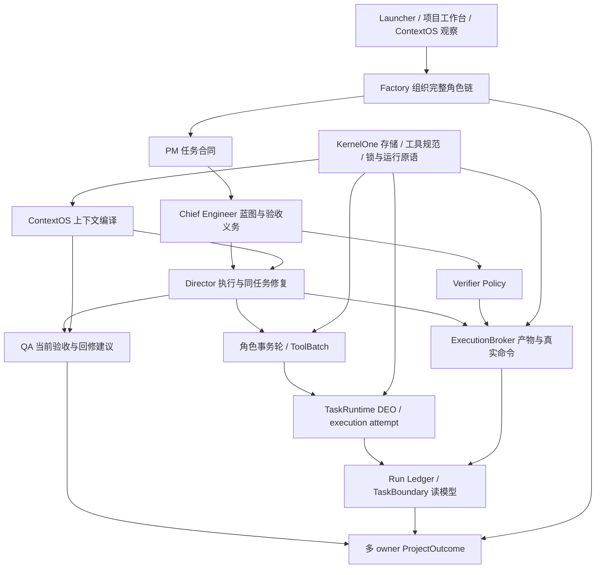
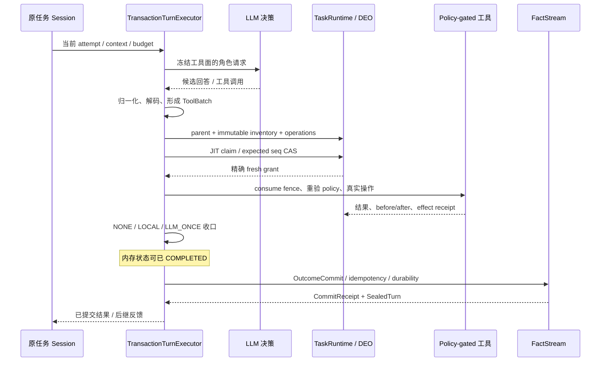
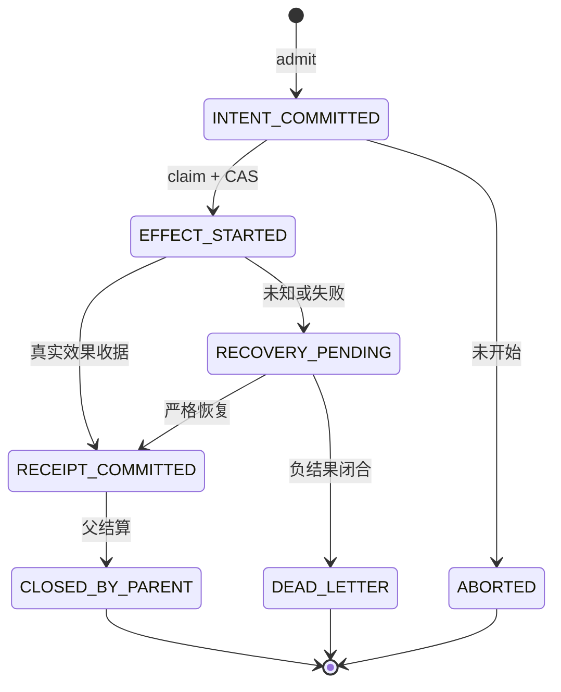
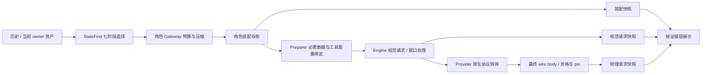
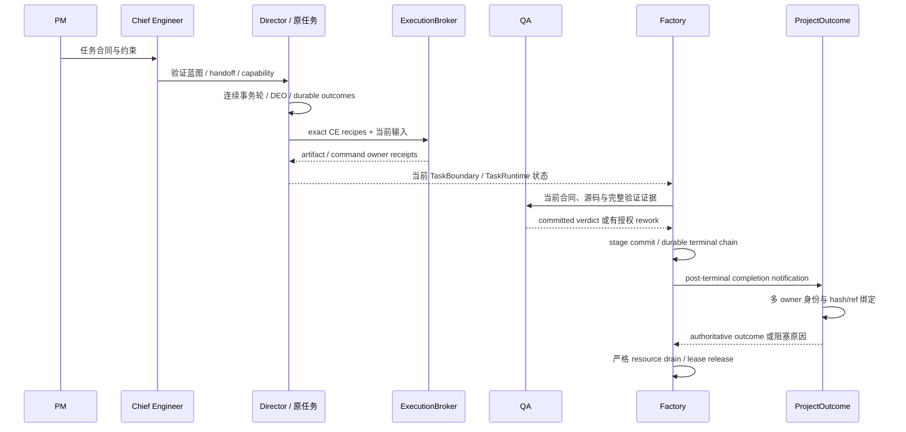
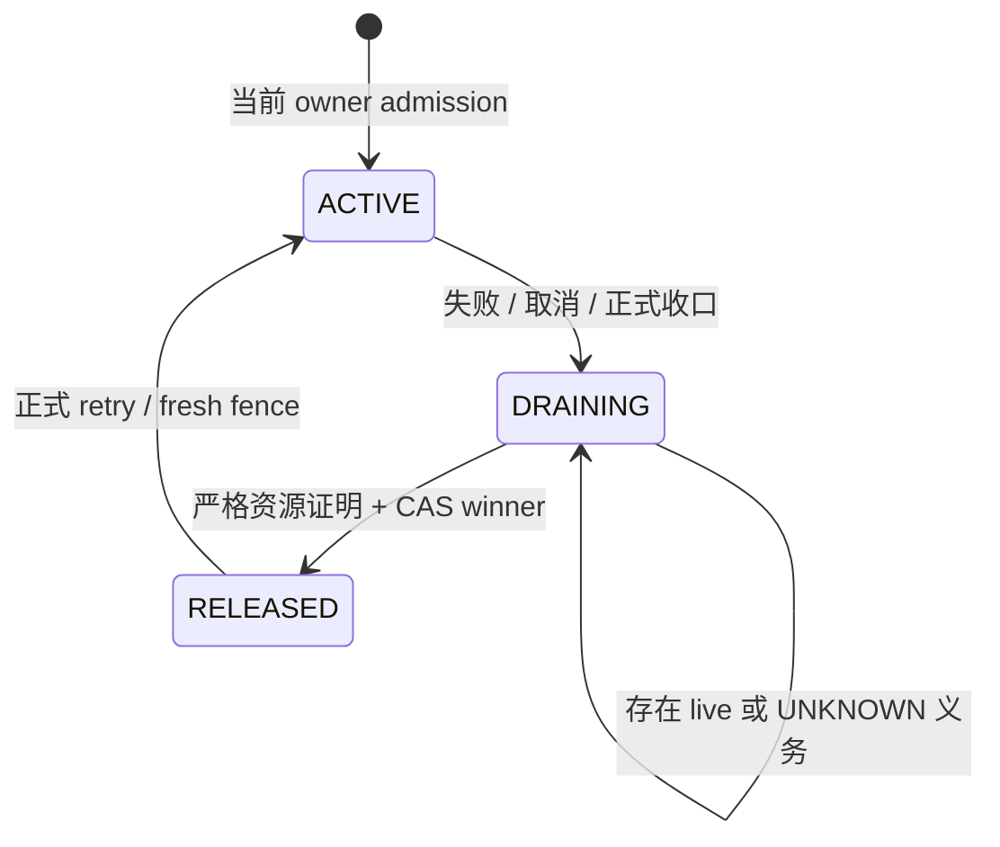

# Polaris：生成式决策与可审计工程执行之间的系统协议

> 工程系统分析论文 · 中文版 · 2026-10-14 观察基线
>
> 本文分析已有实现及已封存失败，未宣称经过同行评审、提出经证明的新算法、获得比较实验优势，或完成全部项目交付。基线为工作区 HEAD `cc0cb98315ff2903783feb33e2739d43ee1c4f9d` 与 148 文件源码集合，集合 manifest 为 `4a0357bed646c94aeb15fb41021e147b0d475e3a71951ab6531623d438d42df7`。这个工作区包含已核实的增量实现，不能将该组合写成一个完全已提交、可直接 checkout 的发布 tag。

## 摘要

大型语言模型可以提出方案、编辑代码和解释失败，但自然语言中的成功声明并不说明操作已经获得权限、确实发生、结果已经提交，或当前产物通过独立验收。Polaris 将这些判断分配给具有单一状态拥有者的组件，并通过身份、合同、能力范围、当前输入、工具效果及收据连接生成式决策与确定性执行。角色链采用 PM→Chief Engineer→Director，并由 QA 与多 owner ProjectOutcome 汇总交付；单轮执行采用 TransactionTurnExecutor、工具批次、Directed Effect Operation（DEO）与独立 OutcomeCommit；ContextOS 则负责把历史和当前事实编译成受预算约束、可追踪的角色输入。

本文依据当前源码、公开契约和封存观测，说明这些层如何协同，以及为什么“有文件”“工具成功”“轮状态完成”“任务完成”“Factory 结束”“资源可释放”均不足以单独证明交付。分析发现，现有机制的主要难点位于组合边界：上下文装配与最终 wire 并非同一对象；效果收据与轮结果存在独立失败窗口；当前验收与全历史资源闭合需要不同投影；严格存储的工作预算可能变成长期会话的增长上限。原项目第 12 个执行 epoch 仍因 exact ENTRY 失败及后继轮提交受阻而失败，独立语义 QA 未完成。这些反例支撑对协议边界的分析，不构成端到端可靠性认证。

**关键词：** 多角色工程系统；TransactionTurn；ContextOS；DEO；事件溯源；能力授权；执行收据；ProjectOutcome；失败恢复。

## 1. 问题、范围与证据等级

一个模型回答“修好了”，至少涉及四个不同命题：它提出了可用方案；平台允许方案中的操作；操作产生了预期副作用；当前项目满足合同及独立验收。它们的证明来源不同。提示词约束模型行为，却不能替代运行时路径门禁；工具返回值描述一次调用，却不能替代编译、测试与语义 QA；状态投影便于观察，却不能因为字段名为 completed 就获得上游事实的写权限。

本文把 Polaris 视为工程执行与治理系统，而不是新的通用操作系统或语言模型内核。研究对象包括 KernelOne 底座、Cell/public 契约、角色事务轮、上下文编译、任务执行、物理进程、控制面与交付汇总。内部 Bench 只作为故障生产者和观察手段，不承担生产项目状态的所有权。Launcher 中的原理图和论文是静态解释视图，不能产生运行事件或成为成功证据。

证据分为三层。第一层是当前源码行为，例如状态转换、参数校验、append 与实际构造点。第二层是封存的生产路径观测，例如真实命令退出码和提交错误。第三层是由源码推导的风险，例如某个汇总字段可能混合历史与当前窗口。第三层不能直接提升为实际故障，更不能把已发现根因提升为已修复。组件测试和独立源码评审提供局部反证，但不能证明所有任务、模型、语言与崩溃时序均可收敛。

## 2. 与已有方法的关联

ReAct 研究模型推理与动作交替；SWE-agent 强调为软件工程代理设计适合其使用的计算机接口；Reflexion 利用语言反馈和情节记忆影响后继尝试，而非更新模型权重。它们为决策、交互和反馈提供相关视角。本文关注的额外工程问题是：动作由谁授权、如何绑定当前事实、执行到哪一步、失败后还有哪些义务，以及谁有权给出交付结论。本文没有复现这些论文的实验，也不据此比较 Polaris 的性能或能力。[ReAct](https://arxiv.org/abs/2210.03629)、[SWE-agent](https://arxiv.org/abs/2405.15793)、[Reflexion](https://arxiv.org/abs/2303.11366)。

事件溯源有助于分离已发生事件与派生状态，保留历史并重建不同视图；外部系统重放还必须避免再次产生副作用。Polaris 的 FactStream、幂等键、执行收据和恢复协议可以在这一视角下理解，但系统也保留 mutable session、工作区文件与进程内状态，不能将全部系统称为纯事件溯源数据库。[Focusing on Events](https://martinfowler.com/eaaDev/EventNarrative.html)。

NATS JetStream 提供持久消息与基于确认的消费及重放。持久消息传输不能自动授予工具写权限，也不能将消费者重投递变成业务副作用恰好一次。Polaris 的实时观察使用 JetStream 与 runtime WebSocket；合同、效果和验收的事实仍由各 owner 提供。消息通道是运输与观察机制，不是万能事实裁决器。[JetStream 官方文档](https://docs.nats.io/concepts/jetstream)。

## 3. 分层架构与单一状态拥有者

Graph First 表示先从组件图确定合法依赖，再进入目录实现。Cell 是最小自治边界，跨 Cell 通过 public command/query/event/result/error 协作。Single State Owner 要求同一权威状态只有一个拥有者；读模型、缓存和 UI 可以复制必要信息，但不能自行修改原 owner 的事实。Bootstrap 负责组装 public ports，避免汇总组件通过 import 私有实现取得隐含权限。



| 层与 owner | 保存或决定什么 | 本层不能单独证明什么 |
| --- | --- | --- |
| PM、Chief Engineer | 任务意图、蓝图、接口、产物与 exact command 义务、handoff | 当前实现正确、命令已运行 |
| roles.kernel | 一轮决策、解码、工具批次与轮结果提交 | 整个项目已完成 |
| ContextOS | 历史、结构状态、活动视图、内容引用和请求审计 | 操作获得权限、引用内容已被模型阅读 |
| runtime.task_runtime | task/session/attempt、DEO intent/claim/receipt、任务执行事实 | QA 通过、全项目义务满足 |
| runtime.execution_broker | 真实进程、当前产物与 verifier owner 收据 | 任意 exit 0 都可作为合同证明 |
| control_plane.run_ledger | capability、effects、gates、TaskBoundary 与 evidence 的聚合读模型 | 上游收据可以由 summary 或缓存补造 |
| factory.pipeline | run/stage/checkpoint、工作区 claim、控制及终态清理 | operational completed 等于 verified delivery |
| runtime.projection | 只读 owner observation、纯 reducer 与 authority binding | 自填全绿字段即可获得 authoritative outcome |

KernelOne 为这些组件提供通用运行原语，角色协议仍归 roles.kernel，DEO 持久状态归 TaskRuntime，修复 catalog 与 scheduler 归 director.runtime。已有 ProjectOutcome 是多 owner 汇总器；因此不能把当前缺口描述成“平台没有统一状态机”，更不能另造第二套任务、授权或完成事实源。[S01]、[S17]、[S23]、[S24]

## 4. 形式对象：身份、授权、输入、效果与结果

为解释现有 DTO，本节使用分析记号，不引入新的产品 schema。一次执行的身份记为：

```text
A = (workspace, project, factory_run, child_run,
     role, task, external_task, session, attempt, worker)
C = (PM contract, CE blueprint, completion contract, handoff)
P = (capability scope, gate policy, policy revision)
I = (authored inputs, dependency identity, executable identity, input hashes)
E = (operation/member identity, normalized arguments, before/after state, receipt)
O = (TurnOutcome, commit receipt, task verdict, QA verdict, ProjectOutcome)
```

workspace 同时是存储和权限边界，一个后端进程绑定一个 workspace。多项目通过多个独立实例观察，不把 active workspace 拼成临时多租户事实层。task 是业务义务的身份，session 承载同一任务连续轮，attempt 区分一次 claim 与执行资格。新 session 可以替换当前 row，但不能抹掉旧 attempt 的效果。role 决定上下文身份与能力策略，不能仅靠一个 prompt 标签重建授权。

contract 描述义务，policy 描述允许的执行，input hash 描述本次实际验证的字节。effect receipt 证明副作用及结果绑定；outcome 汇总一轮或任务的结果。普通 SHA 只能校验绑定与一致性，不能独立证明来源可信，更不是针对任意恶意改写者的数字签名。授权还需可信 owner、当前 attempt、能力范围与精确状态检查。[S02]、[S05]、[S06]

CE 的 JobToken 从已验证项目合同派生 target/write/read paths、required artifacts、command authority hashes 与合同/蓝图身份。它不是另一个合同事实源。一个自然命令通过通用 capability 判断，仍不能直接计入验收：正式 verifier 必须绑定 exact argv/cwd、obligation、当前 input closure 与可信可执行文件。[S16]、[S18]、[S19]

应保持几个不同 token 的语义：LLM token 是窗口和输出容量；JobToken 是派生 capability；claim/fence 是精确执行许可；content ref 是文本取回索引；context_snapshot_ref 是真实落盘请求快照键。它们有时都包含 hash，却不能互相替代。字段含义应由契约决定，而不是从字符串长度猜测。

## 5. TransactionTurn 与 DEO 的实际协议

正式入口是 TransactionTurnExecutor 与 TransactionKernel，后者委托 TurnTransactionController。一次轮调用先验证 attempt 与装配，构建上下文和工具面，请求模型并解码，再按工具效果分组。模型提出候选调用；工具分类、授权和执行顺序由确定性代码决定。工具表、别名与参数先经 ToolSpecRegistry 归一化，再进入 scope、path、command 与 policy guard。自然参数兼容不是权限扩张。[S01]、[S02]、[S03]、[S38]



这里的 Plan 是工具批次执行计划，不意味着每轮还有独立规划模型。Speculate 也不是必经状态。流式 shadow 可以提前执行便宜只读调用，之后 ADOPT、JOIN 或 REPLAY；写工具的 shadow 只做只读 Prepare 探测，不能提前写入。推测能力默认启用，领养重算审计默认关闭，且是否实际触发受调用路径控制。“默认开关启用”不能证明每轮已推测、更不能证明推测写入。[S07]

正式 DEO Prepare 则是不同协议：先校验原 attempt，登记 parent，封存完整有序 inventory，绑定成员参数、scope 与 policy，再确认 readiness。JIT claim 在严格当前 stream head 上以 CAS 将 INTENT_COMMITTED 转为 EFFECT_STARTED，成功才获得可执行 grant。重复 claim 可以观察已发生状态，但 idempotent 命中不能被当成新的派发许可。[S04]、[S05]

fence 绑定精确 parent/member、normalized arguments、policy、当前状态、PID 和对象身份；在进程内注册并单次消费后，私有执行器才实施效果。物理操作已发生而效果收据提交失败，需要 recovery，而不是报成功或假设没有效果。尚未 claim 的操作可以 ABORTED；已开始操作不能通过 abort 撤销现实。rollback contingency 是另一个预授权补偿副作用，只有观察证明补偿成功才可宣称 restored。[S06]、[S08]



整轮完成与整轮提交是两条边界。controller 先执行 `_execute_turn()`，再调用 canonical outcome commit。因此内存 TurnState.COMPLETED 可以早于持久化。effect receipt、TurnOutcome、CommitReceipt 和 SealedTurn 也不是同一个对象；一个轮提交失败不说明此前所有工具都没发生。sessionful outcome 选择 fsync，sessionless 路径可能采用 buffered durability，不能概括为所有写入都立即 fsync。[S09]、[S10]

| 数据库术语类比 | 当前可确认机制 | 必须保留的限制 |
| --- | --- | --- |
| 原子性 | 单流锁下的 append/seq/idempotency；单操作 claim/receipt | 多文件、进程、网络没有共同原子 rollback |
| 一致性 | DTO、合同、hash、scope 与合法转换检查 | 合同一致不等于业务行为正确 |
| 隔离性 | stream 锁、CAS、owner lease、写前状态重验 | 未证明整个 workspace 可串行化 |
| 持久性 | durable events、按路径选择 flush/fsync、commit receipt | buffered 和物理效果之间仍有失败窗口 |
| 两阶段提交 | 先登记 inventory 后领取许可再执行 | 不是全部参与者 vote prepared 后的数据库 2PC |
| exactly once | 稳定 intent、幂等/CAS、一次 fence、恢复避免盲重 | 不保证任意外部副作用全球恰好一次 |

此外，`TaskBoard.transaction()` 的当前实现只持有进程内 RLock 并 yield；接口名称不能证明任意文件或外部操作可共同回滚。[S42]

这些限制不否定协议价值。其价值是缩小权限与重复派发窗口，并在无法确定现实结果时保留 UNKNOWN 和恢复义务，而不是把“不知道”强制转换成成功或未发生。

## 6. ContextOS：上下文编译与三个请求层

ContextOS 把 transcript、结构状态、项目资产、当前目标和工具结果编译为角色输入。默认 StateFirstContextOS 构造普通七阶段 PipelineRunner，并组合 TruthLogService、WorkingStateManager、ReceiptStore 和 ProjectionEngine。它不拥有任务执行、DEO 或交付状态，结构状态里一句 completed 不能替上游事实。[S11]、[S12]

七阶段依次是 TranscriptMerger、Canonicalizer、StatePatcher、BudgetPlanner、WindowCollector、EpisodeSealer、ArtifactSelector。它们合并事件、提取领域 hints、选择活动根与近邻、分配预算、封存退出窗口的片段，并形成 artifact stubs、anchors 与 Run Card。错误可能返回带 fallback 标记的投影；“返回了 messages”不等于每个阶段成功。

TruthLogService 保留进程内 journal 与可替换的活动视图；另一个 TurnTruthLogRecorder 才写磁盘观察日志，且记录是 best-effort。WorkingState 管理目标、计划、阻塞与来源 confidence，是结构化理解，不是 execution state machine。ReceiptStore 将大文本内容引用化，其 receipt 是内容取回索引，不能与 DEO effect receipt 混同。ProjectionEngine 排序、删选与压缩输出模型可读视图，不改变原事实。[S13]、[S14]



第一层角色装配快照证明准备了哪些 messages、来源与工具候选；第二层 Engine 快照证明 post-compression 规范请求；第三层 wire 快照才绑定 provider-native endpoint/body、transport、wire hash 和执行资格。Engine 和 provider 在装配后仍可改变内容，所以前两层不能替第三层。Anthropic 的 system 是顶层字段，Responses 使用 input，不能只审统一 messages[0]。[S15]、[S20]、[S21]

`/v2/context/{hash}/final-request` 兼容返回规范投影；没有真实物理 schema 时 final body 可以为空。HTTP200 或接口名称带 final 不足以证明物理请求已资格化。role_session final gate 能力存在，但需要显式 snapshot、生命周期和 drain 协调器；默认角色入口是否实际构造与传播必须沿调用链证明，不能把未接入说成能力不存在。[S22]

预算也有多层。StateFirst 选择预算保留输出、工具与安全余量；角色 Gateway 使用角色策略和模型窗口的较小上界，并优先保留当前指令；Preparer 将源码与验证数据放入独立数据消息并核对来源；Engine 再计工具 schema、消息包装与输出余量。角色指令预算 8k 和模型窗口 1M 可以同时成立，因为它们限制的对象不同。[S12]、[S15]

因此，无损保存、当前可见和预算内可发送必须分别判断。引用存在不意味着模型取回原文；缓存可被驱逐；freshness 标记未变不意味着旧内容经历后继裁剪后仍在窗口里。当前 token audit 是估算，不能代替 provider 实计 usage；窗口利用率也不能代替 required refs、角色身份和工具覆盖度。

RoleSignalPlane 是网关 supplement 装配点：按角色、flags、priority 与 freshness 读取已有 owner 资产并分配预算，不是常驻独立模型。EnhancedPipelineRunner、Akashic 四层 MemoryManager 和 IntelligentCompressor 有实现，但默认 StateFirst 使用普通 runner；默认角色主链的实际构造点未得到同等证明。ProjectionEngine 的自适应排序是进程内启发式权重反馈，不能写成在线模型训练或已认证的强化学习系统。[S14]、[S26]、[S27]

## 7. PM→CE→Director→QA 与多 owner 交付

完整链路通过合同传递责任，而不是把 PM 的文本直接交给 Director。PM 提供任务意图；CE 将其变成覆盖任务、接口与验收命令的蓝图，生成可消费的 handoff 与能力约束；Director 执行并产生真实效果；QA 对当前实现和验证证据给出独立判断。一次 stage 可以复用已验证范围并不调用模型，但明确要求语义 QA 时，physical verifier 模式和自测结果不能作为该语义判断的替代品。

修复并不总要重启 PM/CE。普通编译、测试或入口错误，应在原任务、原合同和已授权范围内产生 typed feedback，再由 Director 修复。若需要改变合同义务或跨 owner 扩大范围，则需要正式 rework authority，不能从错误信息临时推测新权限。`director.runtime` 拥有 repair catalog、coverage、planner、composer、scheduler 与 revalidation；adapter bridge 只绑定已声明 step，Factory 不另写语言规则或调度事实源。[S28]、[S29]

候选接受与 owner 完成也要分开。一个补丁修好 TEST，却暴露 ENTRY 缺失，可以在其它已通过 gates 保持、scope/command/authority 不漂移时保存增量，再继续同任务。候选有净进展并不意味着 task 应终态成功。反之，一律在所有验证尚未完成时 rollback，会丢失可验证进展。当前实现已有相关 convergence 机制；如何在每个调用路径正确消费其 typed verdict，仍是组合审计问题。

ExecutionBroker 在正式 verifier spawn 前重新解析 exact CE authority，再冻结声明输入、绑定 executable identity、input hash 和 proof profile。Verifier Policy 只判断 proposal 是否属于启用、可信的证明方式，不单独 mint 执行资格。一个脚本被允许执行、一个进程成功启动、一个命令 exit 0、一个 owner receipt 被 seal，是不同证据等级。[S18]、[S19]

干净 VerificationGroup 从 authored inputs 和当前依赖建立候选，先 build 再 type/test/entry，后续命令消费同一组派生输出。它避免宿主旧 dist 偷渡进新候选。即使前几个命令为 0，整组仍可能因为最后入口失败而未 seal；这些前置成功应保留为真实进展，却不能被称为全组权威通过。

项目最终接受已经由 ProjectOutcome 实现。纯 reducer 对调用者提供的六轴只计算 completion_candidate，保持 authority_bound=false 和 completed_verified=false。Bootstrap-bound adapters 通过各 public owner port 观察事实，校验 exact workspace/project/run/contract 身份、projection hashes 与 evidence refs，然后 authority binder 才能授予 completed_verified。[S23]、[S24]

| ProjectOutcome 轴 | 实际问题 | 需要的 owner 证据 |
| --- | --- | --- |
| delivery | 当前产物与物理义务满足了吗 | 当前合同、输入、全部适用 obligation、Broker/verification owner proof |
| chain | Factory 全链是否正式完成 | 配置 stages、成功 stage 与 durable completion event |
| QA | 当前独立审查通过了吗 | 当前 scope 下的 committed QA verdict 与约束 |
| TaskBoundary | 每个任务局部边界完整了吗 | 产物、依赖、missing/failed evidence 与 verifier 列表 |
| TaskRuntime | owner 任务是否收敛 | 原 task 身份、当前执行事实或严格全义务 physical proof |
| RunLedger | 证据与完整性是否闭合 | exact scope、capability、integrity/outcome、有效 missing/failed 集合 |

当前非 Factory owner adapter 不只检查绿色枚举，还要求每个 axis 的 owner hash 绑定在 evidence refs 中，并核对 CE covered tasks、当前 Director child runs 与全部适用义务。因此现有机制不是“模型自评后完成”，也不是“把任意六个 true 拼成接受”。同时，六轴汇总仍依赖 producer 正确产出当前事实；纯 reducer 的确定性无法弥补上游遗漏。[S24]、[S30]

## 8. 正常交付时序及其证明链



图示的是已有接口的主要依赖，不是把所有 I/O 放入一个大原子事务。某一步的异常可能晚于更低层效果发生；因此后继恢复必须先确认事实，而非从上层失败字符串推断“没有写过”。同样，QA 接受不能消除另一个尚未终止的请求，lease release 也不能把 QA 失败改成成功。

Factory 的 `complete_run(success)` 明确只闭合 orchestration lifecycle，保存 verified=false，且不能把已经 FAILED 的 run 升成成功。项目 completion notification 要等 Factory terminal event 已持久化再触发；否则汇总器读到未完成 chain，会把一个准备完成的候选正确判为 incomplete。通知失败应保留为控制面阻塞，不回滚已真实完成的低层效果。[S31]、[S32]

一个可追责链条可写为：最终请求 → 响应/工具生命周期 → 受权 effect receipt → 当前 verifier proof → TaskBoundary/TaskRuntime → RunLedger/QA → owner-bound ProjectOutcome → protected resource release。每个箭头都需要具体身份与引用。源码 whitelist、日志 preview、prepared QA prompt、成功状态摘要只属于辅助说明，不能跳过中间证明。

## 9. 失败恢复、安全性与活性

资源生命周期和业务验收不是同一条状态轴。工作区 lease 防止多个 Factory owner 同时修改同一 workspace，fencing_token 区分权限 epoch；stage claim 绑定一次阶段执行；lifecycle claim 则绑定 cancel、settle、recover、retry 等控制操作的 nonce、sequence 和 run。过期表示旧资格失效，不表示它启动的 provider、进程或效果已经停止。



当前 settlement barrier 中 release_allowed=closed。closed 要求观察到该 Factory、open lifecycle 为零，以及 missing evidence 时严格的 terminal failure dispatch closure。passed 另要求 run projection 正常、failed count 为零、required evidence 无 missing/failed。因此 closed=true、release_allowed=true、passed=false 可以是完全正确的失败清理结果。[S33]

资源安全需要检查全部 stable execution identities：新 attempt 覆盖当前 task row，并不删除旧 attempt 的 effects。验收当前版本则需要当前 CE contract、input 与 authority revision 的证明。旧失败要保留为历史，却不能仅因保留就假定它代表当前候选。当前 barrier 的 failed_count 混合最新任务状态与历史 tool failed_count，是需要明确消费语义的静态风险；最终 ProjectOutcome adapter并不直接读取该 barrier.passed，所以“历史失败 16 次”不足以证明最终接受必被毒化。[S30]、[S33]、[S34]

原终态清理先确认 physical requests、child sessions 与 effect 义务，再对齐 stage claim 和 ledger barrier；保存 frozen terminal TaskRuntime authority 后，才执行正式 reset(keep_plan=True) 和 lease CAS release。恢复需要从 immutable facts 与 frozen projection 找回原 task、session、CE tuple，不能因为 live row 已删除就新建另一任务掩盖问题。[S35]、[S36]

restart 后进程内 coordinator 不再存在，必须 replay immutable start/terminal，并在持有相应 lease authority 的情况下重读稳定 views/fence。一个空的新进程不能证明旧请求已结束。两种恢复 route 若互相拒绝对方的 expired claim，会造成 orphan deadlock；通用解法是精确 resume 原 terminal nonce，并保持 child quiescence、strict closure 与单次 CAS winner，不能手工清锁或改 TTL。[S35]

安全性要求宁可阻塞也不重复派发未知效果；活性要求可证明的终态与同 owner 后继修复能继续。两者并不天然等价：UNKNOWN 正确阻塞，是安全机制的表现；若已有严格负结果却永久不能释放，则是恢复组合缺口。有限模型预算、单轮 ceiling、deadline、资源 lease 和存储限额也分别限制推进。本文没有证明这些约束下所有任务必能最终成功。

## 10. 观察方法与真实失败案例

本次分析先从 Graph、public contracts 与 CodeGraph call-path 定位，再用专家核实的源码索引解释实际执行体；只对已封存的 first-failure 和 closure 观测作因果整理。研究没有重新启动原实例、请求 provider、执行目标命令或进行新的冷历史扫描。历史 read-only query 的耗时仅描述那次观察，不是可泛化性能实验。

| 案例 | 已观察边界 | 机制解释 | 当前能声称的范围 |
| --- | --- | --- | --- |
| F30：QA 指令预算 | 原第 10 epoch 将完整源码证据拼入 current instruction，QA 在 provider 前失败 | 角色指令预算与模型窗口不同；数据 dossier 应作为来源受控的独立 data slot | 当前源码已经有对应数据 slot 与覆盖校验；prepared 成功不等于语义 QA 通过 |
| F32：失败 run 的清理入口 | Factory 已失败、Task1 却 completed，缺 QA 等证据时旧 failure-only 谓词不能进入严格负结果闭合 | 任务局部终态与项目失败可以同时成立，closure 应按 exact canonical failure/dispatch proof 判定 | 局部修复与原严格只读 closure 已有证据；passed=false及历史失败保留，不冒称交付 |
| F34：completed owner 恢复 | 正式 reset 记录 prevcompleted，后继恢复仍要求 owner failed，原 Task1 在 admission 前失败 | reset、failed/completed 与恢复 checkpoint 需要同一 canonical identity 规则 | 当前148源码已支持对应同任务、同 CE 恢复，原第12 epoch确已进入后续质量路径；项目仍失败 |
| F35：轮结果 append | 原第12 epoch 质量修复出现 strict event stream append byte limit 错误 | 严格读页预算与 append 整个流的 lifetime cap 不同 | 已定位，当前未实施修复，不能写成已闭环 |

F35 的 `roles.kernel.turn_outcomes` 已落流为 8,354,716 bytes、47 帧；默认严格 append cap 为 8,388,608 bytes，仅剩 33,892 bytes。已落最后帧为 552,213 bytes。**最后帧大小不是本次未提交 encoded 帧大小；本文没有后者的独立字节证据，不作等同推断。** 当前源码仍在 append 时以“既有整流字节＋新编码帧”检查上限，合法长期历史会接近这一有限容量。[S10]、[S37]

原第12 epoch 的 clean authored-input Group 实际观察到 ENV、BUILD、TYPECHECK、TEST 退出为 0，exact ENTRY 为 1，编译产物路径不能满足已声明 CLI 入口。后续 Director 有七组新语义 start/end callback及只读结果，但新快照缺 final physical body/wire hash；真实物理请求数未知，不能报 0，也不能把七份快照当作七份合格 wire 证明。独立语义 QA 尚未执行，原项目仍 FAILED，整组未 seal。

该案例不是对模型能力的直接否定。入口配置是普通目标缺陷，本应由授权 Director 修复；轮结果提交失败和最终请求证据缺口属于平台组合边界。将二者都写为“模型没按格式输出”会阻止正确归因。同样，局部组件测试通过并不消除原项目尚未完成的 ENTRY、QA 与交付义务。

## 11. 架构成本与收敛原则

协议可靠性来自更多检查，也承担更多成本。一次 outcome commit 需要整理执行证据、序列化 payload、查幂等历史并 append；DEO claim 需要当前 head、成员身份与 policy 重验；strict closure 还要观察全部历史 attempts。源码中的 Factory barrier 查询说明，每个独立 attempt 的 owner-history 校验可累积为 O(A*T) 工作。分页限制内存页大小，不自动消除多次历史遍历。[S34]、[S37]

第一项成本是事实重复。task execution event 可能携带完整 row snapshot，角色 history、上下文、工具结果和 summary又包含相似内容。持久化每一步的全量视图便于恢复，却会扩大 I/O、序列化和扫描；一个 8MiB lifetime cap 与长期同任务运行可能因此发生冲突。后续优化应从 producer 的记录粒度、稳定 immutable prefix、per-frame/work budget 与完整验证边界出发，而不是关 strict 或无限放大上限。

第二项成本是身份传播。workspace、合同、task、session、attempt、authority、input hash 必须跨主执行、质量修复、QA rework、role session 和 restart replay保持一致。少传一个字段可能使正确效果被拒，多信一个缓存字段又可能绕过当前 owner。这里更需要 producer→consumer 的明确契约与真实组合反例，而不是继续加入路径专用 flag。

第三项成本是观察误差。内存 COMPLETED、best-effort truthlog、语义 snapshot、未 seal 的验证组都能提供进展，却缺少另一层完成证明。UI 应展示当前证据等级、缺失和失败，不应只选择最显眼的绿色字段。角色上下文也要保留当前失败与已通过 frontier，减少过期错误反复回灌。[S09]、[S15]、[S33]

可收敛的原则是：复用已有 Cell public 能力；使各执行路径使用同类 authority 与最终请求屏障；将资源 closure 与当前 acceptance 明确分开；保留失败历史与真实 UNKNOWN；为有进展候选提供 typed continuation；对压缩、引用与可选模块声明实际接入状态。最终仍要用一条当前合同下的真实项目链验证效果，而非将解释文档、局部测试或原理图当作运行成功。

## 12. 局限与结论边界

本文没有完成模型、语言或项目全集的比较实验，没有提供吞吐、延迟或成功率指标，也没有形式化证明全 workspace isolation、任意远程副作用 exactly once 或恢复必然终止。观察包含多个源码波次；已修的局部生产者、当前源码能力与旧失败记录分别标注，不能把旧记录当成新修复后的真实端到端成功。

ContextOS 的某些更强主张尚无依据。StateFirst snapshot→compute→commit 的注释提到 CAS，但当前验证并未完成强源版本比较；这是静态风险，本文未新增并发反例。缓存 eviction、best-effort 原文镜像与模块级进程内权重，也限制重启与多 workspace 情况下的保持性。Enhanced/Akashic 的组件实现、默认主调用接入和本次实际执行，是三个不同问题。[S11]、[S26]、[S27]

形式对象和状态图是现有协议的解释抽象，不是新的执行实现。DEO 动态加载 `.source` 文件是实际生产执行体；论文引用它表示可追到执行实现，不能反向把所有带 source/log/receipt 字样的对象当权威。源码行号可能随后续修订变化，应同时核对文件内容与工作区基线。[S08]

Polaris 已有将生成式 proposal 与副作用授权分离、保存效果及轮结果、按当前输入验证、通过多 owner 汇总交付的工程机制。尚未闭合的重点是这些机制在长期执行、不同调用路径及恢复时序中的一致组合。本论文记录这种已有能力及真实缺口，不宣称原项目已交付，也不以研究出版、页面上线或源码评审代替真实验收。

## 13. 源码复核路径

下列定位来自当前源码或专题专家核实索引；它们是可复核实现入口，不是接口永久稳定性承诺。复核顺序为角色调用→工具批次→DEO→OutcomeCommit→ContextOS请求层→verifier→Task/Factory→ProjectOutcome。只读查看源码与已落证据不需要运行原项目；若要执行新的复现，必须另行取得对应工程范围、实例绑定与控制授权。


- **[S01] TransactionTurnExecutor.execute_turn**：`src/backend/polaris/cells/roles/kernel/internal/kernel/transaction_turn_executor.py:62`。
- **[S02] kernel 装配与 attempt 冻结**：`src/backend/polaris/cells/roles/kernel/internal/kernel/transaction_factory.py:220`；`src/backend/polaris/cells/roles/kernel/internal/kernel/transaction_turn_id.py:182`。
- **[S03] ToolSpecRegistry 规范与别名快照**：`src/backend/polaris/kernelone/tool_execution/tool_spec_registry.py:446`。
- **[S04] DEO parent / inventory admission**：`src/backend/polaris/cells/roles/kernel/internal/directed_effect_lifecycle.py:420`。
- **[S05] JIT claim 与当前 stream head**：`src/backend/polaris/cells/roles/kernel/internal/directed_effect_lifecycle.py:886`。
- **[S06] PID / object-bound fence**：`src/backend/polaris/cells/roles/kernel/internal/directed_effect_dispatch.py:77`；`src/backend/polaris/cells/roles/adapters/internal/director/directed_effect_mutation_port.py:608`。
- **[S07] 推测与 adoption audit 默认**：`src/backend/polaris/cells/roles/kernel/internal/speculative_flags.py:14`；`src/backend/polaris/cells/roles/kernel/internal/stream_shadow_engine.py:148`；`src/backend/polaris/cells/roles/kernel/internal/speculation/write_phases.py:23`。
- **[S08] DEO 合法状态、实际 loader 与补偿**：`src/backend/polaris/cells/runtime/task_runtime/internal/directed_effect_operation/_repository_class.source:6707`；`src/backend/polaris/cells/runtime/task_runtime/internal/directed_effect_operation/_repository.py:51`；`src/backend/polaris/cells/roles/kernel/internal/tool_batch_runtime.py:755`。
- **[S09] 轮状态执行后 canonical outcome commit**：`src/backend/polaris/cells/roles/kernel/internal/turn_transaction_controller.py:729`。
- **[S10] TurnOutcome 提交与收据**：`src/backend/polaris/cells/roles/kernel/internal/transaction/outcome_commit.py:55`。
- **[S11] 默认 StateFirst 与 projection 验证**：`src/backend/polaris/kernelone/context/context_os/runtime/engine.py:491`；`src/backend/polaris/kernelone/context/context_os/runtime/engine.py:694`。
- **[S12] 普通七阶段 runner 与角色预算**：`src/backend/polaris/kernelone/context/context_os/pipeline/runner.py:97`；`src/backend/polaris/cells/roles/kernel/internal/context_gateway/gateway.py:281`。
- **[S13] TruthLog journal 与内容 ReceiptStore**：`src/backend/polaris/kernelone/context/truth_log_service.py:360`；`src/backend/polaris/kernelone/context/receipt_store.py:16`。
- **[S14] ProjectionEngine 与只读 RoleSignalPlane**：`src/backend/polaris/kernelone/context/projection_engine.py:375`；`src/backend/polaris/kernelone/context/projection_engine.py:551`；`src/backend/polaris/cells/roles/kernel/internal/context_gateway/role_signals.py:563`。
- **[S15] Preparer 必需数据、工具与 Factory candidate**：`src/backend/polaris/cells/roles/kernel/internal/llm_caller/request_preparer.py:1007`；`src/backend/polaris/cells/roles/kernel/internal/llm_caller/request_preparer.py:1453`。
- **[S16] CE JobToken 派生与 scope 约束**：`src/backend/polaris/cells/chief_engineer/blueprint/internal/ce_consumer.py:200`。
- **[S17] Cell 权属与 public 契约目录**：`src/backend/docs/graph/catalog/cells.yaml:106`。
- **[S18] Broker exact authority / spawn 再验证**：`src/backend/polaris/cells/runtime/execution_broker/internal/project_verification_authority.py:1310`。
- **[S19] Verifier policy proposal 与 proof profile**：`src/backend/polaris/cells/control_plane/verifier_policy/public/service.py:856`。
- **[S20] Engine post-compression 规范请求**：`src/backend/polaris/kernelone/llm/engine/executor.py:630`；`src/backend/polaris/kernelone/llm/engine/executor.py:1045`。
- **[S21] Anthropic 原生 system/messages 转换**：`src/backend/polaris/infrastructure/llm/providers/anthropic_provider.py:543`。
- **[S22] Role-session gate 与 final-request API**：`src/backend/polaris/cells/roles/kernel/internal/llm_caller/final_provider_attempt_gate.py:285`；`src/backend/polaris/cells/roles/kernel/internal/llm_caller/final_provider_attempt_gate.py:946`；`src/backend/polaris/cells/context/engine/public/service.py:188`。
- **[S23] 无 authority 的 ProjectOutcome 纯 reducer**：`src/backend/polaris/cells/runtime/projection/internal/project_outcome.py:15`。
- **[S24] 多 owner ProjectOutcome authority binder**：`src/backend/polaris/cells/runtime/projection/internal/project_outcome_authority.py:69`。
- **[S25] TaskRuntime canonical child settlement**：`src/backend/polaris/cells/runtime/task_runtime/internal/service/_mixin_recovery_reexec.py:620`。
- **[S26] EnhancedPipelineRunner 可选实现**：`src/backend/polaris/kernelone/context/context_os/pipeline/enhanced_runner.py:62`。
- **[S27] Akashic 显式 integration 与 memory manager**：`src/backend/polaris/kernelone/akashic/integration.py:48`；`src/backend/polaris/kernelone/akashic/memory_manager.py:138`。
- **[S28] director.runtime 的 repair schedule 与 coverage**：`src/backend/polaris/cells/director/runtime/public/service/_execution.py:825`。
- **[S29] 有 durable owner action 的 router rework**：`src/backend/polaris/delivery/http/routers/_factory_handlers/mapping.py:129`；`src/backend/polaris/cells/factory/pipeline/internal/factory_run_service/_service_core.py:886`。
- **[S30] 当前 ProjectOutcome 多 owner 汇总**：`src/backend/polaris/bootstrap/runtime_projection_project_outcome_owner.py:431`。
- **[S31] Factory complete_run 的 operational 定义**：`src/backend/polaris/cells/factory/pipeline/internal/factory_run_service/_service_lifecycle.py:1212`。
- **[S32] Factory terminal 后 completion notify**：`src/backend/polaris/cells/factory/pipeline/internal/factory_run_service/_service_physical.py:382`。
- **[S33] 资源 barrier 的 counts / closed / passed**：`src/backend/polaris/cells/control_plane/run_ledger/public/settlement_barrier.py:217`；`src/backend/polaris/cells/control_plane/run_ledger/public/settlement_barrier.py:726`。
- **[S34] 全部历史 attempt 的只读 closure**：`src/backend/polaris/cells/control_plane/run_ledger/public/service.py:1429`。
- **[S35] strict orphan resume 与 freeze/reset/release**：`src/backend/polaris/cells/factory/pipeline/internal/factory_run_service/_service_lifecycle.py:1409`；`src/backend/polaris/cells/factory/pipeline/internal/factory_run_service/_service_lifecycle.py:66`。
- **[S36] 最新 task facts 与当前 head 的 projection**：`src/backend/polaris/cells/runtime/task_runtime/internal/service/_mixin_task_rows.py:1510`。
- **[S37] 严格 read 与整流 append 字节上限**：`src/backend/polaris/kernelone/events/sourcing/file_store.py:613`；`src/backend/polaris/kernelone/events/sourcing/file_store.py:399`。
- **[S38] 捕获快照后的参数归一化**：`src/backend/polaris/kernelone/llm/toolkit/tool_normalization/__init__.py:410`。
- **[S42] TaskBoard.transaction 的进程内锁范围**：`src/backend/polaris/cells/runtime/task_runtime/internal/task_board.py:514`。

## 14. 参考文献

以下均为原始论文、作者原文或官方文档；它们支持相关方法与术语的讨论，不是 Polaris 的实验结果来源。

1. Yao, S. 等. **ReAct: Synergizing Reasoning and Acting in Language Models**. arXiv:2210.03629，2022，v3 2023。[原始论文](https://arxiv.org/abs/2210.03629)。
2. Yang, J. 等. **SWE-agent: Agent-Computer Interfaces Enable Automated Software Engineering**. arXiv:2405.15793，2024。[原始论文](https://arxiv.org/abs/2405.15793)。
3. Shinn, N. 等. **Reflexion: Language Agents with Verbal Reinforcement Learning**. arXiv:2303.11366，2023。[原始论文](https://arxiv.org/abs/2303.11366)。
4. NATS Authors. **JetStream**. 官方概念文档，访问日期 2026-10-14。[官方文档](https://docs.nats.io/concepts/jetstream)。
5. Fowler, M. **Focusing on Events**. 作者工程架构草稿，2006。[作者原文](https://martinfowler.com/eaaDev/EventNarrative.html)。

本论文与源码索引构成解释性材料。真实执行权限、效果、验收和释放仍由现有平台 owner 与契约决定；下载或打印本文不改变任何运行事实。
