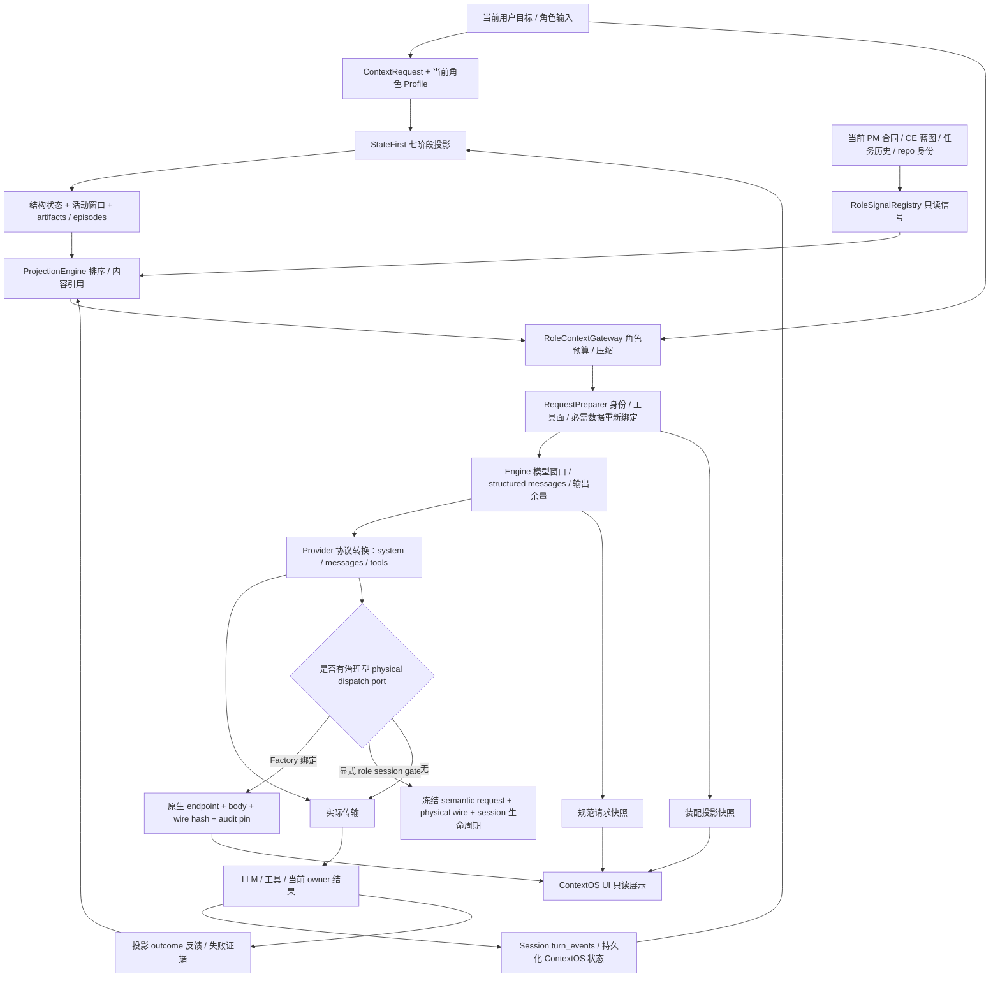

# Polaris ContextOS：状态优先的上下文编译、预算与请求证据

> **2026-10-22 后续候选**：Director实际请求尾部新增原host deadline、观测时刻和近似剩余秒数，每次现算，不累积到会话历史。为保持稳定前缀，原system不变；这不保证M3 cache命中或账单改善，也不是新的时间／权限authority。两个native codec真实loopback body与物理快照已核对，替代模型输出不证明真实交付或更优上下文。原生实验待启动，见 docs/blueprints/POLARIS_RUNTIME_BUDGET_VISIBILITY_20261022.md；本次只更新论文源文，未验证主Launcher加载。

> **2026-10-22 当前证据边界**：下文保留旧 StateFirst／TurnEngine 研究。新工程继续最终 provider request 审计与当前图片投影，并在原 SQLite 内按消费者需要读取 kind／role，不裁剪已持久化历史、不另建缓存事实源。真实新接口对照保留当前 3 图、工具和错误，局部视觉读取生成约 2.13→0.43 秒；不证明真实图像 token／账单减少或交付率提升。r05 仍失败，长期记忆暂不做；详见仓库 docs/blueprints/POLARIS_ENGINEERING_EVENT_SELECTION_20261022.md。

## 摘要

从 TruthLog、WorkingState、StateFirst 七阶段投影、RoleSignalPlane、内容引用及预算出发，逐层分析模型输入的生成与观测。区分默认链路、可选记忆组件、规范请求与最终 wire，说明信息损失、快照保留、并发验证和接入覆盖的实际限制。

关键词：Polaris；工程 Agent；状态拥有者；源码分析；执行证据

研究日期：2026-10-14。方法为源码、调用链与封存失败记录分析。以下机制的实现存在性、默认接入和端到端可靠性分别讨论。行号以本次工作区为准，源文件指纹随研究证据包提供。

## 1. 核心定位：有约束的上下文编译与观测

ContextOS 将原始会话、结构状态、资产、蓝图和工具结果转换成某个角色当前可使用的模型输入。其技术重点是**状态提取、选择、引用、预算、角色隔离、审计和回放**。它不是另一个操作系统，也没有仅凭名称就存在的独立“意识引擎”。执行权、任务状态、真实副作用与交付判定仍由各自的 owner、TaskRuntime、DEO 和 Run Ledger 管理；上下文中的一句“已完成”不能替代它们。

默认角色路径确实构造 `StateFirstContextOS`，后者构造普通七阶段 `PipelineRunner`，并组合 TruthLogService、WorkingStateManager、ReceiptStore、ProjectionEngine。RoleSignalPlane 位于网关的 supplemental turns 装配点。E12 · gateway.py:130（src/backend/polaris/cells/roles/kernel/internal/context_gateway/gateway.py:130） E03 · engine.py:491（src/backend/polaris/kernelone/context/context_os/runtime/engine.py:491） E05 · runner.py:97（src/backend/polaris/kernelone/context/context_os/pipeline/runner.py:97） E14 · projection_dict_builder.py:115（src/backend/polaris/cells/roles/kernel/internal/context_gateway/projection_dict_builder.py:115）

图中箭头表示数据流，不授予执行权限。会话状态和最终请求审计是不同持久化对象，不能混用 hash。E20 · request_preparer.py:1007（src/backend/polaris/cells/roles/kernel/internal/llm_caller/request_preparer.py:1007） E22 · executor.py:630（src/backend/polaris/kernelone/llm/engine/executor.py:630） E25 · factory_dispatch_propagation.py:390（src/backend/polaris/cells/roles/kernel/internal/llm_caller/factory_dispatch_propagation.py:390）

## 2. 四个底层模块分别保存什么

### TruthLog：会话上下文的原始记录与活动视图

**输入**是规范化会话条目。`append` 深拷贝后同时加入 `_journal_entries` 与 `_entries`；`replace_projection_view` 仅更新活动投影视图，保留 append journal。**变换**包括可选语义/关键词索引与按角色、类型、时间搜索。**持久化**必须谨慎理解：这个服务自身的两个列表在内存中，“journal”注释不表示它已成为平台磁盘 FactStream。**输出**是深拷贝 replay、journal 与搜索结果。**不变量**是投影替换不能覆写 journal、外部对象不能反向改内部数据。**失效边界**是进程内记录的生命周期、可选索引失败/队列满，以及是否由调用者实际 append。E01 · truth_log_service.py:360（src/backend/polaris/kernelone/context/truth_log_service.py:360） E60 · truth_log_service.py:99（src/backend/polaris/kernelone/context/truth_log_service.py:99）

另有真正磁盘写入的 `TurnTruthLogRecorder`：事务控制器根据 workspace 创建 `events/kernel.turn.truthlog.events.jsonl`，队列 writer 以 UTF-8 append；flush/shutdown 才显式 `fsync`。上游 recorder 初始化与记录调用是 best-effort，失败写 warning 后不必然中断角色执行。这是 turn 观察日志，也不能替代严格效果提交事实。E33 · correlation.py:111（src/backend/polaris/cells/roles/kernel/internal/transaction/correlation.py:111） E34 · truthlog_recorder.py:159（src/backend/polaris/cells/roles/kernel/internal/transaction/truthlog_recorder.py:159）

### WorkingState：结构化理解，不是执行状态机

**输入**为 transcript 和 domain adapter 的 state hints。**变换**提取 current goal、accepted plan、open loops、blocked-on、deliverables、偏好、事实、实体与决定，保存 source turns/confidence。**持久化**首先是 WorkingStateManager 内存状态；跨会话由 SessionContinuity 返回的 persisted context config 和上层会话保存流程承担。**输出**是结构状态、Run Card/头尾锚点及活动窗口的 pinning 来源。**不变量**是读写深拷贝、结构字段与来源可回查。**失效边界**是领域提取规则、字段上限、重建/序列化遗漏；结构中的“completed”仍只是上下文理解。E02 · working_state_manager.py:1（src/backend/polaris/kernelone/context/working_state_manager.py:1） E06 · stages.py:645（src/backend/polaris/kernelone/context/context_os/pipeline/stages.py:645） E32 · session_continuity.py:493（src/backend/polaris/kernelone/context/session_continuity.py:493）

UI 的 **WorkingMem** 是活动上下文窗口的展示名称。默认链路的实际窗口由 WindowCollector 选择，结构状态由 WorkingStateManager 管理。不能把 UI 卡上的 `WorkingMemoryWindow` 名称当作 Akashic 工作记忆已经被实例化的证明。另一个 `WorkingSetAssembler` 是仓库地图、符号、代码切片的有预算容器；本次全后端静态引用检查仅发现其实现、导出与示例，未发现默认角色运行构造点。E07 · stages.py:957（src/backend/polaris/kernelone/context/context_os/pipeline/stages.py:957） E48 · _model.ts:780（src/frontend/src/app/components/contextos/contextOSData/_model.ts:780） E51 · working_set.py:106（src/backend/polaris/kernelone/context/working_set.py:106）

### ReceiptStore：大文本内容引用

**输入**为搜索输出、文件切片、diff、工具结果或大信号。**变换**超过字符阈值后写 ContentStore，模型消息改成摘要/占位符及 receipt id。**持久化**默认为进程内 ContentStore 与 receipt-id 索引；可 export/import 内容，并由 offload hook 镜像到 workspace 命名空间的 OriginalPayloadCache。**输出**为可取回的原文引用。**不变量**是内容 hash/dedup、相同引用取回相同内容、工作区隔离。**失效边界**是容量回收、进程重启、best-effort 镜像失败、工具未提供取回能力。引用存在不意味着模型已阅读原文。E10 · receipt_store.py:16（src/backend/polaris/kernelone/context/receipt_store.py:16） E11 · content_store.py:58（src/backend/polaris/kernelone/context/context_os/content_store.py:58） E31 · original_payload_cache.py:364（src/backend/polaris/kernelone/llm/toolkit/original_payload_cache.py:364）

这里的“receipt”与 DEO 的不可变 effect receipt 是两个概念。ReceiptStore 的工具输出缓存可以保存失败信息，但不能凭字符串创建命令成功证明、写入授权或任务完成证明。

ContentStore 以 UTF-8 内容的 SHA-256 前 24 位作键，默认 500 项/50MB；先驱逐零引用，再按较低引用数与较旧访问时间驱逐。第二阶段可驱逐仍有引用的条目，因此引用计数不是永久存活承诺。OriginalPayloadCache 默认实例是进程内缓存，可选 SQLite 能力不能自动当作默认磁盘可靠性。E11 · content_store.py:58（src/backend/polaris/kernelone/context/context_os/content_store.py:58） E31 · original_payload_cache.py:364（src/backend/polaris/kernelone/llm/toolkit/original_payload_cache.py:364）

### ProjectionEngine：模型可读视图

**输入**为活动事件、头尾锚点、Run Card、补充信号、当前目标。**变换**去控制面噪声，按 patch/summarize/archive/clear、confidence、recency、dialog act、role priority 排序，工具调用因果组内部保持序号顺序；大结果引用化。**持久化**排序权重/outcome 使用模块级进程内桶；模型消息本身只是输出投影。**输出**为 system/user/assistant/tool messages。**不变量**是投影不修改 TruthLog/WorkingState，用户和 assistant 原话保留，模型 proposal 作为非权威引用处理。**失效边界**是排序、删选及引用造成的信息不可见，以及质量反馈只证明本地启发式效果。E08 · projection_engine.py:375（src/backend/polaris/kernelone/context/projection_engine.py:375） E09 · projection_engine.py:551（src/backend/polaris/kernelone/context/projection_engine.py:551）

自适应排序当前默认开启，可由 `ENABLE_PROJECTION_ADAPTIVE_ORDERING` 关闭。每个 learning key 保留最近 100 个 outcome，至少 5 个后调整权重；它是规则权重反馈，不是在线训练模型权重，也不等于已验证强化学习系统。网关 key 主要为 role id，状态进程内共享且不落磁盘。E58 · projection_engine.py:202（src/backend/polaris/kernelone/context/projection_engine.py:202） E09 · projection_engine.py:551（src/backend/polaris/kernelone/context/projection_engine.py:551）

## 3. StateFirst 七阶段如何把历史变成当前状态

| 阶段 | 真实输入与变换 | 输出与约束 |
|---|---|---|
| TranscriptMerger | 当前消息 + 已有 snapshot；以 event id 合并，增加 sequence，提取 native tool-call 元数据 | typed transcript；保留工具调用与结果的可追踪关联 |
| Canonicalizer | transcript + pending follow-up + 旧 artifacts；dialog-act 与领域路由 | patch / summarize / archive / clear、artifact、follow-up；不是执行 verdict |
| StatePatcher | 非 clear 事件的 domain hints | 带来源/confidence 的结构状态；规则提取质量限制理解能力 |
| BudgetPlanner | model window + 当前 transcript/artifacts + reserve policy | input/retrieval/output/tool/safety budgets、阈值与 validation error |
| WindowCollector | 结构状态根、最近消息、reopened/artifact roots、预算 | pinned/recent 活动事件与排除原因；有界窗口，必要时截短根内容 |
| EpisodeSealer | 退出活动窗口的事件 + open loops | episode cards；pending 与 seal guards 控制封存 |
| ArtifactSelector | 状态、artifacts、episodes、预算 | stubs、episode cards、head/tail anchor、Run Card、slice plan |

普通 runner 的顺序与 typed ProjectionReport 可回查。每个 stage 的异常可能触发 typed fallback，并记录 `ok=False/fallback_used/errors`；因此“成功返回 projection”不等于所有阶段执行成功。E05 · runner.py:97（src/backend/polaris/kernelone/context/context_os/pipeline/runner.py:97） E50 · runner.py:265（src/backend/polaris/kernelone/context/context_os/pipeline/runner.py:265）

StateFirst 的并发模式是 lock 下 snapshot、线程池 compute、lock 下 commit。源码注释称最后一步 CAS，但当前 `_validate_projection` 仅判 projection/snapshot 非空，没有比较源版本；而 compute 参数中的 engine snapshot 没进入 PipelineInput，后者依赖传入 `existing_snapshot`。报告不能把它描述为已实现强版本 CAS 或透明 replay 所有内存 journal。该问题是本次静态发现，未在原运行做并发反例，也未修改源码。E03 · engine.py:491（src/backend/polaris/kernelone/context/context_os/runtime/engine.py:491） E04 · engine.py:694（src/backend/polaris/kernelone/context/context_os/runtime/engine.py:694）

另有 `ImmutableSnapshot/SnapshotStore` 写一次加 SHA 校验的实现，`_create_snapshot` 只保存输入 hash 与有限 projection summary。在当前非测试源码引用中没有找到该方法被 `project` 调用；默认每次 project 自动落此审计快照的说法不成立。真正会话状态保存与真正 LLM 请求快照分别走 SessionContinuity 与 Engine/role invoker。E49 · engine.py:245（src/backend/polaris/kernelone/context/context_os/runtime/engine.py:245） E59 · snapshot.py:94（src/backend/polaris/kernelone/context/context_os/snapshot.py:94） E32 · session_continuity.py:493（src/backend/polaris/kernelone/context/session_continuity.py:493） E57 · _helpers.py:566（src/backend/polaris/cells/roles/kernel/internal/llm_caller/invoker/_helpers.py:566）

## 4. RoleSignalPlane：当前资产的只读补充管线

**输入**是角色、任务、context_policy flags，以及 project structure/task history/CE overview/blueprint step/verdict/repo identity/ownership/resident 的只读 reader。**变换**是 registry 按角色与开关选 provider，priority 排序，读取 content/freshness，逐块分配预算。**持久化**只记 injected signal 的 freshness；默认有界 256-key LRU，key 来自 task id。**输出**仍是 `supplemental_turns`，并记录 sources、offloaded/dropped/skipped 列表。**不变量**是信号不修改源资产，模型只有投影，源 owner 仍唯一。**失效边界**是 provider 缺失返回 None、任务 key 复用、压缩后仍记“已注入”与模型最终看到版本的偏差。E14 · projection_dict_builder.py:115（src/backend/polaris/cells/roles/kernel/internal/context_gateway/projection_dict_builder.py:115） E15 · role_signals.py:563（src/backend/polaris/cells/roles/kernel/internal/context_gateway/role_signals.py:563） E16 · role_signal_freshness.py:23（src/backend/polaris/cells/roles/kernel/internal/context_gateway/role_signal_freshness.py:23）

默认每信号 4000 字符、总 12000 字符，再按角色实际预算约 5%/15% 缩放。压力下未变化的 nice-to-have 不再注入；must-have 可卸载成原文引用。这会减少重复 CE/历史信息，但“来源未变所以不重发”只在模型保留此前信息时有效，后续截断可能破坏该假设。E14 · projection_dict_builder.py:115（src/backend/polaris/cells/roles/kernel/internal/context_gateway/projection_dict_builder.py:115） E15 · role_signals.py:563（src/backend/polaris/cells/roles/kernel/internal/context_gateway/role_signals.py:563）

Resident 能力信号来自配置注入的 provider；缺数据则不注入，roles.kernel 不反向拥有 resident 数据。能力面卡片表示可用接口与边界，不表示 Resident 已经运行过决策或自动改善模型。E53 · signal_sources.py:293（src/backend/polaris/cells/roles/kernel/internal/context_gateway/signal_sources.py:293）

## 5. 预算分层，为什么 8k 与 1M 能同时成立

1. **StateFirst selection budget**：实际模型窗口优先来自 ModelCatalog，再模型表，再调用者 fallback/默认 policy。普通 policy 输出 reserve 18%、工具 reserve 10%、安全 5%（均有下限）；另外分检索和活动窗口预算。这一阶段选择上下文。E56 · policies.py:36（src/backend/polaris/kernelone/context/context_os/policies.py:36）
2. **RoleContextGateway enforcement**：`min(role_policy.max_context_tokens, model_window * 0.85)`，先扣角色 system，再保留当前用户目标；超过当前目标剩余预算直接报错，历史/信号可以压缩。角色预算可以是 8k，而模型配置窗口为 1M，两者限制不同。E12 · gateway.py:130（src/backend/polaris/cells/roles/kernel/internal/context_gateway/gateway.py:130） E13 · gateway.py:281（src/backend/polaris/cells/roles/kernel/internal/context_gateway/gateway.py:281）
3. **RequestPreparer 必需数据再绑定**：当前 source/evidence 作为独立 user 数据消息加入，而不是变成巨大“当前指令”；检查 UTF-8 hash、重复路径、status/drift，再重新 pin sibling exports/write guidance/core role identity。它不凭数据赋予权限。E20 · request_preparer.py:1007（src/backend/polaris/cells/roles/kernel/internal/llm_caller/request_preparer.py:1007） E62 · request_preparer.py:437（src/backend/polaris/cells/roles/kernel/internal/llm_caller/request_preparer.py:437）
4. **Engine 模型预算**：再计 native tools、消息包装和输出余量，对真实 structured `chat_messages` 再压缩，按最终窗口 clamp 输出。角色装配结束之后仍可能改变真正发送内容，因此前置 audit 不能自动当最终 wire。E22 · executor.py:630（src/backend/polaris/kernelone/llm/engine/executor.py:630）
5. **Final request audit**：分别计 message/tool schema/response_format，合为最终输入估算和利用率，附 coverage/required refs。估算使用启发式，Gateway 的 CJK-aware 算法与审计字符算法不是同一个 tokenizer；这不是 provider 实计 usage。E19 · token_estimator.py:12（src/backend/polaris/cells/roles/kernel/internal/context_gateway/token_estimator.py:12） E24 · _builders.py:102（src/backend/polaris/cells/roles/kernel/internal/llm_caller/context_audit/_builders.py:102）

实际已发生的失败说明分层必要：原 epoch10 把完整 source dossier 拼进 current instruction，触发 8k 指令 guard，QA 在 provider 前失败。后续 source-only修复将其放独立数据 slot，并确认来源/hash/CE 正文和 coverage；prepared-only 成功仍不等于 QA 真实调用通过。

Gateway CompressionEngine 当前 `apply_compression` 主分支直接做 smart truncation/emergency fallback；docstring 的“先语义摘要”不能取代实际控制流。StateFirst 路径使用 emergency 截历史、必要时截大的 system 数据平面，当前角色身份 system 在后面插入以免被裁。故无损保存、模型当前可见、预算内可发送是三件不同的事。E17 · compression_engine.py:58（src/backend/polaris/cells/roles/kernel/internal/context_gateway/compression_engine.py:58） E18 · compression_engine.py:428（src/backend/polaris/cells/roles/kernel/internal/context_gateway/compression_engine.py:428） E13 · gateway.py:281（src/backend/polaris/cells/roles/kernel/internal/context_gateway/gateway.py:281）

## 6. 工具面和身份怎样进入模型

Role Profile 提供角色/模型/工具候选，运行态 ToolSpec/能力与当前合同形成 effective tool surface，transaction 可能提供 forced schema/choice。Preparer 格式化 native tools、response transport、温度/输出预算；最终确保当前目标、角色 system identity、当前 source/合同数据一致。Engine 和 provider 又做协议兼容转换。所有最终可调用工具必须与 runtime allowset 对账，角色 whitelist 不能替代实际 schema。E20 · request_preparer.py:1007（src/backend/polaris/cells/roles/kernel/internal/llm_caller/request_preparer.py:1007） E52 · tool_surface.py:146（src/backend/polaris/cells/roles/kernel/internal/transaction/tool_surface.py:146）

弱模型/legacy write-only/edit-only/slim 仍有显式分支，但受 legacy-tool-slices 与 committed continuation 条件控制；有 tool-filter audit 记录原因、原集合、裁后集合及与 prompt 必需工具的冲突。最终 request 若提供工具而 runtime 拒同一工具，属于面不一致；若 prompt 要求工具但 schema 没有，属于上下文与工具合同矛盾。模型输出经过 ToolSpec alias/argument normalization 后才进权限层，不能把自然字段差异直接归因模型能力。E52 · tool_surface.py:146（src/backend/polaris/cells/roles/kernel/internal/transaction/tool_surface.py:146）

Anthropic provider 把角色消息转换成顶层 `system` 和原生 `messages`，再附 tools/options、overrides 与 sanitization；OpenAI Responses 使用 input，Chat 使用 messages。查看 `messages[0]` 并不足以审 Anthropic 真实 system，必须查原生 body 的 protocol。E27 · anthropic_provider.py:543（src/backend/polaris/infrastructure/llm/providers/anthropic_provider.py:543） E28 · service.py:188（src/backend/polaris/cells/context/engine/public/service.py:188）

## 7. 三种请求快照必须分清

| 证据级别 | 实际存储 | 能证明 | 不能证明 |
|---|---|---|---|
| 角色装配投影 | invoker 在 call_start 前保存 messages + provider_request/audit | 角色准备输入、来源与审计；可缺失并标 degraded | Engine 后续裁剪、provider 转换与真实 HTTP body |
| Engine 规范请求 | `llm.provider_request_snapshot.v1`，post-compression messages + schema 摘要/choice/format/token audit | Engine 准备传给 provider 的规范内容 | 原生 endpoint/body 最终字节、headers/options 转换、实际发送成功 |
| 原生 wire 资格快照 | `llm.final_physical_provider_request_context.v1`，exact redacted endpoint/body/transport/wire hash + route authority/pin | 发送边界冻结内容与资格绑定；原生 system/messages/tools | Provider 实际收到/处理完成、工具效果或产品交付成功 |

上述 `llm.final_physical_provider_request_context.v1` 展示快照来自绑定的 Factory semantic propagation port：preparer 的 Factory candidate + signed binding 创建端口，Engine 将其带到 transport；没有端口时所审HTTP helper直接 raw send。**这不等于非Factory没有wire治理能力**。平台还实现了 `FinalProviderAttemptGate.for_role_session`：必须传显式 snapshot_store、session生命周期与drain协调器，保存 `llm.frozen_final_provider_attempt.v1` 的 canonical semantic request及physical_wire，记录terminal失败/确认；它不能冒称Factory scope。其当前wire-equivalence按messages/tools/choice/format逐键比对，区别于Factory provider-native协议资格。此次非测试引用检查未找到默认角色入口构造该session gate的调用点，因此结论限于具体传播/集成缺口，不能把潜在能力不存在当根因。E66 · final_provider_attempt_gate.py:285（src/backend/polaris/cells/roles/kernel/internal/llm_caller/final_provider_attempt_gate.py:285）、E67 · final_provider_attempt_gate.py:946（src/backend/polaris/cells/roles/kernel/internal/llm_caller/final_provider_attempt_gate.py:946）E21 · request_preparer.py:1453（src/backend/polaris/cells/roles/kernel/internal/llm_caller/request_preparer.py:1453） E22 · executor.py:630（src/backend/polaris/kernelone/llm/engine/executor.py:630） E23 · executor.py:1045（src/backend/polaris/kernelone/llm/engine/executor.py:1045） E25 · factory_dispatch_propagation.py:390（src/backend/polaris/cells/roles/kernel/internal/llm_caller/factory_dispatch_propagation.py:390） E26 · _http_pooling.py:270（src/backend/polaris/infrastructure/llm/providers/provider_helpers/_http_pooling.py:270） E57 · _helpers.py:566（src/backend/polaris/cells/roles/kernel/internal/llm_caller/invoker/_helpers.py:566）

`context_snapshot_ref` 是真实落盘的 24 hex 内容地址键，位置为同 workspace runtime 的 `contexts/<shard>/<hash>`；并非 call id、request hash、prompt hash 或路径。`request_hash` 绑定请求身份，`final_physical_wire_hash` 绑定 wire 内容，而 `receipt://` 与 ContentRef 绑定文本资产；DEO效果收据另有op/owner/attempt/physical payload hash等绑定。文本引用与24hex快照即使长得像效果hash，也不能作效果提交/封闭证明；原样保留各契约字段，不从长度猜用途。E30 · context_store_retention.py:114（src/backend/polaris/kernelone/llm/engine/context_store_retention.py:114） E31 · original_payload_cache.py:364（src/backend/polaris/kernelone/llm/toolkit/original_payload_cache.py:364）

`/v2/context/{hash}/final-request` 可返回 available 的规范投影，也可返回实际 wire。API 会从真实物理 schema 中解析 Anthropic system/messages、Responses input；没有物理 schema则 `final_physical_request_body=null`。HTTP200 或“最终请求”标题不是第三层证明。E28 · service.py:188（src/backend/polaris/cells/context/engine/public/service.py:188）

原 epoch12 的审计反例已封存：7 次新角色 start/end 与 7 个可读磁盘语义快照，11 个成功只读结果及 6 个 file_exists scope 拒绝；所有新快照缺 `final_physical_request.body` 与 wire hash。真实物理发送数量未知，不能写成 0，也不能把 7 份语义快照当 7 个 qualified wire。独立 QA 尚未执行；当前项目未交付。报告：`native18-epoch12-independent-qa-wire-gap.json`，SHA `6f19d7bab910450168470897ac06867c5c82e9ca64621f11fa7e4ca08160ca2c`。

## 8. 记忆、RAG 与常驻能力：哪些真正接入

| 名称 | 真实实现/接入分类 | 限制 |
|---|---|---|
| 默认 StateFirst | 角色 gateway 与会话连续性生产路径 | 规则 hints、有限窗口、fallback；不自动等于长期语义记忆 |
| ProjectionEngine 自适应排序 | 默认开启，当前 turn outcome 有反馈调用 | 进程内启发式权重，不是模型训练；未证明跨重启或全工作区隔离 |
| ContextOS MemoryManager | aggregate role 路径按触发/limit召回会话 snapshot | 当前是关键词 Jaccard + 英文规则冲突检查；不是 embedding RAG |
| role_session provider gate | 显式snapshot store + scope/drain/lifecycle，保存物理wire | 平台能力存在；默认入口传播/捕获需单独证明，不可冒Factory资格 |
| Akashic 四层 MemoryManager | Working/SemanticCache/Episodic/Semantic ports、promotion/demotion 与 sync 实现完整存在 | create/default/inject API未见默认角色主链调用；不能宣称所有调用有后台记忆维护 |
| AkashicSemanticMemory | JSONL + 可选 embedding/LanceDB，embedding失败时关键词回退；TruthLogIndex可调用 | 依赖已配置 embedding服务；vector_search=True不证明可用、也不证明被模型消费 |
| Knowledge Pipeline | 文档 extract/chunk/enrich/embed/idempotent store，CLI/显式消费组件 | 文档入库与当前模型检索/引用是两步；未证明默认角色每次自动RAG |
| EnhancedPipelineRunner | 有 phase-aware/attention/graph/memory/predictive组合实现 | 默认StateFirst选择普通Runner；本次未找到生产实例化 |
| phase/attention/predictive | aggregate role另有直接构建 pack的路径 | 局部提示/计划投影存在，不等于所有角色热路径预测压缩 |
| IntelligentCompressor/crushers | greedy score/LLM summary/确定性内容类型压缩实现 | 本次未找到默认角色主链构造IntelligentCompressor；不能替代现CompressionEngine真实流程 |
| WorkingSetAssembler | repo map/symbol/code slices、policy-gated预算组件 | 生产构造点未证，不等于UI WorkingMem |
| Resident | workspace service、显式start/stop、tick生成insights/skills/proposals、RoleRuntime决策入口 | 默认active=False；tick是确定性证据生产者，不允许sidecar LLM，提案需治理与执行链 |
| ContextOS UI | WebSocket runtime事件、context.build/LLM audit派生视图与按需读完整快照 | 估算窗口/调用数、provider-ready卡不能证明底层算法活跃或语义通过 |

Akashic 与 ContextOS 两个不同的 `MemoryManager` 必须分别介绍。aggregate 实际 import的是 `context.context_os.memory.MemoryManager`；后者的候选从会话 manifest/snapshot读取、按当前事实做 conflicts，再决定是否注入。当前规则允许“possible conflict但高相关”注入，不能宣传完整逻辑一致性证明。E35 · integration.py:48（src/backend/polaris/kernelone/akashic/integration.py:48） E36 · memory_manager.py:138（src/backend/polaris/kernelone/akashic/memory_manager.py:138） E37 · semantic_memory.py:64（src/backend/polaris/kernelone/akashic/semantic_memory.py:64） E38 · manager.py:43（src/backend/polaris/kernelone/context/context_os/memory/manager.py:43） E39 · candidates.py:85（src/backend/polaris/kernelone/context/context_os/memory/candidates.py:85） E40 · candidates.py:220（src/backend/polaris/kernelone/context/context_os/memory/candidates.py:220） E41 · conflict_checker.py:66（src/backend/polaris/kernelone/context/context_os/memory/conflict_checker.py:66） E42 · _memory.py:153（src/backend/polaris/cells/roles/runtime/public/aggregate_chat/_memory.py:153） E43 · _memory.py:294（src/backend/polaris/cells/roles/runtime/public/aggregate_chat/_memory.py:294） E44 · enhanced_runner.py:62（src/backend/polaris/kernelone/context/context_os/pipeline/enhanced_runner.py:62）

文档入库的真实流程是 DocumentInput，经 extractor registry、semantic chunker、importance/hash/tags、embedding，再写 IdempotentVectorStore；默认workspace runtime JSONL，可选LanceDB。输出的 memory_ids 是入库记录，不是当前角色已经召回的上下文，也不是 Provider 已看到的证据。无 fragments/chunks 直接 failed；源文件/行号/hash随记录保留。E63 · pipeline.py:311（src/backend/polaris/kernelone/akashic/knowledge_pipeline/pipeline.py:311）、E64 · pipeline.py:235（src/backend/polaris/kernelone/akashic/knowledge_pipeline/pipeline.py:235）

Akashic CompressionDaemon 根据 WorkingMemory usage ratio触发压缩，调用 RoleContextCompressor，失败后可用确定性压缩/eviction并重写窗口；create_memory_manager内 enable_daemon=True只是该API默认，不证明默认Factory/角色运行调用过该API。它是可显式启用的后台组件，本文没有启动或查询原daemon。E65 · compression_daemon.py:234（src/backend/polaris/kernelone/akashic/compression_daemon.py:234）

静态还有一个具体绑定风险：`context_os.memory.MemoryManager.workspace` 未传入默认 `_provider=MemoryCandidateProvider()`，后者默认workspace='.'；aggregate 构造 manager(workspace=...) 不自动改变 provider 的默认工作区。此处未做原namespace查询或调用反例，只列源码已见风险，不能以“workspace隔离完全可靠”宣传。E38 · manager.py:43（src/backend/polaris/kernelone/context/context_os/memory/manager.py:43） E39 · candidates.py:85（src/backend/polaris/kernelone/context/context_os/memory/candidates.py:85）

Resident 的持久化服务真实存在；默认inactive，tick只产 evidence/proposals，execution-impacting判断必须经独立 runtime contract gate。能力信号说明可调用哪些治理接口，不代表自动代码修改、在线训练或后台已常驻；当前是否start必须查实际运行状态，本文不查询或改变它。E45 · autonomy_boundary.py:8（src/backend/polaris/cells/resident/autonomy/internal/autonomy_boundary.py:8） E46 · resident_runtime_service.py:116（src/backend/polaris/cells/resident/autonomy/internal/resident_runtime_service.py:116） E47 · resident_runtime_service.py:464（src/backend/polaris/cells/resident/autonomy/internal/resident_runtime_service.py:464） E53 · signal_sources.py:293（src/backend/polaris/cells/roles/kernel/internal/context_gateway/signal_sources.py:293）

## 9. 回放与保留：三个存储等级

**会话连续性**保存 ContextOS transcript/artifacts/episodes/pending/working state 到上层 session context config，后续 rehydrate；这是重建当前状态的数据。**内容引用缓存**保存大文本，进程内容量/TTL可能让原引用失效。**LLM请求审计存储**按内容地址写 runtime/contexts，完整 wire pin 使用独占锁、workspace storage token、不可变写入和读后核对。E32 · session_continuity.py:493（src/backend/polaris/kernelone/context/session_continuity.py:493） E10 · receipt_store.py:16（src/backend/polaris/kernelone/context/receipt_store.py:16） E11 · content_store.py:58（src/backend/polaris/kernelone/context/context_os/content_store.py:58） E30 · context_store_retention.py:114（src/backend/polaris/kernelone/llm/engine/context_store_retention.py:114）

请求 retention 有 TTL、文件数和总字节上限，默认7天/500MB，pin repository决定是否可删除；过期不等于可删当前受保护资格证据。查询按当前storage runtime、同workspace Instance Registry runtime、旧system cache候选链找文件，旧根只读发现，不复制或活跃切根。E29 · snapshot_paths.py:24（src/backend/polaris/cells/context/engine/public/snapshot_paths.py:24） E30 · context_store_retention.py:114（src/backend/polaris/kernelone/llm/engine/context_store_retention.py:114）

上下文 replay 只能重建模型当时可见视图及来源；若副作用要重试，仍须 TaskRuntime/DEO 独立证据，不能 replay 缓存工具结果就再次认定命令执行。当前 epoch12 严格 append总字节限制阻 turn outcome提交，也说明工具/read发生、观察日志存在、严格提交完成是不同边界。

## 10. 独特性与当前瓶颈

有实装价值的组合是：领域状态优先而非盲堆历史；保留 source-turn根与工具因果组；当前资产 freshness减少重复；大文本引用化并能同workspace取回；角色策略预算与真实模型窗口分层；最终 raw provider body绑定资格/pin；UI只读事件投影。每一项都可以由当前代码确认。它们组合成可解释的上下文治理层，但不能据此推导“全自动交付已经完成”或“记忆系统无损理解一切”。

当前主要瓶颈分别是：多层裁剪可能使已保存的内容不再可见；引用取回并非永久承诺；默认 StateFirst版本校验不足；部分长期记忆组件尚未进入默认链路；关键词/规则理解能力有限；角色key/taskkey的进程内缓存隔离范围较粗；Final-request API仍兼容只含规范投影的快照；内部修复的最终wire证据覆盖缺口已在真实epoch12出现。优先解决顺序需由后续工程授权决定，本次仅解释与记录，不启动修复。

## 11. 证据与方法

所有源码 discovery 先调用 CodeGraph；本次多个查询输出未覆盖目标模块，随后用 RTK UTF-8 精确范围读取补足。无 Transport closed、无伪造图结果。负面接入分类来自明确构造点/引用检查，是静态证据；不能证明动态插件永远不可能接入。没有新增测试、provider probe、原目标命令、公共冷查询或控制动作。当前保存各相关源码 SHA，外部报告不是产品事实源。
