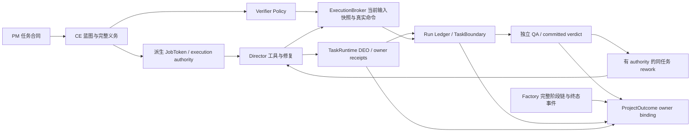
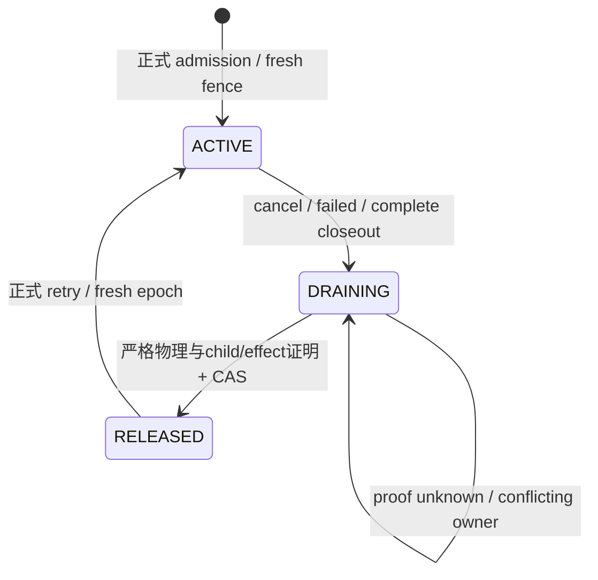

# Polaris 控制与交付：多拥有者证明、验证与恢复

## 摘要

以 PM、Chief Engineer、Director、QA、TaskRuntime、ExecutionBroker、Run Ledger 和 ProjectOutcome 的实际所有权为对象，解释合同、能力、执行、收据、验收、结算与恢复如何组合，并区分当前产物接受与全部历史资源闭合。

关键词：Polaris；工程 Agent；状态拥有者；源码分析；执行证据

研究日期：2026-10-14。方法为源码、调用链与封存失败记录分析。以下机制的实现存在性、默认接入和端到端可靠性分别讨论。行号以本次工作区为准，源文件指纹随研究证据包提供。

## 1. 谁拥有哪一种真相

Graph catalogue 规定 single state owner 与跨 Cell public contract 边界。目录位置不能替代 Graph 的权属定义；bootstrap 可以组装多个 public owner ports，但消费者不能因此直接接管上游状态。

| 组件 | 拥有的状态/事实 | 提供的能力 | 不能单独证明 |
| --- | --- | --- | --- |
| PM / orchestration.pm_planning | 任务意图、验收约束、拆分 | 规划合同 | 实现已正确、命令已执行 |
| Chief Engineer / chief_engineer.blueprint | 蓝图、接口、产物与命令义务、handoff | 校验完整合同、派生执行范围 | 目标当前字节已达标 |
| Factory / factory.pipeline | run/stage、checkpoint、workspace owner claim、stage/lifecycle transaction | 组织完整角色链、恢复及终态清理 | Factory `completed` 不是 verified delivery |
| runtime.task_runtime | numeric task、session/attempt、DEO parent/inventory/operation/receipt、执行事实 | 持久 claim、工具副作用授权与收据、同任务恢复；进程内一次消费 fence 由角色内核执行 | 一个 task completed 不代表项目 QA 与全部合同通过 |
| events.fact_stream / KernelOne | 序号、完整性、幂等、append/query/CAS 的底座 | 保存、验证与重放 owner 发布的事实 | 不替 owner 判断业务结果 |
| control_plane.run_ledger | 控制面事实的读模型及可重建 ledger 投影 | capability/effect/gate/TaskBoundary/evidence 聚合 | 某条 JSONL 行或 summary 不能替上游 owner 收据 |
| control_plane.verifier_policy | 可用 verifier profile、proof semantics、workspace policy | 判断命令能否成为验收证据 | policy authorized 不是执行权或 PASS |
| runtime.execution_broker | 真实进程、当前产物及 verifier 收据 | 受权启动、快照隔离、执行与终止、持久化 proof | 进程启动或 exit 0 不一定满足指定 proof |
| director.runtime | repair catalog、coverage、planner/composer/scheduler、policy execution/revalidation | 在批准范围内实施并验证修复 | coverage match、plan 或 advisory 不是已修改/已通过 |
| QA / qa.audit_verdict、roles.adapters | 按配置选择的独立判断与 QA owner 证据 | 审核当前实现及验收结果，提出 rework | 自测、准备好的 prompt、候选 verdict 不是 committed QA |
| runtime.projection | 无上游事实写权限；有纯 reducer 与 owner observation/binding | 六轴 ProjectOutcome | caller 自填全绿不能得到 authoritative completed_verified |

目录与 contract 的原始 Graph 证据已保存于 `control-analysis-baseline.json` 的 `cells`。当前大多数跨层查询通过 public DTO/port；少数兼容型 service/class 入口仍使调用面比 Graph 的精简 query inventory 更大，不能把目录迁移或 public 命名自动视为全部边界已证实。

## 2. 正常执行链不是四个模型顺序聊天



PM 合同决定“做什么”。CE 明确“谁拥有哪些产物、如何验收、哪些上下文可读”，并产生 Director 可消费的 handoff。Director 必须在已验证 CE 范围内执行。正常执行允许复用已经验证的产物、完成任务或确定性修复，因此某阶段可以没有新 LLM 请求；这不等于跳过该角色的权属。若本次明确要求语义 QA，则必须选择实际 LLM QA 能力，不能用 physical verifier QA 模式替代。

CE 的 `_control_plane_job_token` 不只拼路径：它从完整合同提取 required artifact owners、每任务 command authority hashes、批准的 read context；验证 run/task 身份、interface hash、target/scope 是否仍属于该 owner。token id 从这些事实派生。可读上下文与可写产物是两种权限，不能因模型需要阅读兄弟接口就扩大写范围。

源码：CE token 派生（src/backend/polaris/cells/chief_engineer/blueprint/internal/ce_consumer.py:200）、JobToken DTO（src/backend/polaris/cells/control_plane/run_ledger/public/job_token.py:10）。

## 3. JobToken、claim、grant、receipt 是四件事

JobToken 表达由控制面合同派生的 capability，不是新的合同事实源，也不是某个任务已成功的证据。执行时还需要当前 owner/session/attempt 和 lease。DEO claim 产生一次操作的 fresh grant，grant 约束允许执行的 effect，receipt 才描述实际发生的 effect 与结果。

身份至少同时跨越 `workspace/project/factory_run/child_run/task/external_task/session/attempt/role/worker`，并绑定合同、蓝图、policy、目标与输入 hash。只保留 `task_id=1` 或只保留 `run_id` 都不足以重新获得权限。模型输出的“已写入”也不能替代真实 before/after hash、DEO member/parent 与 durable commit。

命令有两个不同判断。KernelOne command capability 可以判断一个自然命令是否在允许集合内；该集合存在兼容型 prefix 与空集合语义。正式 verifier 则必须进一步绑定 CE 的 exact argv/cwd、obligation、输入闭包、可信可执行文件和 proof profile。不能从“工具层允许运行”直接推出“这次运行可计入验收”。

源码：command capability（src/backend/polaris/kernelone/llm/toolkit/executor/command_capability.py:201）、正式 verifier authority（src/backend/polaris/cells/runtime/execution_broker/internal/project_verification_authority.py:1310）。

## 4. 物理请求控制为什么需要独立的一层

语义 request 与最终 wire body 不同。provider 适配器会转换 messages、tools、tool choice 等；只审准备阶段的 request 会漏掉最终工具被裁剪、角色串线、参数变更或预算差异。

现有 `FinalProviderAttemptGate` 的正确顺序为：冻结最终 wire → 持久化并 pin snapshot → 获得 start permit → durable start receipt → commit started → 才允许 transport dispatch → cleanup → durable terminal receipt → settle。取消调用协程不能提前把仍运行的 blocking transport 标为结束；worker 保留 terminal settlement 的所有权。start persistence 含糊时也不能重新发一次请求碰碰运气。

Factory coordinator 用 execution authority hash 绑定 grant/budget、角色、run、request freeze、wire hash 和 ordinal。reserve 既不表示请求已发送，也不表示可忽略 START_AMBIGUOUS；close/revoke/drain 是防止失败之后继续产生新请求的独立控制。

当前 actual12 的七个语义 callback 与 call_end 是存在的，但它们的 ContextOS snapshot 缺 final wire body/hash。缺 snapshot 不能推断物理请求为零；它说明该路径尚未提供完整物理证明。`FinalProviderAttemptGate` 也具有 role_session 模式，因此不能未经调用链审计就断言“平台仅支持 Factory wire capture”。应核对各入口如何传播 execution authority 并安装最终 gate。

源码：snapshot owner（src/backend/polaris/cells/roles/kernel/internal/llm_caller/final_provider_attempt_gate.py:99）、freeze/start/commit（src/backend/polaris/cells/roles/kernel/internal/llm_caller/final_provider_attempt_gate.py:591）、worker owns terminal（src/backend/polaris/cells/roles/kernel/internal/llm_caller/final_provider_attempt_gate.py:546）、physical reserve（src/backend/polaris/cells/factory/pipeline/internal/factory_physical_attempt_coordinator.py:624）。

## 5. 真实验证：许可、执行、证明与当前性分开

Verifier Policy 只评估 proposal，不 mint execution authority。ExecutionBroker 从 bootstrap-bound owner port 解析 exact DTO，验证 workspace/project/run/contract/obligation、argv/cwd 与 executable identity；spawn 前重新解析 authority，若已变化则拒绝。随后冻结全部声明输入，绑定 input hash，启动受控进程并产出 owner 收据。

“命令执行成功”仍可能只是 candidate observation。正式验收需要收据 seal、当前输入/authority、指定 proof 与稳定输出。长驻入口还可以按已声明 readiness profile 判断 ready 后受控终止；不能把它等同于任意进程存活，也不能把 CLI 缺失替换成宿主旧 dist 能跑。

VerificationGroup 的用途是让 build→type/test→entry 在同一个干净候选上共享派生产物。开始时只复制批准的 authored inputs 和依赖，避免 stale dist。entry 不通过时前面的 exit 0 是实际进展，但未 seal 的整组并不是完整 authority proof。actual12 正是 ENV/build/type/test 为 0、exact ENTRY 为 1；它比旧 host npm start 更真实，也仍是失败。

源码：policy proposal（src/backend/polaris/cells/control_plane/verifier_policy/public/service.py:856）、spawn 前再授权（src/backend/polaris/cells/runtime/execution_broker/internal/project_verification_authority.py:1367）、receipt proof（src/backend/polaris/cells/runtime/execution_broker/internal/project_verification_authority.py:1045）。

## 6. 至少六种“完成”，不能压成一个绿色状态

| 判断 | 它实际回答的问题 | 与全项目交付的关系 |
| --- | --- | --- |
| provider terminal | transport/worker 是否结束，terminal 是否持久化 | 无正确实现含义 |
| effect receipt committed | 受权副作用是否真实、可追责地发生 | 有效果仍可编译/测试失败 |
| TaskBoundary completed_verified | 当前任务声明的产物、依赖、证据、verifier 条件是否满足 | 范围来自当前任务边界；不能替全项目 QA |
| TaskRuntime completed/settled | owner attempt 是否终态、还能否写；任务投影是否 converged | completed task 可以伴随项目 QA 未运行或失败 |
| Factory completed | orchestration session/阶段链是否结束 | `complete_run` 明确写 verified=False |
| ProjectOutcome completed_verified | 六轴当前 owner 证明是否全部满足且 authority_bound | 这是验收汇总结果；仍需将资源释放单独报告 |

TaskBoundary 保留 missing/failed evidence 与 missing/failed verifier 两组字段。单个 `status` 按优先级取一个主要原因，因此 UI/诊断不能只读 status 丢掉其他并存失败。它还会用当前磁盘存在性修正 completed/pending artifact 列表；这属于读模型对齐，不是自动生成 authoritative effect receipt。强验收仍应消费 Broker/DEO 与当前合同证明。

`complete_run` 的 success 参数只闭合 orchestration lifecycle，不升级已经 FAILED 的 run，不授权 verified。成功 QA 后通知项目 completion 要等 Factory completed 事件先 durable，避免在 Factory chain 尚未闭合时查询最终汇总器。

源码：TaskBoundary（src/backend/polaris/cells/control_plane/run_ledger/public/task_boundary.py:815）、Factory 完成定义（src/backend/polaris/cells/factory/pipeline/internal/factory_run_service/_service_lifecycle.py:1212）、post-terminal notify（src/backend/polaris/cells/factory/pipeline/internal/factory_run_service/_service_physical.py:382）。

## 7. operational closed 与 passed 的真正差异

当前 Factory settlement barrier 的公式可直接从源码得到：

```text
closed = 找到该 Factory 的事实
         && open_lifecycle_count == 0
         && (没有 missing required evidence || 失败情况下所有 dispatch 有严格闭合证明)
release_allowed = closed
passed = closed && run_projection.ok && failed_lifecycle_count == 0
         && missing_required_modalities 为空 && failed_required_modalities 为空
```

所以失败 run 完全可以 `closed=true/release_allowed=true/passed=false`。这是安全清理的正确结果：失败的工具/命令确实终态，证明仍保留失败，不需要补成功收据才能释放工作区。反过来，active_task_count=0 也不充分：曾经 dispatch 的 effect 或 provider attempt 可能仍未闭合。

当前 `_lifecycle_counts` 用最新 task facts 求 task 状态，却给 failed_count 加上历史 tool lifecycle failed_count。这个混合使 barrier.passed 可能长期保持 false，值得审计其名称、consumer 和 acceptance revision。**不能由此直接推出最终交付必然被历史失败毒化**：当前 ProjectOutcome adapter 并不读取这个 passed，而是读另一组 exact-scope ledger/current physical owner 结果。需要分别证明最终 consumer 是否使用历史失败计数，不能删旧失败、只扫描新 attempt、或伪造 pass。

源码：counts（src/backend/polaris/cells/control_plane/run_ledger/public/settlement_barrier.py:217）、barrier 公式（src/backend/polaris/cells/control_plane/run_ledger/public/settlement_barrier.py:726）、最终 owner adapter 判据（src/backend/polaris/bootstrap/runtime_projection_project_outcome_owner.py:782）。

## 8. current acceptance 与 all-history resource closure

完整历史有两个用途，必须分别投影。

资源安全需要检查每个 stable execution identity。新 session 覆盖任务当前 row，不会抹掉旧 session 的 effects；全部旧 attempts 都需要 strict closure。RunLedger public query 明确构造每个 task/external/session/attempt/role/worker/run tuple 的 observer query。仅检查最新成功 attempt 会遗漏旧未完成副作用。

验收当前版本则需要 CE 合同和当前 input/authority revision 的证明。旧失败必须留在历史中，不能继续代表当前候选结果。ProjectOutcome adapter 会将 Factory frozen terminal rows 与新 live repair rows 按 owner/seq 合并，剔除 removed live rows，再按 CE covered task ids 限定；它也可以用当前、全义务闭合的 physical diagnostics 证明任务已完成。这里必须保持 exact current owner bundle，不可凭“最后一条时间更晚”覆盖另一合同或项目。

原终态清理的顺序为：physical attempts closure → child settlement → stage claim reconciliation → ledger release barrier → 保存 frozen TaskRuntime projection → 正式 reset(keep_plan=True) → lease CAS release。清理删除 live row/session 后还要从 immutable facts/frozen projection 找到原任务、CE 和 session；这就是 completed/failed/sparse-heartbeat/reset 历史组合为何在恢复中暴露过不同错误。

源码：全部 attempts（src/backend/polaris/cells/control_plane/run_ledger/public/service.py:1497）、frozen/live merge（src/backend/polaris/bootstrap/runtime_projection_project_outcome_owner.py:146）、freeze-before-reset-before-release（src/backend/polaris/cells/factory/pipeline/internal/factory_run_service/_service_lifecycle.py:427）。

## 9. Workspace lease、stage claim 与 lifecycle claim

工作区独占 lease 防止多个 Factory owner 同时写同一 workspace。fencing_token 划分 authority epoch；过期只说明旧 owner 不再可申请新权限，不是旧物理资源已经关闭。stage claim 绑定一次 stage 执行，lifecycle operation claim 绑定 cancel/settle/recover/retry 等控制操作；nonce、sequence、fence 和 run 身份必须一起匹配。



状态图只表示资源生命周期，省略业务 pending/running/failed/completed。每个控制操作也有自己的 claim/commit/rollback。两个操作都认为对方的 expired claim 不能动，就会产生 orphan deadlock；支持 exact terminal settle nonce 恢复的通用路径应同时保留 proof 重读与 single CAS winner，而不是清锁。

restart 后 process-local coordinator 不再存在，当前实现需要 reconstruct/replay 所有 immutable physical starts/terminals，并在受权 lease lock 下读两次 stable views/fence。空的新进程不能替旧请求闭合证明，旧 GET_run.metadata 也不是 fresh lease 的事实源。

源码：exact orphan resume（src/backend/polaris/cells/factory/pipeline/internal/factory_run_service/_service_lifecycle.py:1409）、stale owner route（src/backend/polaris/cells/factory/pipeline/internal/factory_run_service/_service_lifecycle.py:1525）、restart replay（src/backend/polaris/cells/factory/pipeline/internal/factory_run_service/_service_lifecycle.py:114）。

## 10. Repair 与 recovery 的区别及收敛边界

Repair 改善目标实现，recovery 恢复原控制权限与继续执行资格。ordinary compiler/test/entry failure 应产生 typed diagnostic，送回同一个 Director owner，在 CE 允许范围修复；hash/auth/symlink/contract drift 则应拒绝候选或阻塞，不能当 ordinary feedback 自动吞掉。

repair kernel 的规则、coverage、计划、composer、调度顺序和 cycle breaker 归 director.runtime。roles.adapters 的 bridge 只绑定 runtime 宣布的 step；Factory 不应私自加语言 regex 或另一份 scheduler。coverage_gap 只说明没有 deterministic rule，不代表普通 LLM repair 不允许，也不意味着 advisory 可以注册规则或写文件。

保存候选与完成 owner 是两种 verdict。某轮修复让 TEST 通过但 ENTRY 暴露新问题，可以在其它已通过 gates 保持、scope/authority/cmd 不漂移的条件下保存增量，并继续同任务；不能把 accepted candidate 当 Task completed，也不能在全部 verifier 尚未完成时一律 rollback 有价值进度。现有 materialization/quality 共享 convergence 已处理这一语义，但 ordinary no-progress、平台存储失败和 provider failure 仍要分开。

router 自动 rework 不能只把 FAILED 改成 RUNNING。`_stage_local_rework_is_authorized` 要求 Service 投影的 durable workflow owner action，包含 v2 deferred-drain、action id、diagnostic id、正确 decision owner；Service 的 strict stage transaction guard 与 physical replay fence 再防止 stale callback 覆盖当前 run。QA rework、Director local rework、官方用户 retry 是不同入口，应复用 owner authority 并保留 PMCE。

源码：repair ownership（src/backend/polaris/cells/director/runtime/public/service/_execution.py:825）、router rework authority（src/backend/polaris/delivery/http/routers/_factory_handlers/mapping.py:129）、guarded mutation（src/backend/polaris/cells/factory/pipeline/internal/factory_run_service/_service_core.py:971）。

## 11. 最终 ProjectOutcome 是多 owner 绑定，纯 reducer 不是 authority

纯 reducer 只计算 completion_candidate，始终 authority_bound=false/completed_verified=false。bootstrap-bound owner adapter 查询当前 CE completion contract、TaskRuntime、RunLedger、physical diagnostics；校验身份、projection hash 与 evidence refs。另一 public owner port 查询 Factory chain 和 durable completed 事件。authority binder 验证两组 exact DTO 与所有 axis hash/ref，才把候选升级为 completed_verified。

六轴是 delivery、chain、QA、TaskBoundary、TaskRuntime、RunLedger。当前 adapter 还要求账本 available、ready、integrity_ok/outcome_ok/capability.ok、无有效 missing/failed、QA 与 TaskBoundary 通过。physical diagnostics 必须 authority_bound、覆盖全适用 obligation、无 missing/failed；它不能从文件存在或四个 exit 0 推出全绿。

这个设计避免“caller success flag 就是交付”，也避免简单重新造一个万能 completion service。需要继续核对每个 producer 怎样给这些 owner 产生当前、可重读的事实。现有控制面最复杂的点是 fact gathering、恢复后的当前性与异步顺序，而不是纯 reducer。

源码：纯 reducer（src/backend/polaris/cells/runtime/projection/internal/project_outcome.py:15）、owner authority binding（src/backend/polaris/cells/runtime/projection/internal/project_outcome_authority.py:69）、当前 owner bundle（src/backend/polaris/bootstrap/runtime_projection_project_outcome_owner.py:431）。

## 12. 已证明的组合缺口与尚未证明的风险

| 类别 | 证据强度 | 结论及影响 |
| --- | --- | --- |
| 长历史 strict append 硬上限 | 原生产 first-failure + 当前 root/source trace | turn_outcomes 原流 8,354,716bytes，8MiB 剩33,892，末条已提交帧为552,213bytes；后继 outcome 被拒，未提交 encoded 帧的精确大小未知；工具结果之后 outcome 无法 durable commit。严格读取分页已改不解决 append lifetime cap。不能关 strict、删历史或只调巨大 limit。F35 未实施。 |
| FINAL wire capture 路径覆盖 | 实际七个语义快照缺 final body；callback 全end | observability/authority evidence gap 已存在；实际 transport 数/具体遗漏入口还应沿各调用链确认，不能报0或已qualify。 |
| 层级 success 混用 | 原 epoch6 real receipt 与 settlement conflict；当前源码已分离 | 保存增量曾被当 owner完成，引发 completed 与负命令冲突。修复不能反向把失败验收降成成功。 |
| reset→原任务恢复的 terminal-state 组合 | 原 actual9/11 fail + 原Task1 producer修复 | sparse辅助facts、removed successor、prevcompleted 路径曾不一致。当前148的组件与独审证据已通过，不代表完整原项目交付。 |
| historical_failed 累加 | 当前静态源码 | barrier.passed 可能保留历史失败，但 finalProjectOutcome 不消费它；最终poison尚未完成因果证明。 |
| 重复全历史读 | query源码声明 O(A*T)；原单次strict query156s、服务GET超时 | byte分页限制工作集，却仍多次验证历史；CPU/复杂度与事件循环/transport响应预算要分开优化。此次只读未重新跑冷扫描。 |
| DTO/Graph/API多种兼容入口 | Graph与当前bootstrap/query源码 | 增量类型和旧service façade使矩阵难以穷尽。Graph精简query inventory没有完整展示当前authority查询，应更新发现/治理资产；不能仅按module名字证明所有调用合规。 |
| 简略状态覆盖多原因 | TaskBoundary字段与优先级源码 | missing/failed均有字段，主status单值；只用它投影会丢掉并存的真实失败。 |

证明包引用：`role-delivery-full-20261013/native18-actual-epoch12-quality-append-first-failure.json` SHA `00f7e4b7b94fbc385c2bdb816058d3d007f22ac255b212939231830bc1d5dd7c`；`native18-actual-epoch12-engineering-quiescence.json` SHA `c589fef374268b8d0a74b50160f1e65e2f5a63051e68d2c5a33afe27a3f18b25`。后者证明原进程停止，不把缺 wire 或工程 STOP 当 namespace release；原资源真实 DRAININGf28。

## 13. 建议的收敛顺序（未实施）

1. **先画清 authority/read-model/operational 三张边界图。** 复用已有 Cell 和 public contracts，给每个 producer→consumer 明确身份、hash、revision、单次效应、证据新鲜性、失败类型。不要另造第二事实源或把审计包写进平台账本。
2. **将跨路径执行证明收敛到现有入口。** 主执行、Factory quality repair、QA rework、role session 的 final provider freeze/生命周期，工具→DEO→outcome_commit，exactCE→Broker→QA 都应消费同一类当前授权。先解决缺 wire 与 durable append 的已证组合瓶颈，再继续付费真实运行。
3. **把资源闭合与当前验收投影显式分开。** 资源 closure 扫全历史；acceptance 使用真实合同/current input authority revision。失败历史保留。明示 barrier.passed 的适用范围，ProjectOutcome仍是现有多owner汇总器。
4. **有界的是每次工作与单帧，不应意外成为合法项目的短寿命。** 用既有 FactStream 的 seq、完整性和 CAS 原理评估长流 append/query；分帧/分页/immutable-prefix方案必须仍验证全链和同一稳定EOF，不能以普通cache替strict authority。snapshot全量回灌的尺寸也应在 producer 原理层审计。
5. **组合状态矩阵比增加单点flag更重要。** 覆盖 failed/completed/reset、restart coordinator absent、transport取消但worker仍运行、read-only outcome、negative command receipt、多次batch rollover、QA fail/rework、当前通过+旧失败、Append失败在effect前后等 producer真实场景；不要只stubsummary来证明闭环。
6. **先组件与架构反证，最后一条真正项目链。** 若未来获准实现，源互斥STOP后相应focused/negative＋必要正式K1 gate，再真实fresh/current完整链。当前 CE 合同的全部 required 验收义务（本案例为五项）、已配置的独立 QA、owner-bound ProjectOutcome 和资源闭合才能称完整交付；API200、源码批准、host CLI0、可释放资源都不是替代品。

本分析没有宣称实现已全部收敛，也没有展开任何源修复。机器可读事实、确定性结论/静态推断分级及 source refs 见 `control-evidence.json`；CodeGraph 原始回包保留在 `control-codegraph/`。
