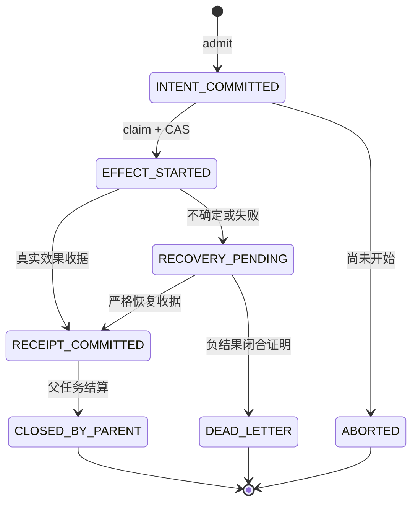

# 工具、能力与效果证据

## 6. Prepare、Carry、Freeze、Claim、Commit、Abort、Recovery

这些词在不同层有具体对象，不能只看名字相同就认为协议相同。

**Prepare** 有两种：可选 shadow 的只读探测；正式 DEO 的成员授权与 inventory 准备。后者先验证 execution attempt，登记 parent registry，封存有序成员清单，再绑定成员策略、登记 operation 并确认 inventory readiness。完整清单在该批次任何正式 read、shadow adoption 或 effect 前准备。[T11]、[T12]、`_executor_execute.py:800`。

**Carry / Freeze** 指把已捕获的 ToolSpec、normalized arguments、能力限制、policy snapshot、目标状态及成员 hash 通过类型化 DTO 传到下一层。Freeze 防止授权后再用不同 registry 或可变 metadata 偷换输入；它不冻结操作系统或 workspace，执行前仍要重新检查当前状态。调用 setup 与 batch member 的固定对象是两层事实。[T01]、[T03]、[T13]、[T34]、[T35]

**Claim** 是即时授权边界：读取当前严格 operation，检查仍为 INTENT_COMMITTED 及成员身份；从当前 operation stream head 求下一 seq，再用 expected version/seq 执行 CAS。成功将意图转为 EFFECT_STARTED，并获得本次 grant。精确重复 claim 可观察已写状态，但不获得新的可执行 grant；角色层明确拒绝 `idempotent=True` 作为新派发权。[T13]、[T44]

**Execute / effect Commit**：claim context 在进程内 fence 注册；adapter 验 scope、参数、当前 policy、目标状态；一次消费 fence 后才能调用物理工具。写入成功需收据，修复绑定还需正确 after state；物理操作完成而 receipt commit 失败会进入 recovery，而不是直接报成功。[T14]、[T15]、[T16]

**Abort** 只适用于未 claim 的 INTENT_COMMITTED；它证明没有按该许可开始操作，不能撤销已发生效果。失败批会终止未执行兄弟成员。提前封存的 rollback contingency 也作为有授权的独立操作，仅在已证明 forward 成功且需要补偿时执行；补偿失败不得宣称 restored。未知的已开始操作保留恢复义务。[T17]、[T19]

**Recovery** 处理 EFFECT_STARTED 后的歧义、无法捕获当前策略、物理失败、结果观察失败或 receipt commit 失败。它追加状态证据，不能重造已失去的进程内 fence、删历史失败或无证据地再执行旧效果。[T13]、[T15]、[T19]

**OutcomeCommit** 在整轮结束后封存轮结果，是另一项 append；它不是 effect receipt 的别名，也不是把此前所有 effect 和后继 QA 一次性提交。[T27]

DEO 状态图严格来自运行时加载的 `.source` 文件；`_repository.py` 显式 UTF-8 读取并 compile/exec 该文件。引用 `.source` 是实际生产执行体，并非将历史文本文档误认活代码。[T20]、[T21]

该图没有 EFFECT_STARTED 直接 ABORTED 的边，也没有 CLOSED_BY_PARENT 回到 INTENT_COMMITTED 的边。恢复后的新执行应属于合法新 attempt/新操作，并保留原 owner 与历史，不是修改旧终态。

## 7. 工具归一化与权限的先后关系

工具不由模型记住某一个内部拼写来获取权限。ToolSpecRegistry 是规范工具、aliases、arg_aliases、效果分类和 provider schema 的 owner。`capture_effective_spec(raw_name)` 取得一份一致、不可变的规范名称与别名快照；参数归一化随后只消费该快照，重新校验 hash，按 schema 别名映射和专用复杂转换生成 canonical arguments。[T34]、[T35]

例如 `run_command` 与 `execute_command` 可以是同一工具的名称别名，但相同名称归一化成功不证明命令已获准。危险参数、跨 workspace 路径、未授权 command/cwd、冲突别名或未注册工具仍需拒绝。参数别名是同义适配，不是推断新的业务权限。

有三类容易混同的 token：

1. **LLM token / window budget**：上下文和输出容量、调用预算，不赋予操作权限。
2. **JobToken / execution envelope capability**：从项目合同与 CE 交接/控制面派生，约束 allowed paths、write paths、commands、stage 和合同/蓝图 hash。读取完整已提交 JobToken 优先于根层的有损 envelope 投影。[T33]
3. **Execution claim / fence**：精确 task attempt、parent、member、arguments hash、当前 policy、PID/对象身份的一次执行许可。[T13]、[T14]

run/task/turn/transition ID 是定位身份；哈希是绑定与一致性校验；授权还需可信 owner/当前 attempt/策略/能力作用域。普通 SHA digest 本身并不是针对恶意重写者的数字签名，不能把“哈希相同”独立解释为“任何来源都可信”。

2026-10-18 的权限投影修正明确区分字段缺失与空值：envelope 中显式 `allowed_write_paths=[]` 保持无写权限，不能用 `target_files` 补回；只有缺少该字段的旧 envelope 保留已有兼容投影。选中的 JobToken 是写权限上界，显式请求约束只能取交集。写范围只接收平坦字符串或字符串集合，畸形嵌套对象中的读路径不能变成写权限。原有读权限与命令授权仍分别校验。

该接口已有公开 envelope 生产者、序列化、kernel 消费者的空值/非空值回归，以及畸形范围的因果反例；局部回归通过不证明远端模型、当前候选 QA、项目交付或资源释放。原始记录保留在 `~/.polaris/audit_archives/autonomous-delivery-20261018/`，后续完整运行必须另行核对最终请求、真实效果、验收与结算。

同日的质量接口补充让当前正式请求中的 `delivery_depth_contract` 直接进入质量检查：已持久化的请求与恢复后的 stage context 携带原验收阈值，空项目无需由外部工程脚本预写 catalog。当前合同缺席时才保留旧输入文件只读兼容；显式坏值、矛盾阈值或可用身份不匹配会形成失败结果，不能以旧文件补回。HTTP 输入、真实 Store、恢复上下文及静态检查器的模块实验已通过；该证据仍不等同真实项目验收。

正式项目身份来自已持久化的当前请求；项目展示名称不能代替 project ID。CE 生产者、Completion 合同与 JobToken 必须消费同一身份。内部 TaskRuntime 行号与外部任务标签属于两个命名空间，只能由同 workspace、run、session 的不可变 owner 事实建立对应，不能通过字符串前缀猜测或当前可变 TaskBoard 补造关系。失败边界即使正确关联，仍保持失败，不能因投影修正升级成验收通过。

首个冻结 L1-01 已验证真实工具写入和部分平台验证，但结果为 FAILED、QA 未执行，Factory 全部资源释放尚未证实。进程清理、模型请求终止、工具效果关闭、当前候选 QA 与项目交付各有证据边界；它们不能相互替代。后续修复须保留该失败与所有 UNKNOWN，另起冻结实验。

资源关闭核对当前与历史 attempt 的独立证明：suspended 可以表示“旧 attempt 已结算、任务仍可恢复”，不能直接当作项目完成。消费生命周期视图时，原始收据与派生字段必须一致；同一验证后的 scope/batch/hash 证明只能消费一次，附加注释或另一种视图格式不能带来新的关闭权限。相关回归和独立反例已通过，首个真实交付及完整资源闭合仍需下一次冻结运行。

全局 Bench 是内部观测模式：仅在内部功能可用、显式 `globalObserver=1` 或 `VITE_POLARIS_GLOBAL_BENCH_OBSERVER=1` 且没有 workspace/instance 绑定时启用；URL 开关优先，DEV 默认不授予全局观察。任务角色投影中的数组、对象、未知或冲突身份保持未确认，不能通过字符串转换或旧分配提示显示为 Director。浏览器订阅验证与真实项目任务推送验证分别记录。

工具分类的纯解释与已捕获快照读取已下沉至 KernelOne：原 Role 生产者保留公共类型、签名与字节格式，观察器迁移将复用同一判定，避免 Ledger 反向依赖 Role 形成循环。读取旧快照时，原记录的四个 hash、名称/别名绑定与类型必须通过核对，不能用当前 Registry 重算结果替代历史捕获。该下沉的相邻回归 283 项、独立复验 126 项通过，27 组旧 wire 冷恢复字节保持一致；只读批次观察器与完整项目交付仍待单独验收。

## 3. JobToken、claim、grant、receipt 是四件事

JobToken 表达由控制面合同派生的 capability，不是新的合同事实源，也不是某个任务已成功的证据。执行时还需要当前 owner/session/attempt 和 lease。DEO claim 产生一次操作的 fresh grant，grant 约束允许执行的 effect，receipt 才描述实际发生的 effect 与结果。

身份至少同时跨越 `workspace/project/factory_run/child_run/task/external_task/session/attempt/role/worker`，并绑定合同、蓝图、policy、目标与输入 hash。只保留 `task_id=1` 或只保留 `run_id` 都不足以重新获得权限。模型输出的“已写入”也不能替代真实 before/after hash、DEO member/parent 与 durable commit。

命令有两个不同判断。KernelOne command capability 可以判断一个自然命令是否在允许集合内；该集合存在兼容型 prefix 与空集合语义。正式 verifier 则必须进一步绑定 CE 的 exact argv/cwd、obligation、输入闭包、可信可执行文件和 proof profile。不能从“工具层允许运行”直接推出“这次运行可计入验收”。

源码：command capability（src/backend/polaris/kernelone/llm/toolkit/executor/command_capability.py:201）、正式 verifier authority（src/backend/polaris/cells/runtime/execution_broker/internal/project_verification_authority.py:1310）。

## 4. 2026-10-19：输入绑定与拒绝反馈

只读批次观察器已复用 KernelOne 捕获语义及完整 invocation inventory 判定。执行器在任何 prepare/await/工具效果前取得独立输入视图；声明和分区都存在时，同一 call 的完整 JSON 参数、native 参数、身份及分类必须一致，不能只比较 call_id。group-only 保留既有执行兼容，inventory-only 可用于记录但不能被当作已执行。原坏 owner 冷读返回明确的输入矛盾，历史字节与失败保留。

普通产物配方错误的拒绝观察不是 effect receipt，也不授予写或执行权限。当前持久 CE 蓝图/JobToken 才是 scope owner；修改 TaskBoard 展示字段或另写 shadow runtime 文件不会改变它。修复反馈必须重新绑定原 owner、合同、exact argv/cwd、来源 hash 与真实 owned artifact/write scope；manifest/source/config 标签不替代权限。覆盖缺失继续阻止交付，但不单独阻止合法原 owner 修复；成功仍依赖新候选的验证 receipt。

Node test grammar 已统一 direct/package 两路；仅识别限定的 literal tsx preload、TAP 与受约束 test 路径，不重写实际命令。Policy 的允许只表示命令可进入下一层，依赖存在、真实执行、proof、当前 QA 与资源关闭仍需各自 owner 证明。模块实验与下一条全新隔离 L1-01 分开记录。

## 5. 2026-10-19 原始执行事实与修复反馈

R02 证明了受限命令拒绝可以进入后续 Director 请求并收敛到获准安装；它同时暴露了入口准入失败不能回到产物修复的缺口。实际 build/test 成功不代表入口运行，更不能代表 QA 或交付成功。

当前修复继续使用原控制面与工具链：只为已绑定当前 CE 命令、owner、源文件哈希及缺失目标的安全字面 Node 入口生成类型化拒绝观察；观察保持 `execution_started=false`、无 receipt。后续修复必须消费原授权，保留 CE 入口合同并重新取得当前候选的真实验证。未改变授权的 `node` 与不可信路径 `/tmp/node` 需要不同的分类；后者仍拒绝且不获得这类产物反馈。

事实身份也需要区分职责：精简心跳保留 typed runtime session，而不重复静态 workflow 字段；父级 Factory token 保留能力所属 run，生命周期事件保留子级执行 run。Run Ledger 只在同一严格耐久切片证明任务与父级 ancestry 后解释这些已有身份，显式矛盾必须拒绝，禁止改写 token、补造事实或从实时可变镜像猜测。原生 R02 仍 FAILED；本节描述的修复尚待新原生运行验证。

## 6. 持久化重建与请求构造使用同一合同

R03 暴露了 CE 请求侧与 PM 证据重建侧选用不同上下文的回归。修复复用 FactoryStore 中实际持久化的启动请求合同，继续比较完整 PM 任务 DTO；没有删除校验或把缺省数量当成新授权。验权必须覆盖真实 PM 提交和冷恢复，替换过验权函数的捕获测试只证明被替换的端口。原始失败只读重放和新的原生成功属于不同证据，前者不能将旧运行改判成功。

## 7. 局部编辑与失败结算的当前证据边界

R04 的真实请求暴露了两个不同问题：不合法的 SEARCH/REPLACE 文本应明确拒绝；合法行范围和显式空串删除则必须与 ToolSpec、预览、物理执行及权限语义一致。同路径局部编辑不能因后面还有修改而被宣告成功且跳过。保留每条局部修改时，后一次准备必须使用前一次真实提交后的文件基线；不能继续复用整批旧快照或放松哈希检查。现有 TaskRuntime parent rollover 已在私有真实 owner 实验中支持连续两条局部修改及前后收据哈希衔接，生产接入与冷恢复验证仍在进行。

工具失败与效果未知需要分别证明。命令退出码可描述真实进程失败；文件编辑拒绝通常没有进程退出码，不能补造 `exit_code=1`。普通 `ok=false`、DEAD_LETTER 或最终文件看起来没变，也不能单独证明执行没有发生。当前正在闭合的机制要求真实写入前验证产生类型化证明，并绑定既有 prepare、目标、输入与 fence，随后由既有恢复、TaskRuntime 和结算消费者验证；异常或部分 I/O 继续保持 UNKNOWN。

原始 native 参数与归一化参数有各自的哈希边界。别名变换后两者可以不同；消费者应核对原生 envelope 与已保存的 native 参数，再通过已冻结的分类快照及 admitted 输入核对归一化调用。直接比较原生哈希和归一化字典会误拒绝合法调用，直接忽略差异则会丢失输入绑定。上述修复不能为缺少历史无效果证明的 R04 生成新收据或强制释放。R04 仍为 FAILED、QA 未运行、逻辑资源释放 UNKNOWN。

当前组件结果（R05 候选，原生运行前）：文件预写拒绝已由纯 KernelOne 值契约描述，mutation port 独立核对实际参数、既有操作上下文、目标与前后哈希，再经原恢复证据和 immutable outcome 持久化。TaskRuntime 冷观察及结算层验证完整 owner 链，分别核对 native 原参哈希和冻结快照下的归一化参数。失败文件调用不补造命令退出码；只有完整验证的预写无效果证明可以与同一 owner 后续成功修改及 completed 状态并存，失败操作历史保留。旧进程失败的既有约束不在此次文件证明范围内。

这部分当前 30 项相关实验及静态检查通过。独立实验先复现“合法修复后已 completed，但旧拒绝仍阻塞”的缺陷，修复后仅冷读同一私有 owner，18 个原文件保持不变，观察到一份真实修改收据及一份预写拒绝证明闭合，观察器不获执行权限。这只证明组件边界。原 R04 的 1240 个文件及原结算 hash 不变，仍不允许释放；普通失败字典、部分 I/O 和缺证明的旧调用仍为 UNKNOWN。完整 Gateway/JIT 联调与新冻结项目验收另行记录。

联合 Gateway/JIT 实验补充（R05 冻结前）：行范围、空串删除、预览及实际修改已消费同一纯组合机制。只有完整文件替换保留既有合并优化；局部或混合修改按原顺序分批，在前一真实收据提交并通过 owner/hash 核对后才准备下一批。新文件的首次写入也绑定其真实 after hash；同文件 SDK 多范围保持原坐标，前一处增行及重复源文本不能重定向后一处修改。完整原调用声明在首次 await 前独立复制，后续调用方变更不改变已授权输入。

独立真实 Gateway 链已通过错误调用、明确的未执行后续结果、同一 owner 合法修复、completed 与冷关闭；同文件连续修改留下两份真实收据，冷重入没有重复提交。显式空权限不回退为提示文件范围，缺少前序可信收据或前像漂移会明确拒绝。冷重入的 fail-closed 不等于已经证明所有故障都能自动恢复；缺少完整可信结果时仍需现有 owner 对账。完整原生 QA、ProjectOutcome 和资源释放仍待新项目验证。

## 8. R05 原生使用及后续接口修复范围

R05 已通过平台原生 `edit_blocks` 的行范围修改产生真实提交，并用随后实际执行成功的 TypeScript 编译确认该时刻产物可编译。命令拒绝反馈也进入后续实际请求，最终合法安装成功。完整测试、入口、QA 和项目交付仍未取得；原生命令效果收据与正式 Broker 的逐输入验证收据分别记录。

当前失败首先停在非执行仓库元数据的静态覆盖：`.gitignore` 尚无适用 disposition，collector 未进入 required verifier loop。修复应在 KernelOne 现有文件证据类型中说明元数据已经过快照、内容及污染检查，同时保持 `execution_qualified=false`；未知源码仍需明确拒绝，元数据不能补足源码数量或业务行数。验证后边界重算也必须消费真实 CE 义务和当前 Broker 证明，不得将延后边界的空数组直接当作已满足全部要求。

ContextOS 的另一缺口来自已提交工具数据转为 native transcript 后丢失来源语义。合法命令结果及普通源码可包含 `timeout_seconds`，字面命中不等于控制面授权。后续修复复用现有提交、调用 inventory 与上下文来源绑定，对实际最终 slot 重验；权限仍由现有 Gateway、JobToken 和 effect owner 决定。未绑定输入、真实控制面结构及身份污染保持严格处理，不增加新的账本或权限来源。上述属于下一候选实现范围，不改写 R05 的失败或两次未发送请求。

## 9. R06 当前模块证据

仅测试配方中，同一 package.json 内的字面 build/lint 前置引用已接入既有证明语法与完整 manifest 哈希；允许进入验证不代表命令已经执行或测试通过。缺失、循环、shell 替换及非证明性叶命令继续拒绝。真实原项目的只读 policy 重算已消除其 npm test 包装误拒绝，未执行其命令或改写目标。

元数据 disposition 与正常边界重验也已进入当前候选：元数据不获执行质量或源码数量信用；正常边界必须具有真实 CE、不可变 claim、当前 artifact/input/receipt 绑定，并保留原始延后记录。组件与真实私有 owner 联调通过不代表新的原生项目成功。下一次运行仍需实际工具效果、当前验证、独立 QA、权威项目结果与释放证据。

当前上下文实现复用提交 inventory、ContextSource、捕获 ToolSpec 与 native/normalized 独立参数哈希，在实际最终 slot 与重试时重验。190 项相关检查和原反例独立复验通过：真实结构化控制面 token 别名剔除，成功源码字面保留，未绑定数据和真实失败仍严格处理。条件提交在原 Ledger projection 锁内校验 canonical 前序；相同已提交 Fact 可恢复投影，无关事件不阻断。当前组件与消费链结果仍需下一个冻结原生项目验证。

## 10. R06 暴露的合法收据投影差异

R06 第一次工具批次被正确拒绝且零效果，真实 deferred followup 已提交，但新增上下文绑定在准备后续请求时把省略默认字段的事件结果与补齐默认字段的 owner 结果误判不一致，项目提前失败。当前修复复用既有严格工具结果类型规范化两种投影；不删除特定字段、不绕过零成功批次的完整性，也不在外层新增盲重试。原生失败、原始请求、拒绝收据和资源释放事实保持不变。真正的接受证据仍是合法下一轮实际效果及新项目独立验收。

参数重验也复用 frozen ToolSpec 的既有语义：真实 decoder 不归一化的读取保持原生 mapping；需要归一化的写工具才重演规范化。冗余 caller flag 不改变分支，真实参数漂移仍拒绝。当前私有真实工具链已能在原拒绝后继续合法写入与编辑，两个 effect receipt 为实际提交；替身模型和组件反证不替代新原生交付。

## 11. R07 与当前完成、验收、释放接口

R07 已真实证明拒绝可回到下一物理请求，合法写入及成功命令结果可持续进入后续上下文。安装、构建、16 项测试与 CLI 入口实际通过，正式 Broker 五个 required 义务具有当前输入证明；独立 QA 未发请求，最终运行仍 FAILED。源码自述、命令准入、工具成功、正式验证、独立验收和资源释放继续使用各自的事实边界。

完成预检不能只凭文件收据提前 finalize。当前实现从实际 claim 与原 capability 核对持久 CE 投影，逐 required obligation 查询当前 artifact/command owner；相同 argv 的不同义务不合并，optional 保持可选。失败命令已存在时记录 failed，尚无证明时保留 missing；缺失、陈旧、跨项目或未提交证明返回既有合法执行路径。真实 proof gate 写入原 Factory，保留完整原 token 与原 gate policy；child 正常边界只记录执行身份及原 claim/token-hash/receipt 依据，不建立第二能力载体。已有 append owner 分配 revision，失败后当前通过可以推进，旧失败仍可审计，QA 仍独立必需。当前 12 项模块验证和独立篡改/恢复实验通过，尚不能视为新的原生交付。

命令真实退出 1 不是 NoEffect，也不是成功。完整 DEO、父关闭、原/归一调用、实际结果及终结 owner 证明成立后，失败操作可以安全闭合，而最终任务可以因后续修复变成 completed；原失败及引用继续存在。TaskRuntime 消费者的 43 项相关验证通过，完整负证明校验函数字节不变。

没有 provider turn 的 preflight 使用已有 `receipt_reuse` 类型。Ledger 仅在原有严格 no-dispatch 条件和真实已闭 owner 观察成立时消费其合法空 turn；真实 dispatch 仍需原 turn 身份与证明。137 项相关验证通过，原事实纯重算及 15 个独立负控支持该分界。资源关闭不赋予工具权限，也不把验收失败改成通过；原 R07 的实际历史租约仍保留 DRAINING/UNKNOWN。

QA 必须分清 Factory/CE 来源、被审 Director 候选和 QA 自身执行身份。数据投影移除控制面字段后，CE 读取不能误用 QA child ID 查询 Factory 蓝图。本地来源读取端口与真实调用者已同步迁移，权限和执行身份不变，不向 provider 数据新增 authority 字段。当前 118 项作者验证及静态检查通过，独立审查另行记证；实际 QA 物理请求及当前候选验收仍待新冻结运行。模块夹具可以使用明确标注的替身，不能将 service 参数捕获冒充最终 provider request。

## 12. R08：计划覆盖与执行权限分离

R08 的正式 Broker 确实完成依赖准备并执行构建：安装通过，构建因 TS2339 失败，其余三项验证未运行。Director 原生工具的命令效果为零，与这两次平台验证执行分别记账。构建失败后模型修复被接口审查条件阻断，当前没有独立 QA，项目仍 FAILED。

`known_rule_matched`、已登记可执行修复器和当前可组成的非空补丁是三种事实。公共 coverage/plan probe 为只读诊断；它不接收 CE 或 JobToken 授权对象，不能凭无计划推导越权或接口冲突。独立纯内存反例和真实输入只读重建支持这一分界；原运行未保存的完整探针继续 UNKNOWN。后续修复应让普通产物失败在原任务授权下进入观察、模型修复及复验，同时保留真实范围和来源冲突的拒绝。不能增加语言特例、扩大权限或把无计划改写为验证通过。

R08 已由实际 owner 完成失败结算和租约释放，资源屏障保持 passed=false；官方停止仅作用于自己的隔离实例。该结果证明一次失败运行的安全闭合，不是交付成功，也不改写历史失败与未知。当前源码和配置在该轮完整运行内未变化，下一实质修复必须使用另一个冻结候选和新运行。

## 13. 当前候选的修复与正常边界恢复

计划探针继续报告可行性，但不再为普通失败合成 CE 权限裁决或禁止模型继续执行。六个现有生产文件及相邻私有调用方同步迁移，真正的路径范围、出口 owner、原始 claim/JobToken 和 Gateway 仍负责授权。独立受控实验仅证明合法适配器回调可达，空范围和外部路径实际被拒绝；替身回调不算真实 Provider 调用、修复收据或交付通过。

后续验证已存在时，普通边界不能继续重放旧 missing/failed 字段。既有 Factory owner 现在对有验证义务的边界复用完整当前证明，保持逐 ID、输入哈希、CE/claim 和原子前序约束；实际 completed owner 私有实验支持正常推进、历史失败保留和冷重试零新增事实，缺失或失效证明仍拒绝。该变化仅一处既有生产 owner，没有第二账本或新的成功旁路。

新原生运行尚未开始。组件检查、宽回归未通过项、冻结回归以及之后真实 QA、ProjectOutcome 与资源释放分别记证；原 R08 继续 FAILED。外部 Outcome reader 的原生文件函数装配已修复准备，但真实当前项目读取仍未执行，不能写成已闭合验收。

## 14. R09：修复协议须表达合法下一步，取消须保留已结算证据

真实 R09 在 CE 阶段失败，Director、Broker 与 QA 未到达。`npx tsc --noEmit` 只能证明适用检查，不能按 build 验收。CE 候选声明 CLI 入口却遗漏对应产物义务；后续请求只暴露配方修复，完整重归一遇到入口源文件范围错误。当前先核对真实 PM 委派和合法 patch 表达能力，不把 CE 自述范围作为授权，也不删严格完整校验。普通候选修正应有可验证的下一步；确实越权的修正仍应返回原合同 owner。

同一轮还暴露取消 producer 的证明失效：已通过 typed suspend 的会话仍持有原 fulfilled proof，取消路径再次改变 resumable，使严格当前证明核对失败。私有真实 owner 实验支持保留已验证结算的 session、仅取消任务行的最小方向；取消后不得据历史 checkpoint 恢复执行，未知效果仍保持未知。这是组件研究结论，R09 原屏障开放、租约 DRAINING 的历史未被重写，官方停止只证明物理资源已停止。

本轮 5 次真实请求与 4 次 CE 结构化输出调用分别计数，不能把 Director 工具零次写成平台总调用零次。实际执行的验证为零，不能将未到达写成 build/test 失败。独立当前 QA、合法 ProjectOutcome 和逻辑释放均未取得，首条完整无人值守交付仍待新冻结运行证明。

## 15. R10 候选：共享角色与 canonical 产物清单

现代 PM 技术委派不再由旧 required_source_kinds 空列表解释为没有可用产物角色；准入和修复反馈共用已有 typed role vocabulary，包含 assets。入口显式 source 在真实 owner 与范围允许时进入原 canonical artifact roster；runtime-only 定位和 scope_for_apply 提示不能授予路径。真正未授权的现代 required 项返回错误，不以静默删项得到成功。实际 noEmit 的 lint 语义、独立 build 要求及既有 coverage 重建均保留。

原候选和同一合法配方补丁已在私有完整归一化实验中从 CLI 拒绝推进到十四项产物、五项验证；private public builder 也消费相同清单，输出包含 CLI 和两份数据的 target、scope、ownership。独立冷重验与范围负控支持该接口。使用 trusted synthetic typed issuer 的组件实验不证明原 Factory PM 权限链、实际 Provider 调用或正式交付。

取消 owner 只在原屏障已验证当前 fulfilled suspension 后保留原 session/proof，并真实取消任务行；取消后的冷 claim 仍拒绝，未知效果仍不能关闭。新运行、当前独立 QA、合法 ProjectOutcome 和实际资源释放必须另行取得。旧 R09 的 DRAINING 与 FAILED 继续保留，不能由新源码或私有实验追认成功。

## 16. R10：诊断、最终响应 schema 与消费者须一致

R10 的失败不是入口源再次漏投影：原候选十三项产物已有 CLI。初始 CE 把构建命令当入口，并引用未知 invariant；后续真实修复报 entrypoint recipe patch identity is not diagnosed。实际请求只诊断 ep.build，却在混合操作上下文重新展示全部入口，schema 没有限定其 ID，并广告了 recipe policy 不允许的 removal。先核对和统一这个接口，不能据最后一句错误删除权限或真正验收。两次原 patch decoded 内容目前 UNKNOWN，受控反例不得冒充原始回放。

当前取消 owner 的修复已在原生失败运行中保持有效 proof，实际屏障关闭并允许释放，租约真实 released；passed 保持 false。平台未执行本轮 build/test/entry 或独立 QA，不能将未到达写成这些验收失败。正式停止仅作用于自己的独立实例，主实例和 NATS 保留。原运行失败与旧 UNKNOWN 不改写，完整交付仍待下一候选实证。

## 17. R11 候选：减少矛盾广告，保留失败提案

配方修复继续消费既有已绑定诊断：混合上下文合并后才最终过滤 mutable targets，schema 广告同组 ID 与禁止 removal，Factory 复用 owner rule，并删去“换新 ID”的冲突通用指导。只读有效义务保留，composer、权限与完整归一化仍负责拒绝不合法提案。合法单行修正与 owner/CAS/范围负控已有显式合成组件证据，不是原生模型行为或真实交付。

decoded proposal 在绑定前复制，保存到既有 FactoryStore，公共 StageResult 携带各轮 ref/hash/byte_count；canonical decoded SHA 不能代替未知 native hashes。存储失败为 UNKNOWN 且保留原语义，快照与阶段链接不具跨文件原子性，孤立快照不能算提交成功。独立 success/reject 冷读、篡改/跨运行引用拒绝和存储失败控制通过；额外最终 FAILED 两轮回放未完成，保持 UNKNOWN。作者 181 项 R1 相关检查、R2 单节点 RED→GREEN 与两个版本的适用范围分别记录。

主 Agent 已核对源码、原校验函数和两路报告/日志封存；新候选尚待冻结正式检查与隔离实跑。旧失败不变，首个完整无人值守交付仍未取得。

## 18. R11：真实修复推进与失败收尾的边界

R11 的真实 CE recipe 修复被接受，Director 自己生成 13 项产物、修复依赖与类型问题；当前正式 INSTALL/BUILD/TYPECHECK 通过，TEST 9/10、exit1，两个入口与 QA 未执行，项目交付失败。38 次物理请求全部完成、reported tokens 1,642,904；不能把完整角色会话 watchdog 叫作某物理 provider 未响应。

已验证的反馈和续行不是完整交付：最初 final 之后仍有后执行命令、内部变更与新模型调用；旧语法 pending 也实际终结为 DEAD_LETTER，未被猜作 NoEffect。最终逻辑屏障仍开放、lease DRAINING，ProjectOutcome 严格只读观测为 UNKNOWN。独立实例已官方停止，主实例/NATS保留，外部代修为零。源码使用归档同字节 worktree，保持单一运行版本。

下一条不变量聚焦失败输出的保真，不靠增加重试、timeout 或测试字面量修复业务。真实 TEST receipt 的完整绑定日志已缺程序断言正文，故先查执行结果到日志/收据的第一损失，再沿同一 producer/consumer 与冷读取验证。保留 Cell/KernelOne 与已有事实 owner，采用有限反例、必要正反控制和明确结束条件；首个完整无人值守交付仍未取得。

## 19. R12 候选：读取超时与流终止的不同语义

R11 当前 TEST 收据的完整权威日志本身已缺断言。与实际 D29 最终请求做逐字节投影对账后，首次偏差收敛到 Broker 的 `wait_for(__anext__, 1s)`：暂时没有输出会取消生成器，后续测试正文无法持久化。相同真实输出的 1.134006 秒静默反例与去静默正控支持这一机制；原日志、收据和旧运行结果不修改。

本次实现保留一个 pending read 跨 idle tick 等待；真实结束时 cancel/await，再关闭迭代器、日志并移除注册表。关闭异常有结构化错误记录。默认一秒检查间隔、执行预算、授权、命令范围和失败判定均保留。原有“延迟首行”测试可能由零行 fallback 救回，因此新因果用例明确要求先有前缀、静默后再有断言，且不能靠 snapshot result 替换丢失输出。

真实私有 verifier runner 产生 FAILED 收据，晚到 stdout/stderr 与断言进入既有 `output_excerpt`，全日志哈希绑定真实字节；公开查询重新读取持久 Store，不重跑命令。authority port 为标注的合成夹具，冷读范围是同进程新 Store 查询，未声称进程重启或完整 PM→CE→Director→QA 已验证。历史 V1 75 PASS、中间版本 37 PASS 与最终聚焦 9 PASS 分别绑定版本。最终三文件停止写入，完整项目效果仍需冻结后的新运行。

## 20. R12：project verifier 覆盖与 task command authority 的交接

R12 CE 候选五个验证配方均属于 TASK-2/3，其中部分覆盖 TASK-1 的文件；TASK-1 的语义交接消费者仅接纳同 task 的 `verification_command_authority`，没有匹配配方即拒绝，否则该任务的合法 `allowed_commands` 将为空。本轮因此停在 CE 2/3，无 Director、build/test 或 QA。覆盖其他任务的输入文件与向其他任务授予执行权限是不同的事实；不能通过删除检查或复制兄弟任务授权补救。

实际最终请求、原候选和一轮修复提案均已留存。当前待证假设是：上游 normalizer/诊断未在交接前表达这个缺口，导致既有修复协议没有获得相应 missing-row 目标。需先用实际基底证明，再在既有 CE owner 内修正，不先扩大 Director 权限。R12 已安全结算并官方停止，但项目 FAILED，§19 日志修复本轮原生未执行；模块测试、可读上下文、资源释放分别报告。

## 21. R13 候选：missing-owner 诊断与合法恢复成对收口

实际 R12 数据在原源码上复现“portfolio 接受、每任务交接拒绝”；旧诊断不允许为 TASK-1 添加缺失配方。现由既有 CE normalizer 在原完整校验后检查自身 authority，产生精确任务及合法 artifact/dependency 的 missing-row 诊断，Factory 绑定后通过现有 schema/composer/store 修复。原 guard、权限、JobToken 及严格 command profile 保留；没有给 Director 旁路授权。

已有 required/optional 自身配方均可满足原消费者，新行可选既有 modality，仍须满足原 canonical profile 和覆盖范围。缺失、已有失败及原类型错误分别保留；畸形输入不能因追加诊断变成 KeyError 或被接受。初始请求只增加一条每任务自身配方说明，没有引入修复阶段的无关结构。

模块链覆盖 public normalization → Factory binding/schema → composer → candidate persist/cold load → portfolio → per-task blueprint/JobToken。R1 213 PASS 与最终 R2 两项初始/修复命令捕获 PASS 分别绑定版本，静态检查通过；合成 issuer 和 canned role/provider ports 明确标注，不能代替最终 provider request 或原生 PM 授权。独审接受有限结论，主 Agent 对 102 份作者/审查证据重哈希零差异。

七条实现路径已停止写入，达到本主题的有限停止条件；下一步对集成候选冻结并运行正式门禁，再以原合同、唯一启动者开展全新隔离 R13。当前尚无 R13 原生成功或完整 QA/ProjectOutcome 证据；旧失败、安全结算和资源释放各自保留。
