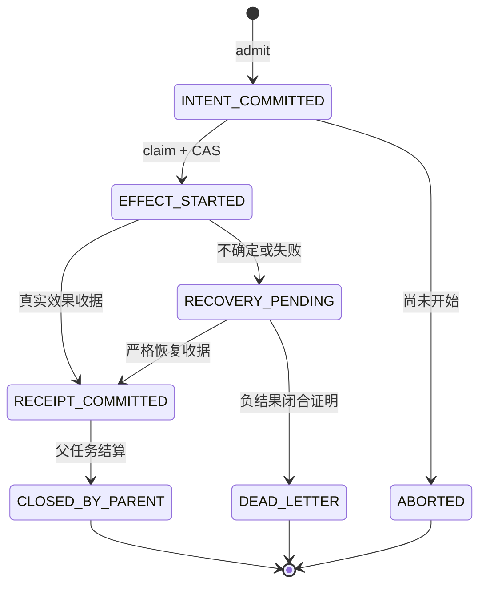

# 工具、能力与效果证据

## 6. Prepare、Carry、Freeze、Claim、Commit、Abort、Recovery

这些词在不同层有具体对象，不能只看名字相同就认为协议相同。

**Prepare** 有两种：可选 shadow 的只读探测；正式 DEO 的成员授权与 inventory 准备。后者先验证 execution attempt，登记 parent registry，封存有序成员清单，再绑定成员策略、登记 operation 并确认 inventory readiness。完整清单在该批次任何正式 read、shadow adoption 或 effect 前准备。[T11]、[T12]、`_executor_execute.py:800`。

**Carry / Freeze** 指把已捕获的 ToolSpec、normalized arguments、能力限制、policy snapshot、目标状态及成员 hash 通过类型化 DTO 传到下一层。Freeze 防止授权后再用不同 registry 或可变 metadata 偷换输入；它不冻结操作系统或 workspace，执行前仍要重新检查当前状态。调用 setup 与 batch member 的固定对象是两层事实。[T01]、[T03]、[T13]、[T34]、[T35]

**Claim** 是即时授权边界：读取当前严格 operation，检查仍为 INTENT_COMMITTED 及成员身份；从当前 operation stream head 求下一 seq，再用 expected version/seq 执行 CAS。成功将意图转为 EFFECT_STARTED，并获得本次 grant。精确重复 claim 可观察已写状态，但不获得新的可执行 grant；角色层明确拒绝 `idempotent=True` 作为新派发权。[T13]、[T44]

**Execute / effect Commit**：claim context 在进程内 fence 注册；adapter 验 scope、参数、当前 policy、目标状态；一次消费 fence 后才能调用物理工具。写入成功需收据，修复绑定还需正确 after state；物理操作完成而 receipt commit 失败会进入 recovery，而不是直接报成功。[T14]、[T15]、[T16]

**Abort** 只适用于未 claim 的 INTENT_COMMITTED；它证明没有按该许可开始操作，不能撤销已发生效果。失败批会终止未执行兄弟成员。提前封存的 rollback contingency 也作为有授权的独立操作，仅在已证明 forward 成功且需要补偿时执行；补偿失败不得宣称 restored。未知的已开始操作保留恢复义务。[T17]、[T19]

**Recovery** 处理 EFFECT_STARTED 后的歧义、无法捕获当前策略、物理失败、结果观察失败或 receipt commit 失败。它追加状态证据，不能重造已失去的进程内 fence、删历史失败或无证据地再执行旧效果。[T13]、[T15]、[T19]

**OutcomeCommit** 在整轮结束后封存轮结果，是另一项 append；它不是 effect receipt 的别名，也不是把此前所有 effect 和后继 QA 一次性提交。[T27]

DEO 状态图严格来自运行时加载的 `.source` 文件；`_repository.py` 显式 UTF-8 读取并 compile/exec 该文件。引用 `.source` 是实际生产执行体，并非将历史文本文档误认活代码。[T20]、[T21]

该图没有 EFFECT_STARTED 直接 ABORTED 的边，也没有 CLOSED_BY_PARENT 回到 INTENT_COMMITTED 的边。恢复后的新执行应属于合法新 attempt/新操作，并保留原 owner 与历史，不是修改旧终态。

## 7. 工具归一化与权限的先后关系

工具不由模型记住某一个内部拼写来获取权限。ToolSpecRegistry 是规范工具、aliases、arg_aliases、效果分类和 provider schema 的 owner。`capture_effective_spec(raw_name)` 取得一份一致、不可变的规范名称与别名快照；参数归一化随后只消费该快照，重新校验 hash，按 schema 别名映射和专用复杂转换生成 canonical arguments。[T34]、[T35]

例如 `run_command` 与 `execute_command` 可以是同一工具的名称别名，但相同名称归一化成功不证明命令已获准。危险参数、跨 workspace 路径、未授权 command/cwd、冲突别名或未注册工具仍需拒绝。参数别名是同义适配，不是推断新的业务权限。

有三类容易混同的 token：

1. **LLM token / window budget**：上下文和输出容量、调用预算，不赋予操作权限。
2. **JobToken / execution envelope capability**：从项目合同与 CE 交接/控制面派生，约束 allowed paths、write paths、commands、stage 和合同/蓝图 hash。读取完整已提交 JobToken 优先于根层的有损 envelope 投影。[T33]
3. **Execution claim / fence**：精确 task attempt、parent、member、arguments hash、当前 policy、PID/对象身份的一次执行许可。[T13]、[T14]

run/task/turn/transition ID 是定位身份；哈希是绑定与一致性校验；授权还需可信 owner/当前 attempt/策略/能力作用域。普通 SHA digest 本身并不是针对恶意重写者的数字签名，不能把“哈希相同”独立解释为“任何来源都可信”。

## 3. JobToken、claim、grant、receipt 是四件事

JobToken 表达由控制面合同派生的 capability，不是新的合同事实源，也不是某个任务已成功的证据。执行时还需要当前 owner/session/attempt 和 lease。DEO claim 产生一次操作的 fresh grant，grant 约束允许执行的 effect，receipt 才描述实际发生的 effect 与结果。

身份至少同时跨越 `workspace/project/factory_run/child_run/task/external_task/session/attempt/role/worker`，并绑定合同、蓝图、policy、目标与输入 hash。只保留 `task_id=1` 或只保留 `run_id` 都不足以重新获得权限。模型输出的“已写入”也不能替代真实 before/after hash、DEO member/parent 与 durable commit。

命令有两个不同判断。KernelOne command capability 可以判断一个自然命令是否在允许集合内；该集合存在兼容型 prefix 与空集合语义。正式 verifier 则必须进一步绑定 CE 的 exact argv/cwd、obligation、输入闭包、可信可执行文件和 proof profile。不能从“工具层允许运行”直接推出“这次运行可计入验收”。

源码：command capability（src/backend/polaris/kernelone/llm/toolkit/executor/command_capability.py:201）、正式 verifier authority（src/backend/polaris/cells/runtime/execution_broker/internal/project_verification_authority.py:1310）。
