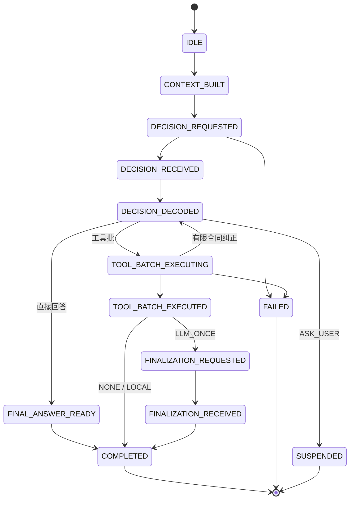
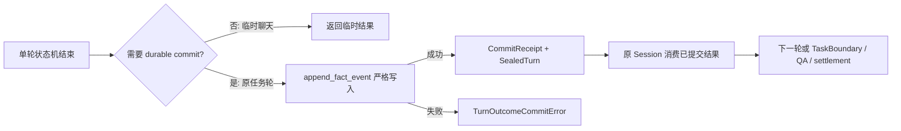
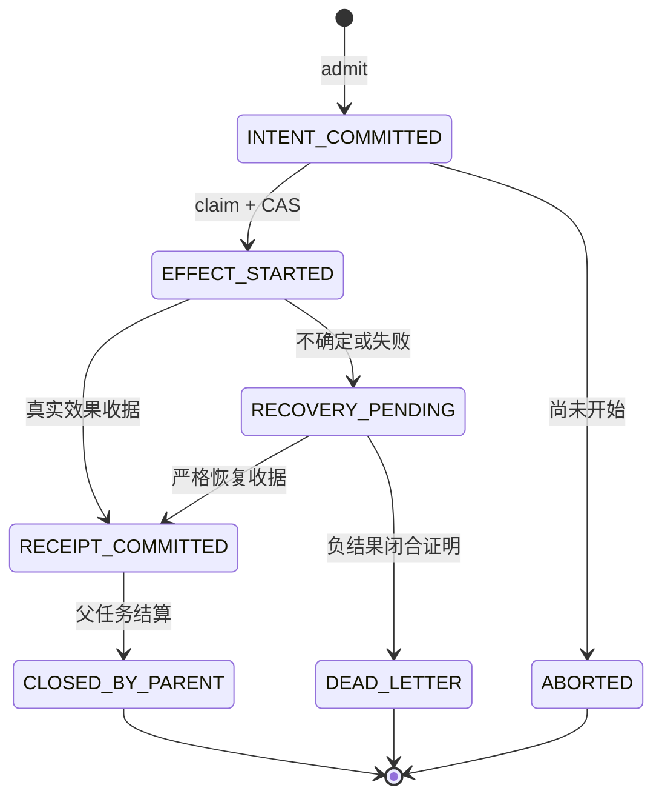

# Polaris 事务回合协议：生成式决策、效果授权与持久提交

## 摘要

以实际 TransactionTurnExecutor、TransactionKernel、DEO 与 OutcomeCommit 调用链为对象，分析角色执行如何将模型候选转换为受约束的工具批次，区分推测读取、持久 claim、一次消费 fence、效果收据、回合落盘与项目接受，并说明这些机制与数据库事务的差异。

关键词：Polaris；工程 Agent；状态拥有者；源码分析；执行证据

研究日期：2026-10-14。方法为源码、调用链与封存失败记录分析。以下机制的实现存在性、默认接入和端到端可靠性分别讨论。行号以本次工作区为准，源文件指纹随研究证据包提供。

## 1. 核心论点与命名

Polaris 将不确定的模型输出放入确定性的执行协议：先确定角色、任务与执行身份，再把模型产生的调用转成可验证的工具批次；具有副作用的成员需通过范围授权、意图登记和即时执行许可，执行后的效果收据与整轮结果分别落盘。其主要价值是让失败能够归因到具体边界，并防止同一许可被重复消费。它不会替模型证明方案正确，也不会把任意文件、进程和外部服务变成一个数据库事务。

真实源码名是 **TransactionTurnExecutor** 和 **TransactionKernel**。前者是角色内核的应用服务；后者位于 `roles.kernel` Cell，继承 `TurnTransactionController` 并委托执行。`TransactionTurn` 适合作为本文的概念名；`Transation` 不是这些符号的拼写。KernelOne 为该协议提供通用存储、锁、工具规范、模型适配等底座，不能把整个执行协议归为一个 KernelOne 数据库事务。源码依据：[T01]、[T02]、[T03]。

还存在名为 `TaskBoard.transaction()` 的接口，其实现仅持有 `RLock` 并 `yield`。这保护同进程临界区，不代表任意异常可回滚全部文件与外部操作。[T40]

## 2. 术语与四种不能混同的状态

| 术语 | 具体含义 | 不能推导的结论 |
|---|---|---|
| Turn / 事务轮 | 一次角色内核调用、模型决策、工具批及收口 | 项目已完成 |
| Invocation / Attempt | 稳定上游执行范围下的逻辑调用及确定性尝试身份 | 身份本身赋予写权限 |
| Session | 原任务范围内连续调用多个 Turn 的会话 | 另一个工具执行权威或新的任务 |
| TaskRuntime execution attempt | 当前任务执行会话、owner/claim/session 等约束绑定 | Factory 或 QA 已通过 |
| ToolBatch | 解码后按效果与执行模式分组的工具调用 | 整批文件写入具有数据库原子性 |
| DEO（Directed Effect Operation） | 对一项有副作用的操作登记意图、claim、收据与恢复状态 | 收据证明业务行为正确 |
| Prepared inventory | 不可变的完整成员清单及授权快照 | 此时已经执行写入 |
| Fence | 与 PID、原始对象身份、精确哈希绑定的一次消费许可 | 可跨进程重建或随意重放 |
| Effect receipt | 真实操作结果及其身份、策略、状态哈希绑定 | 质量验收 verdict |
| TurnOutcome / SealedTurn | 已持久记录的整轮结果及引用 | 任务或项目验收成功 |
| Settlement | 任务/工具/副作用义务已终止，具备释放资源的证据 | `passed=true` |
| Verdict | 在当前合同、当前输入及 verifier/QA 证据下的验收判断 | 能代替真实执行收据 |

四个状态层分别是：单轮 `TurnState`；跨轮 Session 的进展；TaskRuntime 的任务/执行尝试；Factory 与 Run Ledger 的项目接受/结算。它们应关联，但不能仅凭同名 `completed` 相互替代。[T09]、[T29]、[T31]、[T41]

## 3. 真实路径：LLM 决策在哪里，确定性代码在哪里

| 步骤 | 当前入口与工作 | LLM 参与 |
|---|---|---|
| Bind / Prepare context | `TransactionTurnExecutor` 验绑定 attempt，检查 DEO 装配，构建上下文与最终工具表 | 该步骤自身不决定业务动作 |
| Freeze invocation facts | 创建 kernel 时重新验证当前 attempt，并固定该轮工具与预算事实 | 无 |
| Decision | 请求 provider，解码为 `TurnDecision`，检查 native 调用是否丢失、delivery mode 是否允许写 | 模型产生候选回答/调用；解码与门禁由代码执行 |
| Plan ToolBatch | 使用显式的 parallel readonly、serial readonly、serial writes、async 分组；检查 scope 和调用效果 | 模型提出调用；执行计划和效果分类不由文字声明授权 |
| Prepare DEO | 授权每个成员，登记 parent，封存完整 inventory，再登记 operation | 无 |
| JIT claim | 刷新当前 attempt，读严格最新 stream head，以 CAS 领取精确成员许可，捕获当前策略 | 无 |
| Execute / receipt | 注册并消费 fence，重新验证策略，调用私有物理执行器，观察结果并提交效果收据 | 无 |
| Finalize | NONE 返回工具结果；LOCAL 本地整理；LLM_ONCE 生成摘要，工具被禁用 | 仅 LLM_ONCE 再调用模型 |
| OutcomeCommit | 构造 canonical outcome、落事件、得到 commit receipt 与 sealed turn | 无 |
| Continue / verify / settle | 会话消费已提交轮结果；外层任务与 Factory 执行 verifier/QA、结算及释放 | 下一轮决策或语义 QA 可调用模型；状态和释放依据由代码投影 |

源码顺序可直接定位 `TransactionTurnExecutor.execute_turn()`、`TurnTransactionController.execute()` 和 `_execute_turn()`。[T01]、[T05]、[T06]、[T07]。这里的 **Plan** 是执行计划的概念，不等于每轮必有一个独立 Planning Agent 或额外规划 LLM。Chief Engineer 的项目蓝图与这一轮工具批次的执行计划处于不同层。

`Speculate → Plan → ToolBatch → DEO → OutcomeCommit → settlement` 可用于教学，但不是全部运行必须串行经历的固定状态序列。推测执行可与流式模型输出重叠；非流式核心不以一个独立 Speculate 状态开头；settlement 在轮协议外，读取已落事实。

## 4. 单轮状态机与持久提交屏障

下图实线来自 `TurnState` 的允许转换。简化展示主要成功路径；省略移交与部分 FAILED 边，但没有添加不存在的 COMMITTED 枚举。

`TOOL_BATCH_EXECUTED` 返回 `DECISION_REQUESTED`、回到 `CONTEXT_BUILT` 或再次解码的普通循环被明确禁止；finalization 发起工具执行也被禁止。有限合同纠正、独立后继轮或显式 workflow 是不同机制，不能把禁止同一轮无限续跑理解为禁止整个任务持续执行。[T09]

**持久化位于状态机之外的提交屏障**：`execute()` 先 `await _execute_turn()`，再 `_commit_canonical_outcome()`，成功后把 `turn_outcome`、`commit_receipt` 和 `sealed_turn` 加入结果。因而内存 `COMPLETED` 不能证明 outcome 已写入，更不能证明项目通过。[T05]

异常发生后，controller 可尝试提交 error outcome；若原异常就是提交错误，不会伪造成功 receipt。当前 task outcome 的 idempotency key 绑定 workspace token、run、task、turn 与 transition；sessionful 写入要求 fsync，sessionless 路径采用 buffered durability。[T05]、[T27]。因此“所有结果均已 fsync”也是过度概括。

## 5. Speculation：提前读，写入仅提前准备

`ENABLE_SPECULATIVE_EXECUTION` 优先于兼容变量 `KERNELONE_ENABLE_SPECULATIVE_EXECUTION`，默认值为 **enabled**；领养结果重算审计 `SPECULATION_AUDIT_ADOPTIONS` 默认关闭。必须区分“能力默认打开”和“此次路径实际执行、领养并经审计证明正确”。[T22]

流式 shadow 能提前执行便宜的只读调用，并按工具、归一化参数及环境指纹登记结果。正式调用可 ADOPT 已结束结果、JOIN 在跑结果或 REPLAY 正式执行。写工具的 shadow 仅做只读 Prepare：当前实现用 `file_exists` 探测路径，私有 sentinel key 防止与模型真实 read 调用碰撞；它不检查所有语法，更不是文件系统写入。[T23]、[T24]

正式执行前仍完成 DEO inventory；WRITE/ASYNC 不会因为旧工具名称表未识别就作为 READ 领养。写 Prepare 缺失或优化失败可回到同一个正式授权批次执行，不能绕过权限。启用 adoption audit 时，领养读结果会和权威重算比较；默认关闭时，没有每次双算保证。[T25]

推测不会自动构成隔离性：提前读到的文件可能随后变化。系统通过参数/环境指纹、当前策略及目标状态哈希约束复用与写前基线，但这不等于为整个项目创建数据库级一致性快照。

## 6. Prepare、Carry、Freeze、Claim、Commit、Abort、Recovery

这些词在不同层有具体对象，不能只看名字相同就认为协议相同。

**Prepare** 有两种：可选 shadow 的只读探测；正式 DEO 的成员授权与 inventory 准备。后者先验证 execution attempt，登记 parent registry，封存有序成员清单，再绑定成员策略、登记 operation 并确认 inventory readiness。完整清单在该批次任何正式 read、shadow adoption 或 effect 前准备。[T11]、[T12]、`_executor_execute.py:800`。

**Carry / Freeze** 指把已捕获的 ToolSpec、normalized arguments、能力限制、policy snapshot、目标状态及成员 hash 通过类型化 DTO 传到下一层。Freeze 防止授权后再用不同 registry 或可变 metadata 偷换输入；它不冻结操作系统或 workspace，执行前仍要重新检查当前状态。调用 setup 与 batch member 的固定对象是两层事实。[T01]、[T03]、[T13]、[T34]、[T35]

**Claim** 是即时授权边界：读取当前严格 operation，检查仍为 INTENT_COMMITTED 及成员身份；从当前 operation stream head 求下一 seq，再用 expected version/seq 执行 CAS。成功将意图转为 EFFECT_STARTED，并获得本次 grant。精确重复 claim 可观察已写状态，但不获得新的可执行 grant；角色层明确拒绝 `idempotent=True` 作为新派发权。[T13]、[T44]

**Execute / effect Commit**：claim context 在进程内 fence 注册；adapter 验 scope、参数、当前 policy、目标状态；一次消费 fence 后才能调用物理工具。写入成功需收据，修复绑定还需正确 after state；物理操作完成而 receipt commit 失败会进入 recovery，而不是直接报成功。[T14]、[T15]、[T16]

**Abort** 只适用于未 claim 的 INTENT_COMMITTED；它证明没有按该许可开始操作，不能撤销已发生效果。失败批会终止未执行兄弟成员。提前封存的 rollback contingency 也作为有授权的独立操作，仅在已证明 forward 成功且需要补偿时执行；补偿失败不得宣称 restored。未知的已开始操作保留恢复义务。[T17]、[T19]

**Recovery** 处理 EFFECT_STARTED 后的歧义、无法捕获当前策略、物理失败、结果观察失败或 receipt commit 失败。它追加状态证据，不能重造已失去的进程内 fence、删历史失败或无证据地再执行旧效果。[T13]、[T15]、[T19]

**OutcomeCommit** 在整轮结束后封存轮结果，是另一项 append；它不是 effect receipt 的别名，也不是把此前所有 effect 和后继 QA 一次性提交。[T27]

DEO 状态图严格来自运行时加载的 `.source` 文件；`_repository.py` 显式 UTF-8 读取并 compile/exec 该文件。引用 `.source` 是实际生产执行体，并非将历史文本文档误认活代码。[T20]、[T21]

该图没有 EFFECT_STARTED 直接 ABORTED 的边，也没有 CLOSED_BY_PARENT 回到 INTENT_COMMITTED 的边。恢复后的新执行应属于合法新 attempt/新操作，并保留原 owner 与历史，不是修改旧终态。

## 7. 工具归一化与权限的先后关系

工具不由模型记住某一个内部拼写来获取权限。ToolSpecRegistry 是规范工具、aliases、arg_aliases、效果分类和 provider schema 的 owner。`capture_effective_spec(raw_name)` 取得一份一致、不可变的规范名称与别名快照；参数归一化随后只消费该快照，重新校验 hash，按 schema 别名映射和专用复杂转换生成 canonical arguments。[T34]、[T35]

例如 `run_command` 与 `execute_command` 可以是同一工具的名称别名，但相同名称归一化成功不证明命令已获准。危险参数、跨 workspace 路径、未授权 command/cwd、冲突别名或未注册工具仍需拒绝。参数别名是同义适配，不是推断新的业务权限。

有三类容易混同的 token：

1. **LLM token / window budget**：上下文和输出容量、调用预算，不赋予操作权限。
2. **JobToken / execution envelope capability**：从项目合同与 CE 交接/控制面派生，约束 allowed paths、write paths、commands、stage 和合同/蓝图 hash。读取完整已提交 JobToken 优先于根层的有损 envelope 投影。[T33]
3. **Execution claim / fence**：精确 task attempt、parent、member、arguments hash、当前 policy、PID/对象身份的一次执行许可。[T13]、[T14]

run/task/turn/transition ID 是定位身份；哈希是绑定与一致性校验；授权还需可信 owner/当前 attempt/策略/能力作用域。普通 SHA digest 本身并不是针对恶意重写者的数字签名，不能把“哈希相同”独立解释为“任何来源都可信”。

## 8. 与数据库 ACID 和两阶段提交的差别

这是基于源码边界的概念对照，不是数据库基准实验。

| 属性 | 当前协议的机制 | 实际限制 |
|---|---|---|
| Atomicity | 单 stream append 与 seq/idempotency 分配同临界区；单操作有 claim/receipt 状态 | 整轮多个文件、子进程和外部请求没有共同 rollback transaction |
| Consistency | DTO、合同、scope、哈希、状态合法转换和 verifier 约束 | 平台合同一致不等于用户需求正确；仍需独立验收 |
| Isolation | stream 锁、CAS、owner lease、写前 policy/目标状态检查，批内写串行 | 未证明全 workspace 可串行化；并发读和外部主体仍可改变环境 |
| Durability | canonical event、严格 digest、按路径选择 flush/fsync、commit receipt | buffered 不是 fsync；物理效果与整轮 append 存在独立失败窗口 |
| 2PC 类比 | prepare inventory 后 claim/execute，具备先登记后执行的思想 | 不是所有参与者 vote prepared、全局 commit 的数据库 2PC；工具没有统一资源管理器 |
| Exactly once | durable intent、CAS、精确 idempotency、一次 fence、恢复不盲重放 | 防重复派发约束不等于所有文件/网络/进程效果全球恰好一次；崩溃窗口可产生 UNKNOWN |
| Rollback | 已授权、可验证的补偿操作和 after hash 检查 | 补偿也是新副作用，可能失败；不能自动撤销任意远程请求 |

`JsonlEventStore.append()` 的原子性范围是一个事件流的 sequence 分配、idempotency 查找和持久写入锁边界。[T37]、[T38]。典型歧义窗口是“物理工具已执行，receipt 尚未确认”以及“效果收据已确认，TurnOutcome 写入失败”。正确处理是保留原证据、只读确认并走现有恢复协议；不能凭失败异常推出效果未发生。

## 9. Event sourcing、CAS、哈希及恢复的成本

FactStream public API 解析 provenance、workspace/runtime identity、run/task，转发到 KernelOne JSONL event store。传入 expected_seq 时要求精确 CAS；重复 idempotency key 必须与原语义一致，expected_seq 不符也不能静默命中另一条事件。新严格事件包含 digest；普通 `.seq` cursor 不是权威。[T36]、[T37]、[T38]

严格 read 验完整尾部、每帧原始 shape、digest、连续 seq、descriptor 身份，保留一个有界页；不因为尾部损坏就接受前页为已合格证据。其成本随历史字节与帧数增长。read 缓冲上界不等于整个历史只有一次常数成本；重复跨 attempt、跨 gate 冷扫描会累计。[T39]

轮提交源码说明其转换与序列化近似 `O(e+p+n)`：`e` 为执行证据、`p` 为 payload、`n` 为 idempotency stream 扫描；空间 `O(e+p)`，此外严格 append 当前会加载并验证整个历史。DEO 每次 claim 读取最新共享 operation head，前序成员产生 receipt/abort 后不能用成员序号算 head。因此这一精确性会带来更多 I/O 与锁竞争。[T13]、[T27]、[T38]

这些是源码级成本分析，不代表已有正式性能测量或吞吐保证。此前外部工程审计使用全 Python tracing 曾放大一次只读查询时长；该污染探针已停止并单独记录，不能当成平台扫描性能样本。

## 10. 连续自主执行：循环属于 Session，接受属于项目

当前正式连续路径由 `KernelSessionTurnBridge` 接现有 `RoleSessionOrchestrator`：bridge 每轮调用 canonical role kernel，不执行工具。已提交的 prior results 形成后继 history、当前质量反馈和 source evidence；物理 turn timeout 受原 TaskRuntime 会话 deadline 约束。预算型会话可没有单独固定 turn 上限，但仍有 deadline；无预算会话保留默认 ceiling，显式 max_auto_turns 也仍有效。[T29]、[T30]、[T31]

失败轮只有在携带真实 commit receipt、批次结果和 follow-up 语义时才可作为可继续观察。聚合的 `batch_projection` 标记 `projection_only=true`，同时保留各轮 receipt；Session 摘要不产生新的效果权威。[T30]、[T31]

外层 PM 合同、CE 蓝图、Director 执行、verifier/QA 与 Factory 结算负责项目推进。LLM 的“完成”文字、单轮 finalization、Task1 completed、入口进程 exit 0 和 QA 接受属于不同断言。工具结果或某个 phase 通过不能替代完整项目成功。

Run Ledger settlement DTO 明确：`closed` 表示义务终止，失败也能闭合；`release_allowed=closed`；`passed` 另要求 projection ok、失败计数为零、required evidence 无 missing/failed。[T41]、[T42]。释放资源不能反向修改 QA FAIL。缺 required evidence 和真实 required evidence FAIL 也不可合并，前者是未产证据，后者是产物/验收失败。

## 11. 设计意图、实际能力与已暴露的断点

| 设计意图 | 本次源码确认的能力 | 未证明或已知限制 |
|---|---|---|
| 模型决策与效果权威分离 | 解码、scope、policy、DEO、receipt 均有明确代码 owner | prompt/body/tool schema 仍需真实最终请求审计；源码 whitelist 不能代替 wire body |
| 安全连续交付 | 原 task/session 连续 turn、当前失败反馈、真实 verifier 后继 | 不代表所有项目都能收敛；模型可能持续只读，平台预算/存储也可能先失败 |
| 不重复副作用 | idempotency/CAS、一次 fence、精确 claim 与 recovery | 未证明任意外部副作用 exactly once 或完整隔离 |
| 失败可释放资源 | 严格 terminal dispatch/effect 证据闭合 | UNKNOWN 仍阻塞；资源闭合与验收成功分开 |
| 无污染的产物验收 | 当前 clean Group 执行 CE exact recipes，历史产物不能代替当前输入 | 当前入口 FAIL；独立 QA 尚未完成，不能宣称 内部评测 通过 |
| 持久结果推进下一轮 | outcome commit 和 source before/after 绑定 | 当前 stream 总字节 cap 与读页预算语义不同，已阻断正常 append |

**已确认案例 F35（目前未实施修复）**：原 actual epoch12 的质量修复失败为 `failed to commit turn outcome: append_fact_event failed: strict event stream append exceeds the configured byte limit`。只读检查 canonical `roles.kernel.turn_outcomes.jsonl` 得 **8,354,716 bytes、47 帧**；当前默认 append cap 是 **8,388,608 bytes**，仅剩 **33,892 bytes**；末帧 **552,213 bytes**，最大帧 **1,184,096 bytes**。严格 read 以每帧/保留页预算校验，而严格 append 仍对整个文件 `len(lease.read_bytes()) + len(encoded)` 施加同一 cap。[T38]、[T39]

此断点说明存储复杂度防护被当作总历史增长上限后，会破坏正常长期会话推进。本研究快照中该问题尚未修复，不能把私有 RED 或已定位根因写成产品已修。该 epoch 观测到多次 Director 语义调用和只读工具结果，沒有可证明的新写修复；这些计数也不等于已确认新 physical provider wire request。原先 55 个 physical calls 是历史基线。

完整原项目验收当前仍不成立：clean ENV、BUILD、TYPECHECK、TEST 执行观测通过，exact ENTRY 路径缺失；随后质量修复 outcome commit 阻断。该入口应由正常 Director 修改已授权源码/config，再复验，不能由外部研究 Agent 修改生成目标。

另一个静态风险只涉及清理用 settlement barrier 的 passed：该字段要求历史聚合失败计数为零，即使历史义务已资源闭合、当前 unresolved 为零，也可能持续为 false。当前 ProjectOutcome 的权威适配器不消费这个 passed，而是读取精确范围内的当前 owner 证明，因此不能从这一计数直接推出最终项目验收被历史失败阻断。[T42] 交付专题给出其不同 consumer 的源码依据。

## 13. 可复核源码索引

下列行号对应审计时实盘，不是正式接口稳定性承诺。完整 source SHA 与 before/after 对账见论文集的源码证据清单。

- **[T01]** `TransactionTurnExecutor.execute_turn` ； cells/roles/kernel/internal/kernel/transaction_turn_executor.py:62–183（src/backend/polaris/cells/roles/kernel/internal/kernel/transaction_turn_executor.py:62）
- **[T02]** `TransactionKernel` ； cells/roles/kernel/internal/transaction_kernel.py:21–89（src/backend/polaris/cells/roles/kernel/internal/transaction_kernel.py:21）
- **[T03]** `_resolve_directed_effect_composition/create_transaction_kernel` ； cells/roles/kernel/internal/kernel/transaction_factory.py:220–298（src/backend/polaris/cells/roles/kernel/internal/kernel/transaction_factory.py:220）
- **[T04]** `invocation/attempt identity binding` ； cells/roles/kernel/internal/kernel/transaction_turn_id.py:182–397（src/backend/polaris/cells/roles/kernel/internal/kernel/transaction_turn_id.py:182）
- **[T05]** `_commit_canonical_outcome/execute` ； cells/roles/kernel/internal/turn_transaction_controller.py:729–876（src/backend/polaris/cells/roles/kernel/internal/turn_transaction_controller.py:729）
- **[T06]** `_execute_turn` ； cells/roles/kernel/internal/turn_transaction_controller.py:1025–1214（src/backend/polaris/cells/roles/kernel/internal/turn_transaction_controller.py:1025）
- **[T07]** `run_decision_pipeline` ； cells/roles/kernel/internal/transaction/decision_pipeline.py:299–483（src/backend/polaris/cells/roles/kernel/internal/transaction/decision_pipeline.py:299）
- **[T08]** `TransactionConfig` ； cells/roles/kernel/internal/transaction/ledger.py:47–139（src/backend/polaris/cells/roles/kernel/internal/transaction/ledger.py:47）
- **[T09]** `TurnState and transition rules` ； cells/roles/kernel/internal/turn_state_machine.py:34–133（src/backend/polaris/cells/roles/kernel/internal/turn_state_machine.py:34）
- **[T10]** `execute_tool_batch/read-write barrier` ； cells/roles/kernel/internal/transaction/tool_batch_executor/_executor_execute.py:225–385（src/backend/polaris/cells/roles/kernel/internal/transaction/tool_batch_executor/_executor_execute.py:225）
- **[T11]** `_prepare_directed_effect_dispatch` ； cells/roles/kernel/internal/transaction/tool_batch_executor/_executor_core.py:300–425（src/backend/polaris/cells/roles/kernel/internal/transaction/tool_batch_executor/_executor_core.py:300）
- **[T12]** `prepare_batch/inventory admission` ； cells/roles/kernel/internal/directed_effect_lifecycle.py:420–760（src/backend/polaris/cells/roles/kernel/internal/directed_effect_lifecycle.py:420）
- **[T13]** `claim_execution_context` ； cells/roles/kernel/internal/directed_effect_lifecycle.py:886–1127（src/backend/polaris/cells/roles/kernel/internal/directed_effect_lifecycle.py:886）
- **[T14]** `PID-bound fence register/consume` ； cells/roles/kernel/internal/directed_effect_dispatch.py:77–236（src/backend/polaris/cells/roles/kernel/internal/directed_effect_dispatch.py:77）
- **[T15]** `policy revalidation/physical effect/receipt` ； cells/roles/adapters/internal/director/directed_effect_mutation_port.py:608–917（src/backend/polaris/cells/roles/adapters/internal/director/directed_effect_mutation_port.py:608）
- **[T16]** `_execute_directed_effect` ； cells/roles/kernel/internal/tool_batch_runtime.py:596–753（src/backend/polaris/cells/roles/kernel/internal/tool_batch_runtime.py:596）
- **[T17]** `execute_batch/contingency rollback` ； cells/roles/kernel/internal/tool_batch_runtime.py:755–970（src/backend/polaris/cells/roles/kernel/internal/tool_batch_runtime.py:755）
- **[T18]** `execution plan/parallel readonly` ； cells/roles/kernel/internal/tool_batch_runtime.py:1021–1109（src/backend/polaris/cells/roles/kernel/internal/tool_batch_runtime.py:1021）
- **[T19]** `operation transitions/reconciliation` ； cells/runtime/task_runtime/internal/directed_effect_operation/_repository_class.source:2345–2419（src/backend/polaris/cells/runtime/task_runtime/internal/directed_effect_operation/_repository_class.source:2345）
- **[T20]** `_legal_transition` ； cells/runtime/task_runtime/internal/directed_effect_operation/_repository_class.source:6707–6721（src/backend/polaris/cells/runtime/task_runtime/internal/directed_effect_operation/_repository_class.source:6707）
- **[T21]** `actual assembled source loader` ； cells/runtime/task_runtime/internal/directed_effect_operation/_repository.py:51–90（src/backend/polaris/cells/runtime/task_runtime/internal/directed_effect_operation/_repository.py:51）
- **[T22]** `speculative/adoption audit defaults` ； cells/roles/kernel/internal/speculative_flags.py:14–41（src/backend/polaris/cells/roles/kernel/internal/speculative_flags.py:14）
- **[T23]** `speculate_tool_call` ； cells/roles/kernel/internal/stream_shadow_engine.py:148–270（src/backend/polaris/cells/roles/kernel/internal/stream_shadow_engine.py:148）
- **[T24]** `Prepare/Validate/Commit write semantics` ； cells/roles/kernel/internal/speculation/write_phases.py:23–130（src/backend/polaris/cells/roles/kernel/internal/speculation/write_phases.py:23）
- **[T25]** `adopt/join/replay routing` ； cells/roles/kernel/internal/transaction/tool_batch_executor/_executor_execute.py:974–1045（src/backend/polaris/cells/roles/kernel/internal/transaction/tool_batch_executor/_executor_execute.py:974）
- **[T26]** `LLM_ONCE advisory closing` ； cells/roles/kernel/internal/transaction/finalization.py:137–220（src/backend/polaris/cells/roles/kernel/internal/transaction/finalization.py:137）
- **[T27]** `commit_turn_result` ； cells/roles/kernel/internal/transaction/outcome_commit.py:55–195（src/backend/polaris/cells/roles/kernel/internal/transaction/outcome_commit.py:55）
- **[T28]** `to_turn_outcome` ； cells/roles/kernel/internal/transaction/ledger.py:435–497（src/backend/polaris/cells/roles/kernel/internal/transaction/ledger.py:435）
- **[T29]** `KernelSessionTurnBridge and deadline` ； cells/roles/runtime/internal/kernel_session_turn.py:566–685（src/backend/polaris/cells/roles/runtime/internal/kernel_session_turn.py:566）
- **[T30]** `canonical invocation/recoverable committed failures` ； cells/roles/runtime/internal/kernel_session_turn.py:687–750（src/backend/polaris/cells/roles/runtime/internal/kernel_session_turn.py:687）
- **[T31]** `stream_kernel_session derived aggregate` ； cells/roles/runtime/internal/kernel_session_turn.py:829–905（src/backend/polaris/cells/roles/runtime/internal/kernel_session_turn.py:829）
- **[T32]** `RoleSessionOrchestrator cross-turn loop` ； cells/roles/runtime/internal/session_orchestrator.py:711–875（src/backend/polaris/cells/roles/runtime/internal/session_orchestrator.py:711）
- **[T33]** `derive_role_turn_capability_token` ； cells/roles/kernel/internal/kernel/tool_executor.py:241–345（src/backend/polaris/cells/roles/kernel/internal/kernel/tool_executor.py:241）
- **[T34]** `capture_effective_spec` ； kernelone/tool_execution/tool_spec_registry.py:446–487（src/backend/polaris/kernelone/tool_execution/tool_spec_registry.py:446）
- **[T35]** `snapshot-bound normalization` ； kernelone/llm/toolkit/tool_normalization/__init__.py:410–494（src/backend/polaris/kernelone/llm/toolkit/tool_normalization/__init__.py:410）
- **[T36]** `append_fact_event` ； cells/events/fact_stream/public/service.py:244–338（src/backend/polaris/cells/events/fact_stream/public/service.py:244）
- **[T37]** `JsonlEventStore.append` ； kernelone/events/sourcing/file_store.py:231–307（src/backend/polaris/kernelone/events/sourcing/file_store.py:231）
- **[T38]** `_append_locked CAS/idempotency/durability` ； kernelone/events/sourcing/file_store.py:613–709（src/backend/polaris/kernelone/events/sourcing/file_store.py:613）
- **[T39]** `strict read integrity/bounded page` ； kernelone/events/sourcing/file_store.py:399–550（src/backend/polaris/kernelone/events/sourcing/file_store.py:399）
- **[T40]** `TaskBoard.transaction lock` ； cells/runtime/task_runtime/internal/task_board.py:514–517（src/backend/polaris/cells/runtime/task_runtime/internal/task_board.py:514）
- **[T41]** `closure versus acceptance contract` ； cells/control_plane/run_ledger/public/settlement_barrier.py:76–105（src/backend/polaris/cells/control_plane/run_ledger/public/settlement_barrier.py:76）
- **[T42]** `closed/passed/release_allowed projection` ； cells/control_plane/run_ledger/public/settlement_barrier.py:793–855（src/backend/polaris/cells/control_plane/run_ledger/public/settlement_barrier.py:793）
- **[T43]** `strict terminal failure dispatch closure` ； cells/control_plane/run_ledger/public/settlement_barrier.py:529–708（src/backend/polaris/cells/control_plane/run_ledger/public/settlement_barrier.py:529）
- **[T44]** `public DEO claim/abort/receipt authority` ； cells/runtime/task_runtime/public/service.py:217–250（src/backend/polaris/cells/runtime/task_runtime/public/service.py:217）
- **[T45]** `production TransactionConfig mapping` ； cells/roles/kernel/internal/kernel/transaction_factory.py:742–785（src/backend/polaris/cells/roles/kernel/internal/kernel/transaction_factory.py:742）
